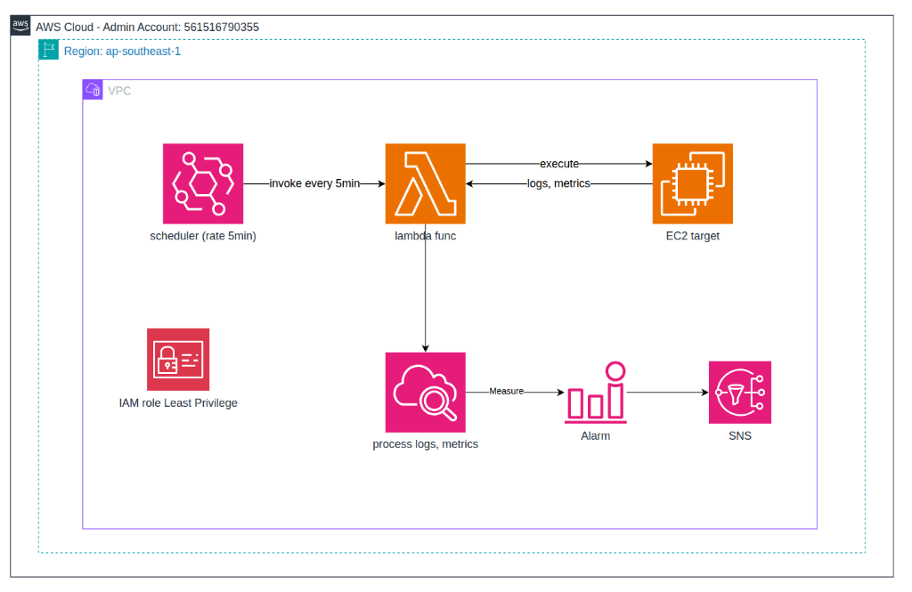
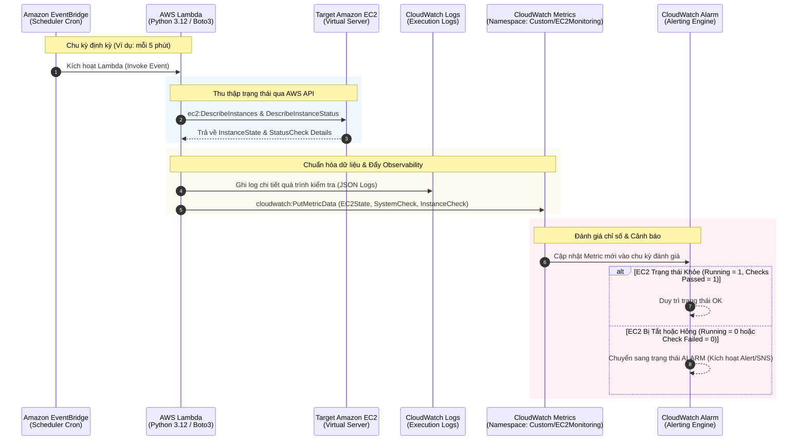

# Lab Thực hành AWS: Giám sát Trạng thái EC2 tự động với EventBridge Scheduler, AWS Lambda và Amazon CloudWatch

- **Tên bài thực hành:** Lập lịch giám sát trạng thái máy chủ EC2 tự động (Automated EC2 Instance Health & State Monitoring)
- **Công nghệ & Dịch vụ sử dụng:** Amazon EC2, Amazon EventBridge Scheduler, AWS Lambda (Python 3.12 / Boto3), Amazon CloudWatch (Custom Metrics, Logs, Alarms), AWS IAM.
- **Mức độ:** Cơ bản đến Trung cấp (Foundational to Intermediate)
- **Thời lượng dự kiến:** 45 – 60 phút
- **Chi phí dự kiến:** **$0.00** (100% hoàn toàn nằm trong gói AWS Free Tier)
- **Ngày cập nhật:** 2026-10-10

---

## 1. Tổng quan Kiến trúc & Mục tiêu bài Lab

### 1.1. Mục tiêu học tập (Learning Objectives)
1. **Làm chủ kiến trúc hướng sự kiện & tự động hóa (Event-Driven Serverless Automation):** Hiểu cách kết hợp các dịch vụ Serverless để quản trị hạ tầng điện toán mà không cần duy trì máy chủ giám sát chuyên dụng (Monitoring Server).
2. **Nắm vững bản chất trạng thái máy chủ Amazon EC2:** Phân biệt rõ `InstanceState` (Trạng thái vòng đời: `running`, `stopped`,...) và `InstanceStatusCheck` (Hai bài kiểm tra sức khỏe phần cứng và hệ điều hành: System Check & Instance Check).
3. **Phân quyền bảo mật IAM theo nguyên tắc đặc quyền tối thiểu (Least Privilege):** Tự tay thiết kế IAM Policy JSON cấp quyền chính xác cho Lambda gọi API EC2 và đẩy metric sang CloudWatch.
4. **Lập trình SDK AWS (Python Boto3):** Viết mã nguồn Lambda truy vấn trạng thái thực tế, chuẩn hóa thành dữ liệu số (Metrics) và đẩy lên CloudWatch qua API `put_metric_data`.
5. **Ứng dụng Amazon EventBridge Scheduler thế hệ mới:** Sử dụng Scheduler hiện đại để kích hoạt tác vụ theo lịch chu kỳ định kỳ.
6. **Vận hành & Giám sát với CloudWatch:** Tạo Custom Metric Namespace, cấu hình CloudWatch Metric Alarm cảnh báo khi máy chủ ngừng hoạt động và thực nghiệm kịch bản giả lập sự cố (Fault Injection).

---

### 1.2. Sơ đồ Kiến trúc Tổng thể & Luồng Xử lý (Architecture & Workflow)



*Hình 1.1: Kiến trúc triển khai trên AWS Region `ap-southeast-1` kết hợp EventBridge Scheduler, Lambda, IAM Least Privilege, CloudWatch Alarm và SNS.*

Luồng tương tác tuần tự giữa các dịch vụ diễn ra như sau:



---

### 1.3. Vấn đề thực tế mà giải pháp này giải quyết
- **Giới hạn của Giám sát mặc định (Basic Monitoring):** Amazon EC2 mặc định cung cấp số liệu CPU, Network, Disk I/O miễn phí theo chu kỳ **5 phút/lần**. Nếu muốn theo dõi 1 phút/lần (Detailed Monitoring), bạn phải trả phí $2.10/instance/tháng.
- **Thiếu chỉ số tùy biến logic:** Trạng thái hoạt động cấp độ tiến trình hoặc kiểm tra tình trạng tắt/bật tích hợp vào hệ thống báo cáo tập trung thường cần cơ chế chủ động thăm dò.
- **Không tốn chi phí máy chủ quản trị:** Thay vì phải dựng cụm Zabbix/Prometheus/Nagios cồng kềnh tốn tiền EC2 chạy 24/7 chỉ để kiểm tra xem vài máy chủ khác có sống hay không, việc dùng kiến trúc Serverless (EventBridge + Lambda) có chi phí xấp xỉ **0 đồng** cho hạ tầng vừa và nhỏ.

---

## 2. Chuẩn bị Tiên quyết (Prerequisites)

1. **Tài khoản AWS (AWS Account):** Đang hoạt động và còn hạn mức AWS Free Tier.
2. **Quyền truy cập:** Tài khoản người dùng có quyền quản trị (AdministratorAccess hoặc quyền cấu hình EC2, IAM, Lambda, EventBridge, CloudWatch).
3. **Region triển khai:** Thống nhất chọn một Region xuyên suốt bài lab (khuyến nghị: **Singapore `ap-southeast-1`** hoặc **N. Virginia `us-east-1`**).

---

## 3. Hướng dẫn Triển khai Từng bước (Step-by-Step)

### Bước 1: Khởi tạo EC2 Instance Mục tiêu (Target Instance)

Chúng ta cần tạo một máy chủ EC2 đóng vai trò là "nạn nhân" để Lambda theo dõi sức khỏe.

1. Đăng nhập vào **AWS Management Console**, chuyển đến dịch vụ **EC2**.
2. Chọn **Launch instances** và điền các thông số:
   - **Name:** `Lab-Target-EC2`
   - **Application and OS Images (Amazon Machine Image - AMI):** Chọn **Amazon Linux 2023 AMI** (Free Tier eligible).
   - **Instance type:** `t2.micro` (hoặc `t3.micro` tùy theo Region bạn chọn, chọn loại có nhãn *Free tier eligible*).
   - **Key pair (login):** Chọn *Proceed without a key pair* (vì trong bài lab này ta không cần SSH vào bên trong máy chủ).
   - **Network settings:**
     - VPC: *Default VPC*.
     - Auto-assign public IP: *Enable*.
     - Security Group: Chọn *Create security group*, bỏ chọn hoặc giữ nguyên cổng SSH 22 (không quan trọng).
   - **Tags:** Nhấn *Add Tag*, nhập `Key: Environment`, `Value: Dev`.
3. Nhấn **Launch instance**.
4. Chờ 1–2 phút cho máy chủ khởi động xong. Sao chép lại mã **Instance ID** của máy chủ này (Ví dụ: `i-0a1b2c3d4e5f67890`).

> [!NOTE]
> Ghi lại mã `Instance ID` của bạn vào một file nháp. Chúng ta sẽ cấu hình mã này làm biến môi trường trong AWS Lambda ở Bước 3.

---

### Bước 2: Tạo IAM Role cho AWS Lambda (Least Privilege)

Để hàm Lambda có thể truy vấn trạng thái EC2 và gửi dữ liệu lên CloudWatch, nó cần một danh tính (IAM Role) có các quyền hạn tối thiểu.

#### 2.1. Tạo IAM Policy
1. Truy cập dịch vụ **IAM** $\rightarrow$ chọn mục **Policies** ở menu bên trái $\rightarrow$ nhấn **Create policy**.
2. Chọn tab **JSON** và dán nội dung policy sau:

```json
{
  "Version": "2012-10-17",
  "Statement": [
    {
      "Sid": "EC2ReadStatusPermissions",
      "Effect": "Allow",
      "Action": [
        "ec2:DescribeInstances",
        "ec2:DescribeInstanceStatus"
      ],
      "Resource": "*"
    },
    {
      "Sid": "CloudWatchPutMetricPermissions",
      "Effect": "Allow",
      "Action": [
        "cloudwatch:PutMetricData"
      ],
      "Resource": "*"
    },
    {
      "Sid": "CloudWatchLogsWritePermissions",
      "Effect": "Allow",
      "Action": [
        "logs:CreateLogGroup",
        "logs:CreateLogStream",
        "logs:PutLogEvents"
      ],
      "Resource": "arn:aws:logs:*:*:*"
    }
  ]
}
```

> [!IMPORTANT]
> **Giải thích phân quyền Least Privilege:**
> - `ec2:DescribeInstances` & `ec2:DescribeInstanceStatus`: Chỉ cho phép đọc trạng thái, không cấp quyền sửa đổi, dừng (`ec2:StopInstances`) hay xóa máy chủ (`ec2:TerminateInstances`).
> - `cloudwatch:PutMetricData`: Chỉ cấp quyền đẩy số liệu tùy biến, không cho phép xóa hay sửa Alarm.
> - `logs:*`: Cho phép hàm Lambda tự động tạo log stream và ghi lại log thực thi để debug.

3. Nhấn **Next**, đặt tên cho Policy: `LambdaEC2MonitoringPolicy`.
4. Nhấn **Create policy**.

#### 2.2. Tạo IAM Role cho Lambda
1. Chọn mục **Roles** ở menu bên trái $\rightarrow$ nhấn **Create role**.
2. **Trusted entity type:** Chọn **AWS service**.
3. **Use case:** Chọn **Lambda** $\rightarrow$ nhấn **Next**.
4. **Add permissions:** Tìm và tick chọn policy `LambdaEC2MonitoringPolicy` vừa tạo ở bước trên $\rightarrow$ nhấn **Next**.
5. **Role name:** Đặt tên là `LambdaEC2MonitoringRole`.
6. Nhấn **Create role**.

---

### Bước 3: Lập trình và Triển khai AWS Lambda Function

Hàm Lambda sẽ đóng vai trò là "bộ não thăm dò". Nó sẽ nhận lệnh kích hoạt, gọi API AWS, giải mã thông tin và gửi số liệu về CloudWatch.

#### 3.1. Tạo Lambda Function
1. Truy cập dịch vụ **AWS Lambda** $\rightarrow$ nhấn **Create function**.
2. Chọn **Author from scratch**.
3. Cấu hình cơ bản:
   - **Function name:** `EC2StatusMonitorFunction`
   - **Runtime:** **Python 3.12**
   - **Architecture:** Chọn **arm64** (tiết kiệm chi phí hơn x86_64) hoặc **x86_64**.
   - **Change default execution role:**
     - Chọn *Use an existing role*.
     - Chọn Role: `LambdaEC2MonitoringRole` đã tạo ở Bước 2.
4. Nhấn **Create function**.

#### 3.2. Cấu hình Biến Môi trường (Environment Variables)
1. Trong giao diện hàm Lambda, chuyển sang tab **Configuration** $\rightarrow$ chọn **Environment variables** ở menu bên trái.
2. Nhấn **Edit** $\rightarrow$ chọn **Add environment variable**:
   - Key: `TARGET_INSTANCE_ID` | Value: *(Dán Instance ID của bạn đã lưu ở Bước 1, ví dụ `i-0a1b2c3d4e5f67890`)*
   - Key: `METRIC_NAMESPACE` | Value: `Custom/EC2Monitoring`
3. Nhấn **Save**.

#### 3.3. Viết Mã nguồn Boto3 (Code Implementation)
Chuyển về tab **Code**, mở tệp `lambda_function.py`, thay thế toàn bộ bằng đoạn mã Python sau:

```python
"""
AWS Lambda Function: EC2 Status Monitor & CloudWatch Custom Metric Emitter
Mục đích: Lấy trạng thái của EC2 instance mục tiêu và đẩy số liệu về Amazon CloudWatch.
Quy chuẩn số liệu:
- EC2RunningState: 1 = Running, 0 = Stopped/Khác
- SystemStatusCheck: 1 = Passed, 0 = Failed, -1 = Không xác định
- InstanceStatusCheck: 1 = Passed, 0 = Failed, -1 = Không xác định
"""

import os
import json
import logging
import boto3
from botocore.exceptions import ClientError

# Thiết lập Logger theo chuẩn vận hành CloudWatch
logger = logging.getLogger()
logger.setLevel(logging.INFO)

# Khởi tạo AWS Boto3 Clients
ec2_client = boto3.client('ec2')
cloudwatch_client = boto3.client('cloudwatch')

# Đọc cấu hình từ biến môi trường
TARGET_INSTANCE_ID = os.environ.get('TARGET_INSTANCE_ID')
METRIC_NAMESPACE = os.environ.get('METRIC_NAMESPACE', 'Custom/EC2Monitoring')


def get_ec2_details(instance_id: str):
    """
    Truy vấn trạng thái vòng đời (lifecycle state) và kiểm tra sức khỏe (status checks) của EC2.
    """
    try:
        # 1. Lấy trạng thái vòng đời (running, stopped, pending,...)
        desc_resp = ec2_client.describe_instances(InstanceIds=[instance_id])
        reservations = desc_resp.get('Reservations', [])
        if not reservations or not reservations[0].get('Instances'):
            logger.error(f"Không tìm thấy máy chủ với ID: {instance_id}")
            return None, None

        instance = reservations[0]['Instances'][0]
        state_name = instance['State']['Name']  # 'running', 'stopped', etc.

        # 2. Lấy kết quả kiểm tra Status Checks
        # Lưu ý: Nếu instance ở trạng thái stopped, describe_instance_status mặc định trả về mảng rỗng
        status_resp = ec2_client.describe_instance_status(
            InstanceIds=[instance_id],
            IncludeAllInstances=True
        )
        status_statuses = status_resp.get('InstanceStatuses', [])
        
        status_info = status_statuses[0] if status_statuses else {}
        return state_name, status_info

    except ClientError as e:
        logger.error(f"Lỗi khi gọi AWS EC2 API: {str(e)}")
        raise e


def publish_metrics_to_cloudwatch(instance_id: str, state_name: str, status_info: dict):
    """
    Chuẩn hóa dữ liệu sang dạng số và gửi MetricData về CloudWatch Custom Namespace.
    """
    # 1. Chuẩn hóa trạng thái Chạy (Running)
    is_running_value = 1.0 if state_name == 'running' else 0.0

    # 2. Chuẩn hóa System Status Check & Instance Status Check
    system_status = status_info.get('SystemStatus', {}).get('Status', 'not-applicable')
    instance_status = status_info.get('InstanceStatus', {}).get('Status', 'not-applicable')

    system_check_val = 1.0 if system_status == 'ok' else (0.0 if system_status == 'impaired' else 0.0)
    instance_check_val = 1.0 if instance_status == 'ok' else (0.0 if instance_status == 'impaired' else 0.0)

    # Nếu máy đang stopped, các status check không khả dụng -> ghi nhận 0.0
    if state_name != 'running':
        system_check_val = 0.0
        instance_check_val = 0.0

    logger.info(
        f"Instance [{instance_id}] -> State: {state_name} ({is_running_value}), "
        f"SystemCheck: {system_status} ({system_check_val}), "
        f"InstanceCheck: {instance_status} ({instance_check_val})"
    )

    # 3. Chuẩn bị gói dữ liệu Metrics
    metric_data = [
        {
            'MetricName': 'EC2RunningState',
            'Dimensions': [{'Name': 'InstanceId', 'Value': instance_id}],
            'Value': is_running_value,
            'Unit': 'Count'
        },
        {
            'MetricName': 'SystemStatusCheckPassed',
            'Dimensions': [{'Name': 'InstanceId', 'Value': instance_id}],
            'Value': system_check_val,
            'Unit': 'Count'
        },
        {
            'MetricName': 'InstanceStatusCheckPassed',
            'Dimensions': [{'Name': 'InstanceId', 'Value': instance_id}],
            'Value': instance_check_val,
            'Unit': 'Count'
        }
    ]

    # 4. Gửi dữ liệu lên Amazon CloudWatch
    try:
        cloudwatch_client.put_metric_data(
            Namespace=METRIC_NAMESPACE,
            MetricData=metric_data
        )
        logger.info(f"Đã gửi thành công {len(metric_data)} metrics lên Namespace: {METRIC_NAMESPACE}")
    except ClientError as e:
        logger.error(f"Lỗi khi gửi metric sang CloudWatch: {str(e)}")
        raise e


def lambda_handler(event, context):
    """
    Entry point chính nhận sự kiện kích hoạt từ EventBridge Scheduler.
    """
    logger.info("Bắt đầu thực thi kiểm tra giám sát EC2...")
    logger.info(f"Dữ liệu Event nhận vào: {json.dumps(event)}")

    if not TARGET_INSTANCE_ID:
        raise ValueError("Biến môi trường TARGET_INSTANCE_ID chưa được thiết lập!")

    # Thực hiện truy vấn
    state_name, status_info = get_ec2_details(TARGET_INSTANCE_ID)
    if state_name is None:
        return {
            'statusCode': 404,
            'body': json.dumps({'error': f'Không tìm thấy instance {TARGET_INSTANCE_ID}'})
        }

    # Đẩy dữ liệu quan sát sang CloudWatch
    publish_metrics_to_cloudwatch(TARGET_INSTANCE_ID, state_name, status_info)

    return {
        'statusCode': 200,
        'body': json.dumps({
            'message': 'Đã thu thập và cập nhật metric thành công',
            'instance_id': TARGET_INSTANCE_ID,
            'state': state_name
        })
    }
```

4. Nhấn nút **Deploy** màu cam để lưu mã nguồn.

#### 3.4. Chạy Thử nghiệm (Test Event)
1. Ngay trên giao diện Code, nhấn tab **Test** (hoặc nút bấm *Test*).
2. Tạo một test event mới:
   - Event name: `ManualTestInvocation`
   - Event JSON: Giữ nguyên `{}` mặc định.
3. Nhấn nút **Test**.
4. Kiểm tra mục **Execution result**:
   - Status: **Succeeded**
   - Log output in ra: `Instance [...] -> State: running (1.0), SystemCheck: ok (1.0), InstanceCheck: ok (1.0)`
   - Kết quả phản hồi: `statusCode: 200`.

---

### Bước 4: Cấu hình Amazon EventBridge Scheduler (Lập lịch Tự động)

Thay vì dùng Scheduled Rules cũ bị hạn chế, chúng ta sử dụng **EventBridge Scheduler** thế hệ mới để kích hoạt Lambda định kỳ mỗi 5 phút.

1. Truy cập dịch vụ **Amazon EventBridge** $\rightarrow$ chọn mục **Schedules** ở menu bên trái.
2. Nhấn **Create schedule**.
3. **Step 1: Specify schedule detail**
   - **Schedule name:** `EC2-Status-Monitor-5Min`
   - **Schedule group:** Chọn `default`.
   - **Schedule pattern:** Chọn **Recurring schedule**.
   - **Schedule type:** Chọn **Rate-based schedule**.
   - **Rate expression:** Nhập `5` và chọn đơn vị `minutes` (Mỗi 5 phút chạy một lần).
   - **Flexible time window:** Chọn **Off** (Trong môi trường lab, ta tắt giãn tải để dễ dàng kiểm chứng đúng giờ).
   - Nhấn **Next**.
4. **Step 2: Select target**
   - Chọn mục **Templated targets** $\rightarrow$ chọn dịch vụ **AWS Lambda**.
   - Tại mục **Lambda function**, chọn: `EC2StatusMonitorFunction`.
   - Payload: Để trống (mặc định).
   - Nhấn **Next**.
5. **Step 3: Set up settings**
   - **Action after completion:** Mặc định là `NONE` (vì đây là lịch lặp lại).
   - **Retry policy and Dead-letter queue (DLQ):** Giữ mặc định (Maximum retry attempts: 185).
   - **Permissions (Execution role):** Chọn **Create a new role for this schedule** (EventBridge sẽ tự động tạo một IAM Role cấp quyền `lambda:InvokeFunction` tương ứng).
   - Nhấn **Next**.
6. **Step 4: Review and create schedule**
   - Kiểm tra lại các thông số $\rightarrow$ Nhấn **Create schedule**.

> [!NOTE]
> Bây giờ, cứ mỗi 5 phút, EventBridge Scheduler sẽ tự động gọi hàm Lambda `EC2StatusMonitorFunction` mà không cần bất kỳ sự can thiệp thủ công nào.

---

### Bước 5: Thiết lập Amazon CloudWatch Custom Metric & Alarm

#### 5.1. Kiểm tra Custom Metrics
1. Truy cập dịch vụ **Amazon CloudWatch** $\rightarrow$ chọn mục **Metrics** $\rightarrow$ chọn **All metrics**.
2. Trong tab *Browse*, bạn sẽ thấy xuất hiện một Custom Namespace mới có tên: **Custom/EC2Monitoring**.
3. Bấm vào `Custom/EC2Monitoring` $\rightarrow$ chọn `InstanceId`.
4. Bạn sẽ thấy 3 chỉ số:
   - `EC2RunningState`
   - `SystemStatusCheckPassed`
   - `InstanceStatusCheckPassed`
5. Tick chọn `EC2RunningState` để xem biểu đồ giá trị đường thẳng ở mức `1` (biểu thị máy đang chạy bình thường).

#### 5.2. Tạo CloudWatch Alarm cảnh báo khi máy chủ bị tắt hoặc lỗi
1. Tại menu bên trái của CloudWatch, chọn **Alarms** $\rightarrow$ chọn **In alarm** (hoặc **All alarms**) $\rightarrow$ nhấn **Create alarm**.
2. **Step 1: Specify metric and conditions**
   - Nhấn **Select metric**.
   - Điều hướng vào `Custom/EC2Monitoring` $\rightarrow$ `InstanceId` $\rightarrow$ tick chọn `EC2RunningState` của máy chủ của bạn $\rightarrow$ nhấn **Select metric**.
   - Cấu hình điều kiện đánh giá:
     - **Statistic:** `Minimum` (hoặc `Average`).
     - **Period:** `5 minutes`.
     - **Threshold type:** `Static`.
     - **Whenever EC2RunningState is...:** Chọn **Lower/Equal (`<=`)**.
     - **than...:** Nhập `0`. (Nghĩa là nếu giá trị rơi xuống 0 hoặc thấp hơn, máy chủ đã bị tắt hoặc gặp lỗi).
   - Mục **Additional configuration**:
     - *Datapoints to alarm:* `1 out of 1` (Chỉ cần 1 chu kỳ vi phạm là cảnh báo ngay).
     - *Missing data treatment:* Chọn **Treat missing data as bad (breaching threshold)** (Nếu không nhận được dữ liệu, coi như có sự cố).
   - Nhấn **Next**.
3. **Step 2: Configure actions**
   - **Alarm state trigger:** Chọn **In alarm**.
   - *Send a notification to the following SNS topic:*
     - Nếu bạn đã có SNS Topic gửi email, chọn topic đó.
     - Nếu chưa có, chọn *Create new topic*, nhập email cá nhân của bạn, hoặc chọn *Remove* để bỏ qua bước gửi email (trong lab này ta có thể chỉ cần quan sát sự đổi màu trạng thái trên Console).
   - Nhấn **Next**.
4. **Step 3: Add name and description**
   - **Alarm name:** `Alarm-EC2-Instance-Stopped`
   - **Alarm description:** `Cảnh báo kích hoạt khi máy chủ EC2 Lab bị dừng hoặc gặp lỗi trạng thái.`
   - Nhấn **Next**.
5. **Step 4: Preview and create** $\rightarrow$ Nhấn **Create alarm**.
6. Lúc này, Alarm sẽ ở trạng thái **OK** (màu xanh lá cây) vì máy chủ đang chạy với giá trị Metric = 1.

---

## 4. Kiểm thử Thực tế & Mô phỏng Sự cố (Fault Injection & Testing)

Để kiểm chứng toàn bộ hệ thống hoạt động chính xác theo đúng thiết kế, chúng ta sẽ thực hiện kịch bản giả lập sự cố: Chủ động tắt máy chủ EC2.

### 4.1. Tiến hành Dừng Máy chủ (Simulate Failure)
1. Quay lại dịch vụ **EC2** $\rightarrow$ chọn mục **Instances**.
2. Chọn máy chủ `Lab-Target-EC2`.
3. Nhấn **Instance state** $\rightarrow$ chọn **Stop instance** $\rightarrow$ xác nhận **Stop**.
4. Đợi trạng thái máy chuyển sang **Stopped**.

### 4.2. Quan sát Phản ứng Tự động của Hệ thống
1. **Kiểm tra Lambda Execution (CloudWatch Logs):**
   - Chờ khoảng 3 – 5 phút để EventBridge Scheduler kích hoạt lần tiếp theo.
   - Truy cập **CloudWatch** $\rightarrow$ **Log groups** $\rightarrow$ chọn `/aws/lambda/EC2StatusMonitorFunction`.
   - Mở Log stream mới nhất, bạn sẽ thấy dòng log:
     ```text
     Instance [i-0a1b2c3d4e5f67890] -> State: stopped (0.0), SystemCheck: not-applicable (0.0), InstanceCheck: not-applicable (0.0)
     Đã gửi thành công 3 metrics lên Namespace: Custom/EC2Monitoring
     ```
2. **Kiểm tra Metric:**
   - Quay lại mục **Metrics** $\rightarrow$ xem đồ thị của `EC2RunningState`.
   - Bạn sẽ thấy đường biểu đồ từ mức `1` tụt thẳng đứng xuống mức `0`.
3. **Kiểm tra CloudWatch Alarm:**
   - Vào mục **Alarms**.
   - Quan sát mục `Alarm-EC2-Instance-Stopped`: Trạng thái đã chuyển từ **OK (Xanh)** sang **In ALARM (Đỏ)**.
   - *(Nếu cấu hình SNS, hộp thư email của bạn sẽ nhận được thông báo chi tiết về sự cố).*

### 4.3. Phục hồi Máy chủ (Recovery Verification)
1. Quay lại EC2, chọn máy chủ `Lab-Target-EC2` $\rightarrow$ nhấn **Instance state** $\rightarrow$ chọn **Start instance**.
2. Đợi máy khởi động lại sang `running` và kiểm tra 2/2 status checks passed.
3. Chờ chu kỳ 5 phút tiếp theo của Scheduler.
4. Metric trên CloudWatch bật ngược lại mức `1`.
5. CloudWatch Alarm tự động chuyển trạng thái từ **In ALARM** quay về **OK**. Hệ thống tự phục hồi giám sát hoàn toàn tự động!

---

## 5. Quy trình Dọn dẹp Tài nguyên (Resource Cleanup - Zero Cost)

> [!CAUTION]
> **Quy tắc vàng của Cloud Engineer:** Luôn dọn dẹp tài nguyên sau khi hoàn thành bài lab để tránh phát sinh chi phí ngoài ý muốn do tài nguyên chạy ngầm.

Thực hiện dọn dẹp theo thứ tự chuẩn sau:

1. **Xóa Lịch trình EventBridge Scheduler:**
   - Vào **EventBridge** $\rightarrow$ **Schedules** $\rightarrow$ chọn `EC2-Status-Monitor-5Min` $\rightarrow$ nhấn **Delete**.
   - *(Hành động này ngăn chặn việc Lambda tiếp tục bị gọi định kỳ).*
2. **Xóa máy chủ EC2:**
   - Vào **EC2** $\rightarrow$ **Instances** $\rightarrow$ chọn `Lab-Target-EC2` $\rightarrow$ chọn **Instance state** $\rightarrow$ **Terminate instance** (Xóa hoàn toàn).
3. **Xóa CloudWatch Alarm & Logs:**
   - Vào **CloudWatch** $\rightarrow$ **Alarms** $\rightarrow$ chọn `Alarm-EC2-Instance-Stopped` $\rightarrow$ nhấn **Delete**.
   - Vào **Log groups** $\rightarrow$ chọn `/aws/lambda/EC2StatusMonitorFunction` $\rightarrow$ Actions $\rightarrow$ **Delete log group(s)**.
4. **Xóa AWS Lambda Function:**
   - Vào **Lambda** $\rightarrow$ **Functions** $\rightarrow$ chọn `EC2StatusMonitorFunction` $\rightarrow$ Actions $\rightarrow$ **Delete**.
5. **Xóa IAM Role & Policy:**
   - Vào **IAM** $\rightarrow$ **Roles** $\rightarrow$ tìm và xóa `LambdaEC2MonitoringRole` (và role tự động do EventBridge Scheduler tạo ra nếu có).
   - Vào **Policies** $\rightarrow$ tìm và xóa `LambdaEC2MonitoringPolicy`.

---

## 6. Đánh đổi (Trade-offs) & Mở rộng trong Môi trường Thực tế

### 6.1. Bảng Đánh đổi Kiến trúc: Tự viết Lambda vs. Dịch vụ AWS có sẵn

| Tiêu chí | Tự viết Lambda + EventBridge (Giải pháp bài Lab) | Bật Detailed Monitoring trên EC2 | Sử dụng AWS Systems Manager (SSM) Agent |
| :--- | :--- | :--- | :--- |
| **Chi phí** | **Gần như $0/tháng** (Nằm trọn trong Free Tier). | $2.10 / instance / tháng. | Miễn phí SSM, chỉ tính phí CloudWatch Logs/Metrics nếu đẩy thêm. |
| **Độ trễ phát hiện** | Tùy thuộc chu kỳ cron (Ví dụ 5 phút hoặc 1 phút). | Cố định 1 phút. | Gần thời gian thực (Real-time heartbeats). |
| **Độ phức tạp quản trị** | Cần quản lý code Lambda, IAM Role và Scheduler. | Không cần quản trị code (Chỉ cần tick 1 nút trên EC2). | Phải cài đặt Agent bên trong OS của máy chủ. |
| **Khả năng mở rộng nghiệp vụ** | **Rất cao:** Lambda có thể viết thêm logic phức tạp (gửi Slack, tự động gọi API khởi động lại EC2, kiểm tra HTTP endpoint). | **Thấp:** Chỉ thuần túy thu thập metrics phần cứng tiêu chuẩn của EC2. | **Cao:** Có thể chạy lệnh quản trị tự động bên trong OS (Patching, Shell Script). |

---

### 6.2. Hướng Mở rộng Sản xuất (Production Enhancements)

Nếu áp dụng mô hình này cho doanh nghiệp với hàng trăm máy chủ EC2:

1. **Giám sát Đa máy chủ theo Cặp Thẻ (Tag-Based Discovery):**
   - Thay vì hardcode một `TARGET_INSTANCE_ID`, hàm Lambda gọi `ec2.describe_instances(Filters=[{'Name': 'tag:AutoMonitor', 'Values': ['true']}])`.
   - Bất kỳ máy chủ nào được gắn thẻ `AutoMonitor = true` sẽ tự động được hệ thống đưa vào danh sách giám sát mà không cần sửa code.
2. **Tự động Khắc phục Sự cố (Auto-Remediation):**
   - Nếu Lambda phát hiện `SystemStatusCheckPassed == 0` (lỗi phần cứng máy chủ vật lý bên dưới của AWS), Lambda có thể chủ động gọi API `ec2.stop_instances` rồi `ec2.start_instances` để ép AWS chuyển máy ảo sang một Host vật lý khác khỏe mạnh hơn (Instance Reboot/Recovery).
3. **Tích hợp Thông báo đa kênh (Notification Fan-out):**
   - Đấu nối CloudWatch Alarm sang Amazon SNS. Từ SNS liên kết tới một Lambda chuyển tiếp (Webhook) để gửi thông báo định dạng đẹp kèm nút bấm xử lý trực tiếp vào kênh Telegram, Slack hoặc Microsoft Teams của đội ngũ DevOps trực ca.

---

## 7. Câu hỏi Phỏng vấn & Ôn tập Củng cố Kiến thức

### Câu 1: Sự khác biệt bản chất giữa `System Status Check` và `Instance Status Check` trên EC2 là gì?
- **Trả lời:**
  - `System Status Check`: Giám sát hạ tầng phần cứng vật lý, hệ thống cấp điện, làm mát và mạng máy chủ của chính trung tâm dữ liệu AWS. Nếu check này fail, lỗi thuộc về AWS. Cách xử lý thông thường là Stop rồi Start lại máy chủ để chuyển sang Host vật lý khác.
  - `Instance Status Check`: Giám sát hệ điều hành bên trong máy ảo (OS kernel, file system bị lỗi, cạn kiệt bộ nhớ RAM, cấu hình mạng sai). Nếu check này fail, lỗi thuộc về người dùng (Khách hàng chịu trách nhiệm theo mô hình Shared Responsibility). Cách xử lý là kiểm tra OS logs, khởi động lại hệ điều hành hoặc can thiệp bằng EC2 Serial Console.

### Câu 2: Tại sao hàm Lambda của chúng ta cần quyền `cloudwatch:PutMetricData` mà không phải `cloudwatch:*`?
- **Trả lời:** Theo nguyên tắc **Least Privilege** (Đặc quyền tối thiểu) trong trụ cột Security của Well-Architected Framework, tài nguyên chỉ được cấp đúng những hành động cần thiết để hoàn thành nhiệm vụ. Lambda chỉ cần gửi số liệu điểm đo lường (`PutMetricData`), không được phép xem các metric nhạy cảm khác, không được sửa đổi cấu hình cảnh báo (`PutMetricAlarm`), hay xóa dữ liệu giám sát của doanh nghiệp.

### Câu 3: Nếu muốn giảm thời gian phát hiện sự cố từ 5 phút xuống 1 phút, những yếu tố nào trong hệ thống sẽ thay đổi và có phát sinh chi phí không?
- **Trả lời:**
  - Cần chỉnh sửa biểu thức lịch trình của EventBridge Scheduler thành `rate(1 minute)`.
  - Cần chỉnh sửa `Period` của CloudWatch Alarm thành `1 minute`.
  - **Tác động chi phí:** Số lần gọi Lambda sẽ tăng gấp 5 lần (từ ~8,640 lần/tháng lên ~43,200 lần/tháng). Tuy nhiên, con số này vẫn nằm sâu trong mức miễn phí 1,000,000 requests/tháng của AWS Lambda Free Tier. Đối với CloudWatch, số lượng metrics vẫn giữ nguyên (3 custom metrics), chi phí chỉ phát sinh nếu vượt quá 10 custom metrics miễn phí đầu tiên.

---

## 8. Tự Động Hóa Toàn Diện Với Terraform (Infrastructure as Code)

Toàn bộ hạ tầng bài Lab 01 (EC2, IAM, Lambda Python 3.12, EventBridge Scheduler, CloudWatch Custom Alarm & SNS) đã được đóng gói thành mã nguồn Terraform chuẩn module hóa tại thư mục:  
📁 [`labs/lab-01-terraform/`](./lab-01-terraform/)

### 8.1. Cấu trúc Thư mục Dự án Terraform
```text
labs/lab-01-terraform/
├── providers.tf             # Khai báo version AWS Provider & tags mặc định
├── variables.tf             # Biến cấu hình (Region, Instance Type, Schedule Rate, Email)
├── main.tf                  # Định nghĩa toàn bộ tài nguyên: EC2, IAM, Lambda, Scheduler, Alarm
├── outputs.tf               # Xuất thông tin: Instance ID, Public IP, Lambda ARN, Alarm Name
├── terraform.tfvars.example # File mẫu truyền tham số cấu hình
└── src/
    └── lambda_function.py   # Mã nguồn Python 3.12 Boto3 (tự động đóng gói thành file zip)
```

### 8.2. Quy trình 3 Bước Triển Khai và Dọn Dẹp Bằng 1 Lệnh
```bash
# Di chuyển vào thư mục Terraform
cd labs/lab-01-terraform

# 1. Khởi tạo và tải AWS provider
terraform init

# 2. Xem trước kế hoạch và triển khai toàn bộ bài lab (chỉ mất ~2 phút)
terraform plan
terraform apply -auto-approve

# 3. Sau khi thực hành xong, dọn dẹp sạch sẽ 100% tài nguyên để không tốn phí Free Tier
terraform destroy -auto-approve
```

---

**Tài liệu tham khảo chính thức từ AWS:**
- [AWS Lambda Developer Guide with Boto3](https://docs.aws.amazon.com/lambda/latest/dg/)
- [Amazon EventBridge Scheduler User Guide](https://docs.aws.amazon.com/scheduler/latest/UserGuide/)
- [Amazon CloudWatch Custom Metrics API Reference](https://docs.aws.amazon.com/AmazonCloudWatch/latest/monitoring/publishingMetrics.html)
- [Troubleshooting EC2 Instances with Status Checks](https://docs.aws.amazon.com/AWSEC2/latest/UserGuide/monitoring-system-instance-status-check.html)
