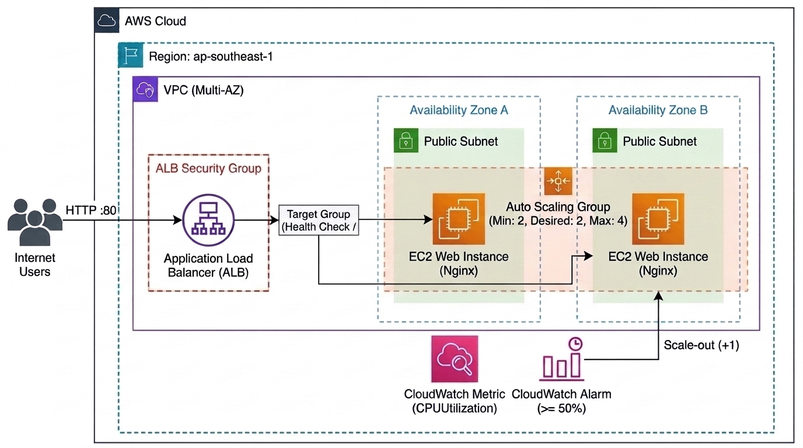
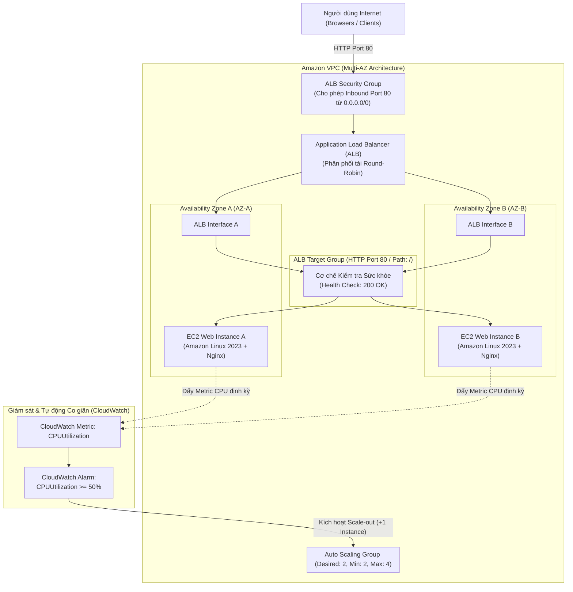

# Lab Thực hành AWS: Xây dựng Cụm Máy chủ Web Tự động Co giãn (Auto Scaling) và Cân bằng Tải (Application Load Balancer) với CloudWatch Alarms

- **Tên bài thực hành:** Triển khai Cụm Máy chủ Web Sẵn sàng Cao (High Availability Web Fleet with ALB, EC2 Auto Scaling & CloudWatch Alarms)
- **Công nghệ & Dịch vụ sử dụng:** Amazon EC2 (Launch Template, User Data Bash Script), Application Load Balancer (ALB), Target Groups, Auto Scaling Group (ASG), Amazon CloudWatch (Metrics & Alarms), Security Groups.
- **Mức độ:** Cơ bản đến Trung cấp (Foundational to Intermediate)
- **Thời lượng dự kiến:** 45 – 60 phút
- **Chi phí dự kiến:** **$0.00** (100% hoàn toàn nằm trong gói AWS Free Tier)
- **Ngày cập nhật:** 2026-10-13

---

## 1. Tổng quan Kiến trúc & Mục tiêu bài Lab

### 1.1. Mục tiêu học tập (Learning Objectives)
1. **Làm chủ Kiến trúc Độ sẵn sàng cao (High Availability - HA):** Phân tán máy chủ web trên nhiều Vùng sẵn sàng (**Multi-AZ**) để đảm bảo hệ thống không có điểm lỗi đơn lẻ (**Single Point of Failure - SPOF**).
2. **Kỹ thuật Phân tầng Tường lửa (Security Group Chaining):** Thiết lập mô hình an ninh phòng thủ chiều sâu: Chỉ cho phép người dùng Internet truy cập vào Load Balancer, và máy chủ EC2 chỉ chấp nhận kết nối HTTP bắt nguồn từ Load Balancer.
3. **Tự động hóa Khởi tạo Hạ tầng (Bootstrap Automation):** Sử dụng **EC2 Launch Template** kết hợp kịch bản **User Data (Bash Script)** để tự động cài đặt web server Nginx và sinh trang thông tin máy chủ động (Dynamic Host Info) qua EC2 Metadata IMDSv2.
4. **Cơ chế Cân bằng Tải (Load Balancing & Health Checks):** Cấu hình **Application Load Balancer (ALB)** phân phối lưu lượng Round-Robin và tự động loại bỏ máy chủ bị hỏng ra khỏi nhóm điều phối.
5. **Độ co giãn Tự động (Elastic Self-Healing & Dynamic Auto Scaling):** Thiết lập **Auto Scaling Group (ASG)** tự phục hồi máy chủ khi gặp sự cố phần cứng và tự động nhân rộng (**Scale-out**) khi tải CPU tăng cao.
6. **Thực nghiệm Kịch bản Giả lập Quá tải (Chaos & Stress Testing):** Chủ động bơm tải CPU lên 100% bằng Linux Shell để chứng kiến CloudWatch Alarm kích hoạt ASG bung thêm máy chủ mới theo thời gian thực.

---

### 1.2. Sơ đồ Kiến trúc Luồng Xử lý (Architecture Workflow)



*Hình 1.1: Kiến trúc Multi-AZ High Availability kết hợp Application Load Balancer, Auto Scaling Group, Launch Template và CloudWatch Alarm.*

Luồng tương tác chi tiết giữa các thành phần:



---

### 1.3. Vấn đề thực tế mà giải pháp này giải quyết
- **Chấm dứt hiện tượng Sập Web vào giờ cao điểm:** Thay vì phải tốn tiền thuê sẵn máy chủ cỡ lớn chạy 24/7, Auto Scaling tự động bơm thêm máy chủ khi có lượng truy cập đột biến và tự hủy bớt máy chủ khi đêm xuống để tiết kiệm chi phí.
- **Tự phục hồi lỗi (Self-Healing):** Nếu một máy chủ bị sập hệ điều hành hoặc phần cứng host bị hỏng, ALB phát hiện Health Check thất bại sẽ ngừng gửi khách vào máy đó, đồng thời ASG tự động xóa máy hỏng và khởi tạo một máy mới thay thế ngay lập tức.
- **Bảo mật tuyệt đối cho Web Fleet:** Các máy chủ backend không cần mở cổng 80 rộng rãi ra Internet; chúng ẩn mình phía sau Application Load Balancer.

---

## 2. Chuẩn bị Tiên quyết (Prerequisites)

1. **Tài khoản AWS (AWS Account):** Còn hạn mức **AWS Free Tier**.
2. **Quyền truy cập:** Tài khoản người dùng có quyền quản trị EC2, VPC, CloudWatch.
3. **Region triển khai:** Thống nhất chọn một Region xuyên suốt bài lab (khuyến nghị: **Singapore `ap-southeast-1`** hoặc **N. Virginia `us-east-1`**).
4. **VPC Mặc định (Default VPC):** Có sẵn ít nhất 2 Subnets nằm ở 2 Availability Zones khác nhau (ví dụ: `ap-southeast-1a` và `ap-southeast-1b`).

---

## 3. Hướng dẫn Triển khai Từng bước (Step-by-Step)

### Bước 1: Thiết lập Phân tầng Bảo mật (Security Group Chaining)

Chúng ta cần tạo 2 Security Groups với mối quan hệ ràng buộc lẫn nhau:

#### 1.1. Tạo Security Group cho Load Balancer (`ALB-SG`)
1. Truy cập **EC2 Console** $\rightarrow$ chọn mục **Security Groups** ở menu bên trái $\rightarrow$ nhấn **Create security group**.
2. Thiết lập thông số:
   - **Security group name:** `ALB-Security-Group`
   - **Description:** `Cho phép lưu lượng HTTP từ Internet vào ALB`
   - **VPC:** Chọn *Default VPC*.
3. **Inbound rules:** Nhấn **Add rule**:
   - Type: **HTTP** | Port range: `80` | Source: **Anywhere-IPv4 (`0.0.0.0/0`)**.
4. Nhấn **Create security group**.

#### 1.2. Tạo Security Group cho Máy chủ Web (`EC2-Web-SG`)
1. Nhấn **Create security group** lần nữa:
   - **Security group name:** `EC2-Web-Security-Group`
   - **Description:** `Chỉ cho phép HTTP bắt nguồn từ ALB Security Group`
   - **VPC:** Chọn *Default VPC*.
2. **Inbound rules:** Nhấn **Add rule**:
   - Type: **HTTP** | Port range: `80`.
   - **Source:** Chọn **Custom**, gõ chữ `sg-` và chọn chính xác `ALB-Security-Group` vừa tạo ở bước trên!
3. Nhấn **Create security group**.

> [!IMPORTANT]
> **Nguyên tắc Security Group Chaining:** Việc đặt Source là ID của `ALB-Security-Group` đảm bảo rằng **chỉ các gói tin đi qua Load Balancer mới được phép chạm vào máy chủ EC2**. Kẻ tấn công trên Internet dù biết IP công cộng của EC2 cũng không thể gửi request trực tiếp vào cổng 80 của máy chủ.

---

### Bước 2: Tạo EC2 Launch Template (Bản Thiết kế Máy chủ)

Launch Template đóng vai trò là "khuôn đúc" để Auto Scaling Group tự động sản xuất hàng loạt các máy chủ giống hệt nhau.

1. Tại menu bên trái của EC2, chọn **Launch Templates** $\rightarrow$ nhấn **Create launch template**.
2. **Launch template name:** `WebServer-LaunchTemplate`
3. **Application and OS Images (AMI):** Chọn **Amazon Linux 2023 AMI** (*Free tier eligible*).
4. **Instance type:** Chọn `t2.micro` (hoặc `t3.micro` tùy theo Region).
5. **Key pair:** Chọn *Don't include in launch template* (chúng ta không cần SSH vào máy).
6. **Network settings:**
   - Subnet: *Don't include in launch template* (để ASG tự chọn subnet đa vùng sau).
   - Firewall (Security Groups): Chọn **Select existing security group** $\rightarrow$ Chọn `EC2-Web-Security-Group`.
7. **Advanced details (Cấu hình Nâng cao):**
   - Kéo xuống dưới cùng tìm mục **User data**, dán toàn bộ đoạn mã Bash script sau:

```bash
#!/usr/bin/env bash
# Tự động hóa cài đặt Web Server và sinh trang hiển thị định danh máy chủ
set -euo pipefail

# 1. Cập nhật hệ điều hành và cài đặt Nginx
dnf update -y
dnf install -y nginx stress

# 2. Lấy thông tin Metadata của máy chủ qua IMDSv2
TOKEN=$(curl -s -X PUT "http://169.254.169.254/latest/api/token" -H "X-aws-ec2-metadata-token-ttl-seconds: 21600")
INSTANCE_ID=$(curl -s -H "X-aws-ec2-metadata-token: $TOKEN" http://169.254.169.254/latest/meta-data/instance-id)
AZ=$(curl -s -H "X-aws-ec2-metadata-token: $TOKEN" http://169.254.169.254/latest/meta-data/placement/availability-zone)
PRIVATE_IP=$(curl -s -H "X-aws-ec2-metadata-token: $TOKEN" http://169.254.169.254/latest/meta-data/local-ipv4)

# 3. Tạo trang web HTML sinh động hiển thị thông tin máy chủ
cat <<EOF > /usr/share/nginx/html/index.html
<!DOCTYPE html>
<html>
<head>
    <title>AWS High Availability Demo</title>
    <style>
        body { font-family: Arial, sans-serif; text-align: center; margin-top: 50px; background-color: #f4f6f8; }
        .card { background: white; padding: 30px; border-radius: 10px; display: inline-block; box-shadow: 0 4px 8px rgba(0,0,0,0.1); }
        h1 { color: #FF9900; }
        .info { font-size: 18px; margin: 10px 0; color: #232F3E; }
        .badge { background: #28a745; color: white; padding: 5px 10px; border-radius: 5px; font-weight: bold; }
    </style>
</head>
<body>
    <div class="card">
        <h1>AWS Auto Scaling & Load Balancing</h1>
        <p class="badge">Trạng thái: HEALTHY</p>
        <div class="info"><strong>Instance ID:</strong> ${INSTANCE_ID}</div>
        <div class="info"><strong>Availability Zone:</strong> ${AZ}</div>
        <div class="info"><strong>Private IP:</strong> ${PRIVATE_IP}</div>
        <hr/>
        <p style="color: #666; font-size: 14px;">Tự động phục vụ bởi Nginx trên Amazon Linux 2023</p>
    </div>
</body>
</html>
EOF

# 4. Khởi động và kích hoạt dịch vụ Nginx
systemctl start nginx
systemctl enable nginx
```

8. Nhấn **Create launch template**.

---

### Bước 3: Tạo Target Group và Application Load Balancer (ALB)

#### 3.1. Tạo Target Group
1. Tại menu bên trái của EC2, chọn **Target Groups** $\rightarrow$ nhấn **Create target group**.
2. **Basic configuration:**
   - Target type: **Instances**.
   - Target group name: `TG-WebServer-HTTP`.
   - Protocol: **HTTP** | Port: `80`.
   - VPC: Chọn *Default VPC*.
   - Protocol version: `HTTP1`.
3. **Health checks:**
   - Health check protocol: `HTTP`.
   - Health check path: `/`.
   - *Advanced health check settings:*
     - Healthy threshold: `2` (Chỉ cần 2 lần kiểm tra thành công là coi là khỏe mạnh).
     - Unhealthy threshold: `2` (2 lần thất bại là đánh dấu máy hỏng).
     - Timeout: `5` giây | Interval: `10` giây.
4. Nhấn **Next**.
5. Mục *Register targets*: **Không chọn máy chủ nào** (vì Auto Scaling Group sẽ tự động đăng ký sau) $\rightarrow$ Nhấn **Create target group**.

#### 3.2. Tạo Application Load Balancer
1. Chọn **Load Balancers** ở menu bên trái $\rightarrow$ nhấn **Create load balancer**.
2. Tại mục **Application Load Balancer**, nhấn **Create**.
3. **Basic configuration:**
   - Load balancer name: `ALB-Production-Web`.
   - Scheme: **Internet-facing** (Tiếp nhận truy cập từ Internet).
   - IP address type: **IPv4**.
4. **Network mapping:**
   - VPC: Chọn *Default VPC*.
   - **Mappings:** Tick chọn ít nhất **2 Availability Zones** (ví dụ: `ap-southeast-1a` và `ap-southeast-1b`), mỗi AZ chọn một public subnet.
5. **Security groups:**
   - Bỏ chọn default, tick chọn: `ALB-Security-Group`.
6. **Listeners and routing:**
   - Protocol: **HTTP** | Port: `80`.
   - Default action: Chọn Forward to $\rightarrow$ chọn `TG-WebServer-HTTP`.
7. Nhấn **Create load balancer**. (Chờ 2–3 phút để ALB chuyển sang trạng thái *Active*).

---

### Bước 4: Tạo Auto Scaling Group (ASG) và Cấu hình Co giãn Động

1. Tại menu bên trái của EC2, chọn **Auto Scaling Groups** $\rightarrow$ nhấn **Create Auto Scaling group**.
2. **Step 1: Choose launch template or configuration**
   - Auto Scaling group name: `ASG-WebServer-Fleet`.
   - Launch template: Chọn `WebServer-LaunchTemplate` (Phiên bản: Latest / 1).
   - Nhấn **Next**.
3. **Step 2: Choose instance types and network**
   - VPC: Chọn *Default VPC*.
   - **Availability Zones and subnets:** Tick chọn **2 Subnets** nằm ở 2 AZs khác nhau (khớp với các AZ đã chọn cho ALB ở Bước 3).
   - Nhấn **Next**.
4. **Step 3: Configure advanced options**
   - **Load balancing:** Chọn **Attach to an existing load balancer**.
   - Chọn **Choose from your load balancer target groups** $\rightarrow$ Chọn `TG-WebServer-HTTP`.
   - **Health checks:**
     - Turn on **Elastic Load Balancing health checks** (Nếu ALB thấy web server lỗi, ASG sẽ tự thay thế máy).
     - Health check grace period: Đổi thành `180` seconds (cho máy 3 phút để khởi động và chạy xong User Data script).
   - Nhấn **Next**.
5. **Step 4: Configure group size and scaling policies**
   - **Group size:**
     - **Desired capacity:** `2` (Hệ thống luôn duy trì 2 máy chủ).
     - **Minimum capacity:** `2` (Không bao giờ giảm dưới 2 máy).
     - **Maximum capacity:** `4` (Khi quá tải tối đa bung lên 4 máy).
   - **Scaling policies:** Chọn **Target tracking scaling policy**:
     - Scaling policy name: `ScaleOnCPU-TargetTracking`.
     - Metric type: **Average CPU utilization**.
     - Target value: `50` (Tự động bung thêm máy nếu CPU trung bình vượt quá 50%).
     - Warmup time: `120` seconds.
   - Nhấn **Next**.
6. **Step 5: Add notifications** $\rightarrow$ Nhấn **Next**.
7. **Step 6: Add tags** $\rightarrow$ Nhấn *Add tag*: `Key: Environment`, `Value: Production` $\rightarrow$ Nhấn **Next**.
8. **Step 7: Review** $\rightarrow$ Nhấn **Create Auto Scaling group**.

> [!NOTE]
> Ngay sau khi bấm tạo, Auto Scaling Group sẽ tự động khởi chạy **2 máy chủ EC2** nằm ở 2 AZ khác nhau, tự chạy script cài đặt Nginx và đăng ký vào Target Group của ALB.

---

### Bước 5: Kiểm tra Khả năng Cân bằng Tải (Round-Robin Verification)

1. Vào **Load Balancers**, chọn `ALB-Production-Web`.
2. Tìm mục **DNS name** và sao chép địa chỉ URL (ví dụ: `ALB-Production-Web-123456789.ap-southeast-1.elb.amazonaws.com`).
3. Mở một tab trình duyệt mới và dán địa chỉ DNS name vào thanh địa chỉ.
4. Bạn sẽ thấy giao diện web hiển thị thông tin máy chủ:
   - **Instance ID:** `i-0a111111111111111`
   - **Availability Zone:** `ap-southeast-1a`
5. Nhấn **F5 (Reload)** trang web liên tục:
   - Bạn sẽ thấy giá trị **Instance ID** và **Availability Zone** lập tức đổi sang máy thứ hai (`i-0b222222222222222` tại `ap-southeast-1b`).
   - Điều này chứng minh Application Load Balancer đang điều phối lưu lượng luân phiên giữa 2 trung tâm dữ liệu độc lập hoàn hảo!

---

## 4. Thực nghiệm Giả lập Quá tải & Co giãn Động (Chaos & Stress Testing)

Bây giờ chúng ta sẽ thực hiện kịch bản giả lập sự cố thực tế: Đẩy tải CPU của một máy chủ lên 100% để ép hệ thống tự động bung thêm máy chủ mới.

### 4.1. Tiến hành Bơm tải CPU (Stress Injection)
1. Vào **EC2 Console** $\rightarrow$ **Instances** $\rightarrow$ Chọn 1 trong 2 máy chủ đang chạy của ASG.
2. Tạm thời chỉnh sửa Inbound Rules của `EC2-Web-Security-Group` để mở thêm cổng **SSH (Port 22)** hoặc kết nối trực tiếp qua **EC2 Instance Connect** (nếu máy có public IP).
3. Đăng nhập vào terminal của máy chủ EC2 đó.
4. Chạy lệnh sau để ép máy chủ chạy tối đa 100% công suất CPU trong 5 phút (300 giây):
   ```bash
   # Sử dụng công cụ stress đã được cài sẵn trong script User Data
   stress --cpu 2 --timeout 300s
   ```
   *(Nếu không cài được stress, chạy lệnh vòng lặp Python sau:)*
   ```bash
   python3 -c "import time; end = time.time() + 300; [x**2 for x in iter(lambda: time.time() < end, False)]" &
   ```

### 4.2. Quan sát Phản ứng Tự động của Hệ thống
1. **Quan sát CloudWatch Metric & Alarm:**
   - Truy cập **CloudWatch** $\rightarrow$ **Alarms**.
   - Bạn sẽ thấy Alarm tự động sinh bởi Target Tracking Policy có tên tương tự: `TargetTracking-ASG-WebServer-Fleet-AlarmHigh-...`
   - Chờ khoảng 2 phút: Biểu đồ CPU vọt lên vượt ngưỡng 50%, Alarm chuyển sang trạng thái màu đỏ: **In ALARM**.
2. **Quan sát Auto Scaling Group:**
   - Quay lại **Auto Scaling Groups** $\rightarrow$ chọn `ASG-WebServer-Fleet` $\rightarrow$ chọn tab **Activity**.
   - Bạn sẽ thấy dòng thông báo:
     `"Executing policy: TargetTracking... Increasing the capacity from 2 to 3 (or 4)"`.
3. **Quan sát Target Group & EC2:**
   - Vào danh sách **EC2 Instances**: Máy chủ thứ 3 (`i-0c333333333333333`) đang tự động được khởi tạo (`Pending` $\rightarrow$ `Running`).
   - Vào **Target Groups**: Máy chủ thứ 3 xuất hiện và chuyển sang trạng thái **healthy**.
4. **Hạ tải & Thu hẹp Tự động (Scale-in Verification):**
   - Sau khi lệnh `stress` kết thúc sau 300 giây, CPU hạ nhiệt về 0%.
   - CloudWatch Alarm chuyển ngược lại về trạng thái **OK (Xanh)**.
   - Sau thời gian Scale-in Cooldown, Auto Scaling Group sẽ nhẹ nhàng xóa bớt máy chủ thứ 3 để đưa quy mô trở về mức tối thiểu ban đầu (2 máy).

---

## 5. Quy trình Dọn dẹp Tài nguyên (Resource Cleanup - Zero Cost)

> [!CAUTION]
> **Thực hiện đúng thứ tự sau** để đảm bảo 100% không bị treo tài nguyên và không phát sinh bất kỳ chi phí ngoài ý muốn nào:

1. **Xóa Auto Scaling Group (Quan trọng nhất):**
   - Vào **Auto Scaling Groups** $\rightarrow$ Chọn `ASG-WebServer-Fleet` $\rightarrow$ Nhấn **Delete**.
   - Gõ `delete` để xác nhận.
   - *Hành động này sẽ tự động hủy (Terminate) toàn bộ các máy chủ EC2 con bên dưới.*
2. **Xóa Application Load Balancer:**
   - Vào **Load Balancers** $\rightarrow$ Chọn `ALB-Production-Web` $\rightarrow$ Actions $\rightarrow$ **Delete load balancer**.
3. **Xóa Target Group:**
   - Vào **Target Groups** $\rightarrow$ Chọn `TG-WebServer-HTTP` $\rightarrow$ Actions $\rightarrow$ **Delete**.
4. **Xóa Launch Template:**
   - Vào **Launch Templates** $\rightarrow$ Chọn `WebServer-LaunchTemplate` $\rightarrow$ Actions $\rightarrow$ **Delete template**.
5. **Xóa Security Groups:**
   - Vào **Security Groups**:
     - Xóa `EC2-Web-Security-Group` trước.
     - Sau đó xóa `ALB-Security-Group`.

---

## 6. Đánh đổi (Trade-offs) & Mở rộng trong Môi trường Thực tế

### 6.1. So sánh 3 Chiến lược Co giãn (Scaling Policies)

| Chiến lược | Cơ chế hoạt động | Trường hợp áp dụng |
| :--- | :--- | :--- |
| **Target Tracking (Bài lab)** | Tự động tăng giảm để giữ metric ổn định quanh một mục tiêu (ví dụ: giữ CPU ở 50%). | **Khuyên dùng cho 90% ứng dụng:** Đơn giản, tự động tính toán số lượng máy cần thêm/bớt. |
| **Step Scaling** | Định nghĩa các bậc thang cụ thể (ví dụ: CPU > 60% thêm 1 máy; CPU > 80% thêm 3 máy). | Phù hợp khi lưu lượng tăng đột biến rất nhanh (Flash Sale) cần tăng vọt số lượng máy tức thì. |
| **Scheduled Scaling** | Lên lịch co giãn theo mốc thời gian cố định (ví dụ: 08:00 sáng thêm 10 máy, 20:00 tối giảm về 2 máy). | Phù hợp cho các doanh nghiệp có chu kỳ làm việc hành chính cố định dễ đoán trước. |

---

### 6.2. Hướng Mở rộng Cho Môi trường Doanh nghiệp (Production Ready)
1. **Kết hợp Tiết kiệm Chi phí với Mixed Instances Policy:**
   - Cấu hình ASG cho phép 2 máy chủ ban đầu chạy bằng **On-Demand** để đảm bảo tính ổn định; các máy chủ scale-out thêm vào giờ cao điểm sẽ sử dụng **Spot Instances** với chip **AWS Graviton (`t4g.small`)** để **tiết kiệm tới 70% – 90% chi phí**.
2. **Triển khai HTTPS/TLS với AWS Certificate Manager (ACM):**
   - Gắn chứng chỉ SSL/TLS miễn phí từ ACM vào Listener 443 của ALB để mã hóa toàn bộ dữ liệu người dùng.
3. **Bảo vệ bằng AWS WAF:**
   - Gắn trực tiếp **AWS WAF** vào Application Load Balancer để ngăn chặn SQL Injection, Cross-Site Scripting (XSS) và chặn các IP tấn công từ chối dịch vụ.

---

## 7. Câu hỏi Phỏng vấn & Ôn tập Củng cố Kiến thức

### Câu 1: Tại sao chúng ta nên liên kết Health Check của Auto Scaling Group với Elastic Load Balancing (ELB) thay vì chỉ dùng EC2 status check mặc định?
- **Trả lời:** Mặc định, ASG chỉ kiểm tra sức khỏe ở tầng hạ tầng ảo hóa của EC2 (phần cứng host và hệ điều hành). Nếu phần mềm máy chủ web (Nginx) bên trong bị treo (Crash) hoặc trả về lỗi 500, bản thân máy ảo EC2 vẫn ở trạng thái `running`, nên ASG sẽ không biết để thay thế máy. Khi bật **ELB Health Checks**, ASG sẽ lắng nghe kết quả kiểm tra HTTP từ Target Group của ALB; nếu ứng dụng web không phản hồi mã `200 OK`, ASG sẽ lập tức đánh dấu máy chủ là không lành mạnh (`unhealthy`) và tự động thay thế bằng một máy chủ mới.

### Câu 2: Trong kiến trúc bảo mật, kỹ thuật "Security Group Chaining" giữa ALB và EC2 mang lại lợi ích gì so với việc mở cổng 80 cho dải IP của VPC?
- **Trả lời:** Nếu mở cổng 80 cho toàn bộ dải mạng VPC CIDR (`10.0.0.0/16`), bất kỳ tài nguyên nào nằm trong VPC (kể cả máy chủ của môi trường test khác hoặc máy chủ bị xâm nhập) đều có thể gửi request trực tiếp vào backend web server. Bằng cách chỉ định Source là ID của `ALB-Security-Group`, chỉ duy nhất các gói tin đi qua bộ lọc và thuật toán điều phối của ALB mới được phép chạm vào máy chủ EC2, triệt tiêu nguy cơ bị vượt mặt (Bypass) Load Balancer.

### Câu 3: Điểm khác biệt cốt lõi giữa "Warm-up Time" và "Cooldown Period" trong Auto Scaling là gì?
- **Trả lời:**
  - `Warm-up Time`: Khoảng thời gian cho phép một máy chủ mới khởi động, nạp code và chạy ổn định trước khi số liệu metric của nó được tính vào mức trung bình của toàn nhóm (tránh việc máy mới vừa bật CPU cao làm kích hoạt thêm một đợt scale-out không cần thiết).
  - `Cooldown Period`: Khoảng thời gian hệ thống "tạm dừng đánh giá" sau khi vừa thực hiện xong một hành động co giãn, nhằm chờ đợi xem tải hệ thống đã ổn định lại hay chưa trước khi quyết định tăng hoặc giảm tiếp.

---

**Tài liệu tham khảo chính thức từ AWS:**
- [AWS Official Documentation: What is an Application Load Balancer?](https://docs.aws.amazon.com/elasticloadbalancing/latest/application/)
- [Amazon EC2 Auto Scaling User Guide](https://docs.aws.amazon.com/autoscaling/ec2/userguide/)
- [AWS Well-Architected Framework: Reliability Pillar](https://docs.aws.amazon.com/wellarchitected/latest/reliability-pillar/)
