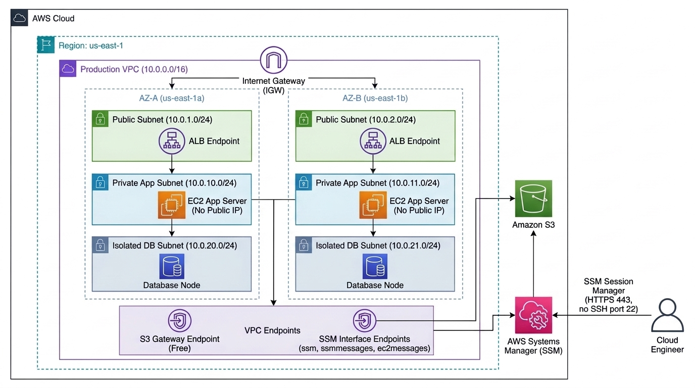
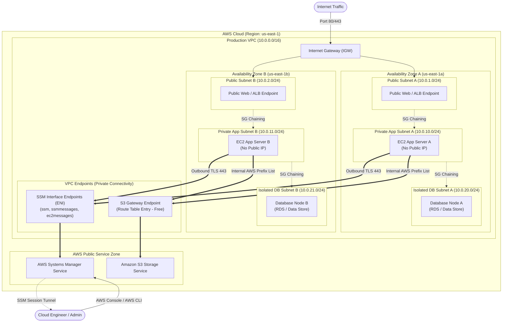
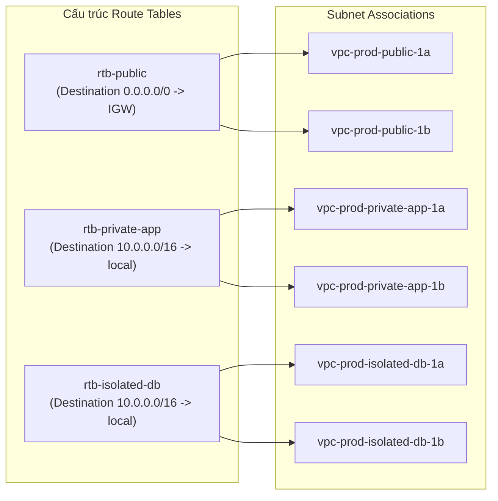
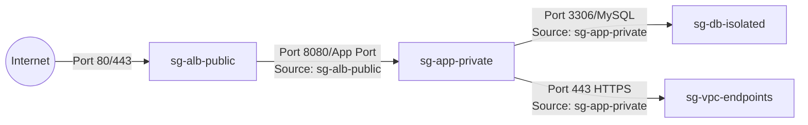
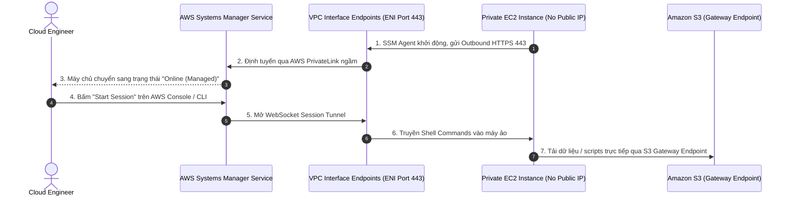

# Lab Thực hành AWS: Xây dựng Mạng VPC 3 Tầng (3-Tier Multi-AZ) Chuẩn Doanh nghiệp, Quản trị Không Cần SSH qua SSM Session Manager & Bảo mật Zero-Egress với VPC Endpoints

- **Tên bài thực hành:** Thiết kế Mạng VPC 3-Tier Multi-AZ, Quản trị An toàn với AWS Systems Manager và Kết nối Riêng tư bằng VPC Endpoints (PrivateLink & Gateway)
- **Công nghệ & Dịch vụ sử dụng:** Amazon VPC (CIDR, Subnets, Route Tables, Internet Gateway, VPC Endpoints), Amazon EC2 (Private Instances, Amazon Linux 2023), AWS Systems Manager (SSM Agent, Session Manager), AWS IAM (Instance Profile), Security Groups.
- **Mức độ:** Trung cấp (Intermediate)
- **Thời lượng dự kiến:** 60 – 75 phút
- **Chi phí dự kiến:** **$0.00** (Hoàn toàn tối ưu trong gói AWS Free Tier, sử dụng SSM và Gateway Endpoint hoàn toàn miễn phí; triển khai Interface Endpoint ngắn hạn trong bài lab và hướng dẫn dọn dẹp để không phát sinh chi phí).
- **Ngày cập nhật:** 2026-10-14

---

## 1. Tổng quan Kiến trúc & Mục tiêu bài Lab

### 1.1. Mục tiêu học tập (Learning Objectives)
1. **Thiết kế Mạng Đa vùng Sẵn sàng cao (Multi-AZ 3-Tier VPC Architecture):** Tự tay quy hoạch dải mạng CIDR (`10.0.0.0/16`), chia tách 6 Subnets trải dài trên 2 Availability Zones (`us-east-1a` và `us-east-1b`) theo 3 phân lớp tiêu chuẩn doanh nghiệp:
   - **Tầng Public (Web / Load Balancer):** Chứa Internet Gateway (IGW) tiếp nhận lưu lượng từ Internet.
   - **Tầng Private Application (Backend App):** Không có Public IP, không định tuyến trực tiếp ra Internet.
   - **Tầng Isolated Database (Data Tier):** Hoàn toàn cô lập (Zero-Egress), không có đường ra Internet.
2. **Khai tử Bastion Host & Cổng 22 SSH với AWS Systems Manager Session Manager:** Cấu hình máy chủ EC2 nằm sâu trong Private Subnet không có Public IP nhưng vẫn kết nối shell an toàn thông qua Outbound HTTPS (Port 443) tới dịch vụ SSM của AWS.
3. **Phân quyền IAM Least Privilege cho Hạ tầng Máy chủ:** Tạo IAM Role và Instance Profile gắn quyền `AmazonSSMManagedInstanceCore` chuẩn khuyến nghị của AWS Security.
4. **Cấu hình Kết nối Riêng tư Zero-Egress với VPC Endpoints (AWS PrivateLink & Gateway Endpoint):**
   - Thiết lập **Gateway Endpoint cho Amazon S3** (miễn phí 100%, không cần NAT Gateway).
   - Thiết lập bộ ba **Interface Endpoints (`ssm`, `ssmmessages`, `ec2messages`)** với Private IP nội bộ để máy chủ trong Private Subnet giao tiếp với Systems Manager mà không cần Internet hay NAT Gateway tốn kém ($32+/tháng).
5. **Kỹ thuật Phòng thủ Tường lửa Đa tầng (Defense in Depth & SG Chaining):** Ràng buộc truy cập nghiêm ngặt giữa tầng Web $\rightarrow$ tầng App $\rightarrow$ tầng Database bằng Security Group Source ID.

---

### 1.2. Sơ đồ Kiến trúc Hệ thống (Architecture Diagram)



*Hình 1.1: Kiến trúc mạng VPC 3-Tier Multi-AZ (Public, Private App, Isolated DB) kết nối riêng tư qua S3 Gateway Endpoint và SSM Interface Endpoints.*

Luồng tương tác chi tiết giữa các thành phần:



---

## 2. Bảng Quy hoạch Dải mạng (Subnet IP Allocation Plan)

Quy hoạch dải mạng VPC chuẩn theo quy tắc tính lũy thừa 2 và dự phòng mở rộng:

| Tên Subnet | Vùng sẵn sàng (AZ) | Dải CIDR | Loại Subnet | Số IP khả dụng | Mục đích sử dụng |
| :--- | :--- | :--- | :--- | :--- | :--- |
| `vpc-prod-public-1a` | `us-east-1a` | `10.0.1.0/24` | Public | 251 | Public ALBs, NAT (nếu có), Bastion endpoints |
| `vpc-prod-public-1b` | `us-east-1b` | `10.0.2.0/24` | Public | 251 | Public ALBs Multi-AZ |
| `vpc-prod-private-app-1a` | `us-east-1a` | `10.0.10.0/24` | Private | 251 | Backend Microservices, Business Logic EC2 |
| `vpc-prod-private-app-1b` | `us-east-1b` | `10.0.11.0/24` | Private | 251 | Backend Microservices Multi-AZ |
| `vpc-prod-isolated-db-1a` | `us-east-1a` | `10.0.20.0/24` | Isolated | 251 | Cơ sở dữ liệu chính (RDS Primary, Aurora) |
| `vpc-prod-isolated-db-1b` | `us-east-1b` | `10.0.21.0/24` | Isolated | 251 | Cơ sở dữ liệu dự phòng (RDS Standby Replica) |

> [!NOTE]
> Trong dải mạng `/24` (tổng cộng 256 địa chỉ IP), AWS **luôn giữ lại 5 địa chỉ IP đầu và cuối** cho mục đích quản trị hạ tầng (IP mạng `.0`, Router `.1`, DNS Server `.2`, Dự phòng tương lai `.3`, và Broadcast `.255`). Do đó, mỗi Subnet sẽ có chính xác **251 địa chỉ IP khả dụng**.

---

## 3. Các bước Triển khai Chi tiết (Step-by-Step Implementation)

### Bước 1: Khởi tạo VPC & Quy hoạch 6 Subnets Multi-AZ

#### 1.1. Tạo VPC tùy biến (Custom VPC)
1. Đăng nhập vào **AWS Management Console**, chọn Region **us-east-1 (N. Virginia)**.
2. Tìm kiếm dịch vụ **VPC** $\rightarrow$ chọn **Your VPCs** $\rightarrow$ click **Create VPC**.
3. Cấu hình các thông số:
   - **Resources to create:** Chọn `VPC only` (để tự tay cấu hình từng thành phần mạng nhằm hiểu sâu bản chất).
   - **Name tag:** `vpc-production-lab03`
   - **IPv4 CIDR block:** `10.0.0.0/16` (cung cấp 65,536 địa chỉ IP).
   - **IPv6 CIDR block:** `No IPv6 CIDR block`.
   - **Tenancy:** `Default`.
4. Click **Create VPC**.
5. **Bật DNS Hostnames:** Chọn VPC vừa tạo $\rightarrow$ click menu **Actions** $\rightarrow$ chọn **Edit VPC settings** $\rightarrow$ tích chọn **Enable DNS hostnames** $\rightarrow$ click **Save changes** *(Bắt buộc bật để SSM và Interface Endpoints phân giải domain nội bộ)*.

#### 1.2. Tạo 6 Subnets
Vào mục **Subnets** $\rightarrow$ click **Create subnet** lần lượt cho 6 Subnets sau:

1. **Subnet Public 1A:**
   - **VPC ID:** Chọn `vpc-production-lab03`
   - **Subnet name:** `vpc-prod-public-1a`
   - **Availability Zone:** `us-east-1a`
   - **IPv4 subnet CIDR block:** `10.0.1.0/24`
2. **Subnet Public 1B:**
   - **Subnet name:** `vpc-prod-public-1b`
   - **Availability Zone:** `us-east-1b`
   - **IPv4 subnet CIDR block:** `10.0.2.0/24`
3. **Subnet Private App 1A:**
   - **Subnet name:** `vpc-prod-private-app-1a`
   - **Availability Zone:** `us-east-1a`
   - **IPv4 subnet CIDR block:** `10.0.10.0/24`
4. **Subnet Private App 1B:**
   - **Subnet name:** `vpc-prod-private-app-1b`
   - **Availability Zone:** `us-east-1b`
   - **IPv4 subnet CIDR block:** `10.0.11.0/24`
5. **Subnet Isolated DB 1A:**
   - **Subnet name:** `vpc-prod-isolated-db-1a`
   - **Availability Zone:** `us-east-1a`
   - **IPv4 subnet CIDR block:** `10.0.20.0/24`
6. **Subnet Isolated DB 1B:**
   - **Subnet name:** `vpc-prod-isolated-db-1b`
   - **Availability Zone:** `us-east-1b`
   - **IPv4 subnet CIDR block:** `10.0.21.0/24`

> [!TIP]
> Đối với 2 Subnet Public (`vpc-prod-public-1a` và `vpc-prod-public-1b`), hãy chọn từng subnet $\rightarrow$ **Actions** $\rightarrow$ **Edit subnet settings** $\rightarrow$ tích chọn **Enable auto-assign public IPv4 address** để các tài nguyên public tự động có địa chỉ IP công khai.

---

### Bước 2: Thiết lập Internet Gateway & Bảng Định tuyến (Route Tables)

Hạ tầng 3 tầng yêu cầu tối thiểu **3 Bảng định tuyến (Route Tables)** riêng biệt để kiểm soát lưu lượng nghiêm ngặt.



#### 2.1. Tạo và Gắn Internet Gateway (IGW)
1. Vào mục **Internet Gateways** $\rightarrow$ click **Create internet gateway**.
2. Đặt tên: `igw-production-lab03` $\rightarrow$ click **Create internet gateway**.
3. Chọn IGW vừa tạo $\rightarrow$ **Actions** $\rightarrow$ **Attach to VPC** $\rightarrow$ Chọn `vpc-production-lab03` $\rightarrow$ click **Attach internet gateway**.

#### 2.2. Tạo và Phân loại Route Tables
1. **Public Route Table:**
   - Click **Create route table** $\rightarrow$ Name: `rtb-prod-public` $\rightarrow$ Chọn VPC `vpc-production-lab03`.
   - Chọn tab **Routes** $\rightarrow$ **Edit routes** $\rightarrow$ Add route:
     - **Destination:** `0.0.0.0/0`
     - **Target:** Chọn `Internet Gateway` $\rightarrow$ chọn `igw-production-lab03`.
     - Click **Save changes**.
   - Chọn tab **Subnet associations** $\rightarrow$ **Edit subnet associations** $\rightarrow$ Gắn 2 subnets: `vpc-prod-public-1a` và `vpc-prod-public-1b` $\rightarrow$ Click **Save associations**.

2. **Private App Route Table:**
   - Click **Create route table** $\rightarrow$ Name: `rtb-prod-private-app` $\rightarrow$ Chọn VPC `vpc-production-lab03`.
   - Giữ nguyên route mặc định `10.0.0.0/16 -> local` (không trỏ ra IGW).
   - Chọn tab **Subnet associations** $\rightarrow$ Gắn 2 subnets: `vpc-prod-private-app-1a` và `vpc-prod-private-app-1b`.

3. **Isolated DB Route Table:**
   - Click **Create route table** $\rightarrow$ Name: `rtb-prod-isolated-db` $\rightarrow$ Chọn VPC `vpc-production-lab03`.
   - Giữ nguyên route mặc định `10.0.0.0/16 -> local`.
   - Chọn tab **Subnet associations** $\rightarrow$ Gắn 2 subnets: `vpc-prod-isolated-db-1a` và `vpc-prod-isolated-db-1b`.

---

### Bước 3: Phân tầng Bảo mật với Security Group Chaining

Thiết lập hệ thống tường lửa theo nguyên tắc **Zero Trust** và **SG Chaining** (không dùng IP tĩnh mà trỏ trực tiếp bằng ID của Security Group):



#### 3.1. Tạo 4 Security Groups:
Vào **Security Groups** $\rightarrow$ click **Create security group**:

1. **`sg-alb-public` (Tầng tiếp nhận Internet):**
   - **VPC:** `vpc-production-lab03`
   - **Inbound Rules:**
     - Type: `HTTP` | Port: `80` | Source: `0.0.0.0/0`
     - Type: `HTTPS` | Port: `443` | Source: `0.0.0.0/0`
   - **Outbound Rules:** Giữ nguyên mặc định (Allow all traffic).

2. **`sg-app-private` (Tầng Backend Máy chủ Ứng dụng):**
   - **VPC:** `vpc-production-lab03`
   - **Inbound Rules:**
     - Type: `Custom TCP` | Port: `8080` (hoặc HTTP 80) | Source: Chọn **Custom** $\rightarrow$ nhập ID của `sg-alb-public` *(Chỉ chấp nhận dữ liệu từ Load Balancer)*.
     - *(Tuyệt đối không mở port 22 SSH!)*
   - **Outbound Rules:**
     - Type: `HTTPS` | Port: `443` | Destination: `0.0.0.0/0` (hoặc trỏ vào `sg-vpc-endpoints` để gửi HTTPS tới VPC Endpoints).

3. **`sg-db-isolated` (Tầng Cơ sở Dữ liệu Cô lập):**
   - **VPC:** `vpc-production-lab03`
   - **Inbound Rules:**
     - Type: `MySQL/Aurora` | Port: `3306` | Source: Chọn ID của `sg-app-private` *(Chỉ máy chủ App mới được truy vấn Database)*.
   - **Outbound Rules:** Xóa toàn bộ outbound rules hoặc chỉ cho phép phản hồi cục bộ trong VPC.

4. **`sg-vpc-endpoints` (Dành riêng cho Interface Endpoints):**
   - **VPC:** `vpc-production-lab03`
   - **Inbound Rules:**
     - Type: `HTTPS` | Port: `443` | Source: Chọn ID của `sg-app-private` (hoặc dải CIDR VPC `10.0.0.0/16`).
   - **Outbound Rules:** Giữ nguyên mặc định.

---

### Bước 4: Tạo IAM Role & Khởi tạo Máy chủ EC2 trong Private Subnet

#### 4.1. Tạo IAM Role cho SSM Session Manager
1. Vào dịch vụ **IAM** $\rightarrow$ chọn **Roles** $\rightarrow$ click **Create role**.
2. **Trusted entity type:** Chọn `AWS service`.
3. **Use case:** Chọn `EC2` $\rightarrow$ click **Next**.
4. **Permissions policies:** Tìm và tích chọn policy chuẩn của AWS:
   - `AmazonSSMManagedInstanceCore`
5. Click **Next** $\rightarrow$ Đặt tên Role: `EC2-SSM-Instance-Role-Lab03` $\rightarrow$ click **Create role**.

#### 4.2. Khởi tạo Máy chủ EC2 trong Private Subnet (Không có Public IP)
1. Vào dịch vụ **EC2** $\rightarrow$ chọn **Instances** $\rightarrow$ click **Launch instances**.
2. **Name:** `ec2-backend-app-private`
3. **Application and OS Images:** `Amazon Linux 2023 AMI` (đã tích hợp sẵn SSM Agent v3.x).
4. **Instance type:** `t2.micro` (hoặc `t3.micro` / `t4g.small` nằm trong Free Tier).
5. **Key pair (login):** Chọn **Proceed without a key pair (Not recommended)** *(Minh chứng cho việc không cần SSH key khi dùng Systems Manager!)*.
6. **Network settings** $\rightarrow$ click **Edit**:
   - **VPC:** Chọn `vpc-production-lab03`
   - **Subnet:** Chọn `vpc-prod-private-app-1a`
   - **Auto-assign public IP:** Đảm bảo chọn **Disable**.
   - **Firewall (security groups):** Chọn **Select existing security group** $\rightarrow$ chọn `sg-app-private`.
7. **Advanced details:**
   - **IAM instance profile:** Chọn `EC2-SSM-Instance-Role-Lab03`.
   - **Metadata version (IMDS):** Chọn `V2 only (token required)`.
8. Click **Launch instance**.

> [!WARNING]
> Tại thời điểm này, máy chủ EC2 đang nằm trong Private Subnet không có Public IP và không có đường đi ra Internet (không có NAT Gateway). Do đó, SSM Agent trên máy chủ **chưa thể** gửi tín hiệu heartbeat về AWS SSM Control Plane. Máy chủ sẽ chưa xuất hiện trong danh sách Managed Instances của Session Manager! Ta sẽ giải quyết triệt để bài toán này ở Bước 5 bằng VPC Endpoints.

---

### Bước 5: Cấu hình Zero-Egress VPC Endpoints (Gateway & Interface Endpoints)

Để máy chủ Private giao tiếp với AWS Services mà không tốn chi phí mở NAT Gateway ($0.045/giờ + $0.045/GB), ta cấu hình VPC Endpoints nội bộ.

#### 5.1. Tạo S3 Gateway Endpoint (Hoàn toàn Miễn phí 100%)
1. Vào **VPC** $\rightarrow$ chọn **Endpoints** $\rightarrow$ click **Create endpoint**.
2. **Name tag:** `vpce-s3-gateway`
3. **Service category:** Chọn `AWS services`.
4. **Services:** Tìm kiếm `s3` và chọn Type là **Gateway** (ký hiệu: `com.amazonaws.us-east-1.s3`).
5. **VPC:** Chọn `vpc-production-lab03`.
6. **Route tables:** Tích chọn cả 2 bảng định tuyến:
   - `rtb-prod-private-app`
   - `rtb-prod-isolated-db`
7. **Policy:** Chọn `Full access` (hoặc tùy biến Endpoint Policy).
8. Click **Create endpoint**.
*(Ngay lập tức, AWS sẽ tự động bơm một entry Prefix List `pl-xxxx (com.amazonaws.us-east-1.s3)` vào Route Table trỏ tới Endpoint ID!)*

#### 5.2. Tạo Bộ ba Interface Endpoints cho AWS Systems Manager
Để SSM Agent trong Private Subnet kết nối thành công về máy chủ điều khiển của AWS qua đường mạng riêng ảo PrivateLink, ta cần tạo 3 Interface Endpoints:
1. `com.amazonaws.us-east-1.ssm` (Gửi API điều khiển)
2. `com.amazonaws.us-east-1.ssmmessages` (Kênh truyền dữ liệu shell thời gian thực của Session Manager)
3. `com.amazonaws.us-east-1.ec2messages` (Kênh truyền lệnh điều khiển và nạp bản vá)

**Thao tác tạo từng Interface Endpoint:**
1. Vào **VPC** $\rightarrow$ **Endpoints** $\rightarrow$ click **Create endpoint**.
2. **Name tag:** Đặt lần lượt `vpce-ssm`, `vpce-ssmmessages`, `vpce-ec2messages`.
3. **Service category:** Chọn `AWS services`.
4. **Services:** Tìm và chọn dịch vụ tương ứng (Type: **Interface**).
5. **VPC:** Chọn `vpc-production-lab03`.
6. **Subnets:**
   - Chọn Availability Zones: `us-east-1a`
   - Chọn Subnet tương ứng: `vpc-prod-private-app-1a`
7. **Security groups:** Tích chọn `sg-vpc-endpoints`.
8. Click **Create endpoint**.

*(Lặp lại cho đủ cả 3 Interface Endpoints: `ssm`, `ssmmessages`, và `ec2messages`).*



---

### Bước 6: Kiểm tra Kết nối Thực tế (Verification & Testing)

#### 6.1. Kiểm tra trạng thái máy chủ trong Fleet Manager
1. Vào dịch vụ **AWS Systems Manager** $\rightarrow$ chọn mục **Fleet Manager** (hoặc **Session Manager**).
2. Quan sát danh sách **Managed nodes**:
   - Máy chủ `ec2-backend-app-private` sẽ xuất hiện với **SSM Agent status: Online**.
   - Lưu ý rằng máy chủ này **hoàn toàn không có Public IP**, không mở cổng 22, và nằm trong Private Subnet không có NAT Gateway!

#### 6.2. Mở Shell Trực tiếp với Session Manager
1. Chọn máy chủ `ec2-backend-app-private` $\rightarrow$ click nút **Node actions** $\rightarrow$ chọn **Start terminal session** (hoặc chọn tab **Session Manager** $\rightarrow$ click **Start session**).
2. Một cửa sổ dòng lệnh Linux Shell an toàn sẽ mở ra ngay trên trình duyệt:

```bash
# Kiểm tra user đang thực thi (mặc định là ssm-user với quyền sudo)
whoami
# Output: ssm-user

# Kiểm tra địa chỉ IP nội bộ của máy chủ
ip addr show eth0
# Output: inet 10.0.10.x/24 brd 10.0.10.255

# Kiểm tra khả năng kết nối ra Internet thông thường (kỳ vọng: BỊ CHẶN HOÀN TOÀN vì Zero-Egress)
curl -I --connect-timeout 5 https://www.google.com
# Output: curl: (28) Failed to connect to www.google.com port 443: Connection timed out

# Kiểm tra kết nối riêng tư tới Amazon S3 qua Gateway Endpoint (kỳ vọng: THÀNH CÔNG RỰC RỠ)
aws s3 ls --region us-east-1
# Output: Liệt kê danh sách các S3 Buckets trong tài khoản mà không cần Internet!
```

> [!TIP]
> Bạn có thể kết nối từ máy tính cá nhân bằng terminal cục bộ mà không cần mở trình duyệt thông qua AWS CLI và plugin **Session Manager Plugin**:
> ```bash
> aws ssm start-session --target i-0123456789abcdef0
> ```

---

## 4. Dọn dẹp Tài nguyên (Clean-up Resources)

Để đảm bảo tài khoản **100% không phát sinh chi phí**, hãy thực hiện dọn dẹp theo thứ tự sau:

1. **Xóa EC2 Instance:**
   - Vào **EC2** $\rightarrow$ **Instances** $\rightarrow$ Chọn `ec2-backend-app-private` $\rightarrow$ **Instance state** $\rightarrow$ **Terminate instance**.
2. **Xóa VPC Endpoints:**
   - Vào **VPC** $\rightarrow$ **Endpoints** $\rightarrow$ Chọn 3 Interface Endpoints (`vpce-ssm`, `vpce-ssmmessages`, `vpce-ec2messages`) và Gateway Endpoint (`vpce-s3-gateway`) $\rightarrow$ Actions $\rightarrow$ **Delete VPC endpoints**.
   *(Lưu ý: Interface Endpoint có tính phí nhẹ $0.01/giờ theo ENI, việc xóa ngay sau bài lab giúp chi phí luôn là $0.00).*
3. **Xóa Internet Gateway:**
   - Vào **Internet Gateways** $\rightarrow$ Chọn `igw-production-lab03` $\rightarrow$ Actions $\rightarrow$ **Detach from VPC** $\rightarrow$ Sau đó chọn Actions $\rightarrow$ **Delete internet gateway**.
4. **Xóa Subnets và Route Tables:**
   - Vào **Route Tables** $\rightarrow$ Xóa `rtb-prod-public`, `rtb-prod-private-app`, `rtb-prod-isolated-db`.
   - Vào **Subnets** $\rightarrow$ Xóa 6 subnets đã tạo.
5. **Xóa Security Groups & VPC:**
   - Vào **Security Groups** $\rightarrow$ Xóa lần lượt `sg-db-isolated`, `sg-app-private`, `sg-vpc-endpoints`, `sg-alb-public`.
   - Vào **Your VPCs** $\rightarrow$ Chọn `vpc-production-lab03` $\rightarrow$ Actions $\rightarrow$ **Delete VPC**.
6. **Xóa IAM Role:**
   - Vào **IAM** $\rightarrow$ **Roles** $\rightarrow$ Tìm và xóa `EC2-SSM-Instance-Role-Lab03`.

---

## 5. Đánh đổi (Trade-offs) & So sánh Kiến trúc Thực tế

### 5.1. So sánh: NAT Gateway vs. VPC Endpoints

| Tiêu chí | NAT Gateway | VPC Endpoints (PrivateLink & Gateway) |
| :--- | :--- | :--- |
| **Bản chất** | Thiết bị chuyển đổi địa chỉ mạng tập trung cho toàn VPC đi ra Internet. | Kết nối nội bộ private ảo hóa thông qua hạ tầng mạng ngầm của AWS. |
| **Chi phí cố định** | Cao (~$32.40 / tháng / AZ chưa tính phí data). | **S3 Gateway miễn phí 100%**; Interface Endpoints ~$7.20 / tháng / AZ. |
| **Bảo mật** | Gói tin vẫn đi ra Internet Gateway công khai (dù được ẩn IP). | **Gói tin không bao giờ rời khỏi mạng nội bộ AWS**; hỗ trợ gắn Endpoint Policy. |
| **Khả năng tiếp cận** | Có thể truy cập bất kỳ trang web / API nào trên toàn thế giới. | Chỉ truy cập được các dịch vụ AWS cụ thể được cấu hình. |
| **Khuyến nghị kiến trúc** | Dùng khi máy chủ bắt buộc tải package từ Internet (`yum update`, pip, npm). | Dùng cho hệ thống yêu cầu bảo mật tài chính, ngân hàng, y tế (**Zero-Egress**). |

---

### 5.2. So sánh: SSH Bastion Host truyền thống vs. AWS Systems Manager Session Manager

| Tiêu chí | SSH Bastion Host (Truyền thống) | AWS SSM Session Manager (Hiện đại) |
| :--- | :--- | :--- |
| **Cổng mạng (Ports)** | Mở cổng Inbound `22` (tiềm ẩn nguy cơ Brute Force / Scan IP). | **Đóng 100% Inbound Ports** (Chỉ cần Outbound 443 từ máy chủ). |
| **Quản lý Khóa (SSH Keys)** | Phức tạp: Phải phân phát file `.pem`, dễ bị rò rỉ hoặc mất khóa. | **Không cần SSH Key:** Xác thực tập trung qua IAM và AWS Organizations SSO. |
| **Hạ tầng tốn kém** | Phải duy trì máy chủ Bastion (tốn chi phí EC2, IP Elastic, bảo trì OS). | **Serverless:** Dịch vụ quản trị có sẵn từ AWS, không tốn tài nguyên quản lý. |
| **Nhật ký kiểm toán (Audit)** | Khó theo dõi ai đã gõ lệnh gì trên server nếu không cài tool phụ trợ. | **Ghi log chi tiết 100%:** Toàn bộ lệnh gõ và video session được lưu tự động lên CloudWatch Logs và S3. |

---

## 6. Câu hỏi Phỏng vấn & Ôn tập Củng cố Kiến thức

### Câu 1: Tại sao chúng ta cần đến 3 Subnets khác nhau (Public, Private App, Isolated DB) thay vì chỉ gộp chung thành một Private Subnet?
- **Trả lời:** Đây là nguyên tắc **Phân vùng Mạng (Network Segmentation / Defense in Depth)**. Việc chia 3 tầng giúp thiết lập các ranh giới kiểm soát bảo mật khác nhau:
  1. *Public Subnet:* Nơi duy nhất tiếp xúc trực tiếp với Internet bên ngoài (chứa ALB), có rủi ro tấn công cao nhất.
  2. *Private App Subnet:* Chứa code nghiệp vụ, cần giao tiếp ra ngoài (gọi API đối tác hoặc dịch vụ AWS) nhưng không cho phép Internet gọi trực tiếp vào.
  3. *Isolated DB Subnet:* Chứa tài sản quý giá nhất là dữ liệu. Tầng này tuyệt đối không được phép có bất kỳ con đường nào nối ra Internet (kể cả qua NAT Gateway) để triệt tiêu hoàn toàn nguy cơ rò rỉ dữ liệu (Data Exfiltration) nếu máy chủ ứng dụng bị tin tặc chiếm quyền điều khiển.

### Câu 2: Khi nào thì chúng ta nên chọn S3 Gateway Endpoint thay vì S3 Interface Endpoint?
- **Trả lời:**
  - **S3 Gateway Endpoint** nên được ưu tiên sử dụng cho hầu hết các kiến trúc nội bộ chạy trên EC2/VPC vì nó **hoàn toàn miễn phí** và có băng thông không giới hạn trực tiếp qua Route Table.
  - **S3 Interface Endpoint** chỉ cần thiết khi bạn có hệ thống trung tâm dữ liệu đặt tại chỗ (**On-Premises**) kết nối qua AWS Direct Connect / VPN muốn truy cập S3 qua IP nội bộ, hoặc khi bạn cần truy cập S3 từ một VPC khác mà không muốn thiết lập peering phức tạp.

### Câu 3: Một máy chủ EC2 trong Private Subnet đã được gắn IAM Role có quyền `AmazonSSMManagedInstanceCore`, nhưng trên AWS Console máy chủ vẫn không hiện trạng thái Online trong Session Manager. Bạn sẽ kiểm tra những nguyên nhân kỹ thuật nào?
- **Trả lời:** Các nguyên nhân cốt lõi cần kiểm tra theo thứ tự:
  1. *Thiếu DNS Resolution:* VPC chưa bật tính năng **Enable DNS hostnames** hoặc **Enable DNS resolution**, khiến SSM Agent không phân giải được endpoint URL của AWS.
  2. *Tường lửa chặn Outbound:* Security Group của EC2 chặn cổng Outbound HTTPS `443` tới Interface Endpoints.
  3. *Thiếu Interface Endpoints:* Hệ thống chưa tạo đủ bộ 3 endpoints (`ssm`, `ssmmessages`, `ec2messages`) trong cùng Subnet/AZ của máy chủ.
  4. *Security Group của Interface Endpoint:* Security Group gắn vào các Interface Endpoints chưa cho phép Inbound HTTPS `443` từ dải mạng của máy chủ EC2.
  5. *Dịch vụ SSM Agent chưa chạy:* SSM Agent trên OS bị crash hoặc chưa được bật tự khởi động (`systemctl status amazon-ssm-agent`).

---

**Tài liệu tham khảo chính thức từ AWS:**
- [AWS Official Documentation: VPC with public and private subnets](https://docs.aws.amazon.com/vpc/latest/userguide/VPC_Scenario2.html)
- [AWS Systems Manager Session Manager User Guide](https://docs.aws.amazon.com/systems-manager/latest/userguide/session-manager.html)
- [AWS Documentation: AWS PrivateLink and VPC endpoints](https://docs.aws.amazon.com/vpc/latest/privatelink/concepts.html)
