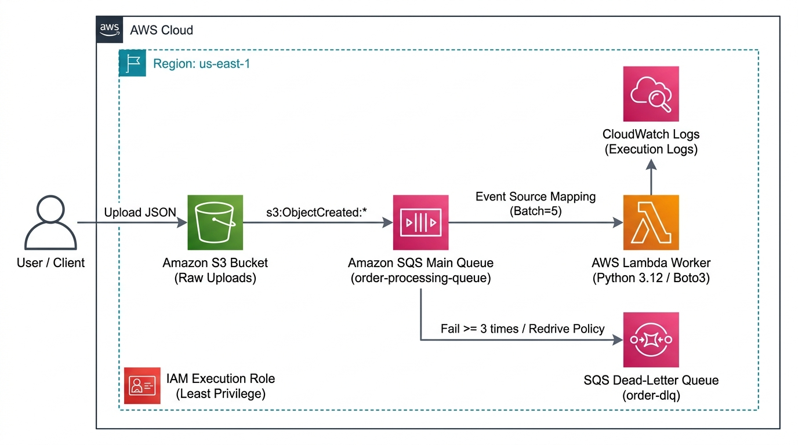
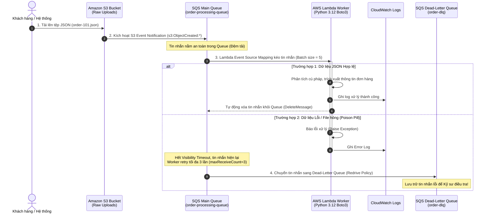

# Lab Thực hành AWS: Xây dựng Đường ống Xử lý Dữ liệu Hướng Sự kiện (Event-Driven Pipeline) Bất đồng bộ với Amazon S3, SQS (Dead-Letter Queue) và AWS Lambda

- **Tên bài thực hành:** Kiến trúc Xử lý Bất đồng bộ chịu lỗi (Fault-Tolerant Asynchronous Processing) với S3, SQS Buffer, Lambda Worker và Dead-Letter Queue
- **Công nghệ & Dịch vụ sử dụng:** Amazon S3 (Bucket, Event Notifications, Lifecycle), Amazon SQS (Standard Queue, Dead-Letter Queue, Redrive Policy), AWS Lambda (Python 3.12, Event Source Mapping, Boto3), Amazon CloudWatch (Logs, Metrics), AWS IAM (Least Privilege Roles).
- **Mức độ:** Trung cấp (Intermediate)
- **Thời lượng dự kiến:** 60 – 75 phút
- **Chi phí dự kiến:** **$0.00** (100% hoàn toàn nằm trong gói AWS Free Tier).
- **Ngày cập nhật:** 2026-10-16

---

## 1. Tổng quan Kiến trúc & Mục tiêu bài Lab

### 1.1. Bối cảnh Bài toán Thực tế (Real-World Scenario)
Trong các doanh nghiệp, người dùng hoặc hệ thống đối tác thường xuyên tải lên các tệp tin dữ liệu lớn (ảnh, video, file giao dịch CSV/JSON) lên Amazon S3. 

Nếu cấu hình **S3 trực tiếp kích hoạt AWS Lambda**:
1. Khi có đợt tải lên hàng loạt (ví dụ 10,000 files trong 1 phút), 10,000 hàm Lambda sẽ bị kích hoạt đồng thời làm cạn kiệt giới hạn **Concurrency Limit** của tài khoản AWS, làm nghẽn Database phía sau.
2. Nếu hàm Lambda gặp lỗi (lỗi định dạng dữ liệu, timeout), S3 chỉ thử lại (retry) tối đa 2 lần rồi **vứt bỏ sự kiện**, dẫn tới **mất dữ liệu của khách hàng**.

**Giải pháp Kiến trúc Chuẩn Doanh nghiệp:** Chèn một hàng đợi **Amazon SQS** ở giữa làm bộ đệm (**Decoupling & Buffering**) kết hợp với **Dead-Letter Queue (DLQ)** để cô lập các tệp hỏng:
$$\text{S3 Bucket} \xrightarrow{\text{ObjectCreated}} \text{Amazon SQS} \xrightarrow{\text{Batch / Throttled}} \text{AWS Lambda} \xrightarrow{\text{Fail } \ge 3 \text{ times}} \text{SQS DLQ}$$

---

### 1.2. Mục tiêu Học tập (Learning Objectives)
1. **Làm chủ Kiến trúc Hướng sự kiện (Event-Driven Architecture):** Cấu hình **Amazon S3 Event Notifications** tự động phát thông điệp JSON mỗi khi có file mới tải lên.
2. **Kỹ thuật Đệm Hàng đợi (Queue Buffering & Decoupling):** Sử dụng Amazon SQS để làm phẳng tải (Traffic Smoothing), bảo vệ tài nguyên tính toán và cơ sở dữ liệu.
3. **Cấu hình Cơ chế Chịu lỗi với Dead-Letter Queue (DLQ):** Thiết lập **Redrive Policy** với `maxReceiveCount = 3` để tự động cô lập các thông điệp lỗi (Poison Pills) mà không làm tắc nghẽn luồng xử lý chính.
4. **Tích hợp Tự động AWS Lambda với SQS (Event Source Mapping):** Hiểu cơ chế Lambda tự động poll SQS, xử lý theo lô (**Batch Size**), và tự động xóa message khi hoàn tất.
5. **Thiết kế IAM Policy Chuẩn Least Privilege:** Tự tay viết chính sách IAM cho phép S3 ghi vào SQS (SQS Access Policy) và quyền cho Lambda đọc SQS và ghi CloudWatch Logs.
6. **Thực nghiệm Kịch bản Giả lập Lỗi (Chaos / Poison Pill Testing):** Cố tình tải lên file JSON sai cấu trúc để quan sát SQS retry 3 lần và tự động đẩy tin nhắn vào DLQ.

---

### 1.3. Sơ đồ Kiến trúc Luồng Xử lý (Architecture Workflow)



*Hình 1.1: Đường ống xử lý bất đồng bộ với S3 Event Notifications, SQS Main Queue làm bộ đệm, Lambda Worker và SQS Dead-Letter Queue.*

Luồng tương tác chi tiết giữa các thành phần:



---

## 2. Chuẩn bị Tài nguyên & Tham số Kỹ thuật

Để bài lab diễn ra mạch lạc, các tham số tài nguyên được quy ước thống nhất như sau:

| Tài nguyên | Tên định danh (Resource Name) | Cấu hình kỹ thuật |
| :--- | :--- | :--- |
| **AWS Region** | `us-east-1` (Bắc Virginia) | Khu vực mặc định hỗ trợ đầy đủ tính năng. |
| **S3 Raw Bucket** | `event-driven-raw-data-<account-id>` | Tên bucket duy nhất toàn cầu, bật Event Notifications. |
| **SQS Dead-Letter Queue** | `order-dlq` | Standard Queue, Retention = 14 ngày. |
| **SQS Main Queue** | `order-processing-queue` | Standard Queue, Visibility Timeout = 60s, gắn Redrive Policy vào `order-dlq`. |
| **IAM Role** | `Lambda-SQS-Execution-Role` | Policy: `AWSLambdaBasicExecutionRole` + `AWSLambdaSQSQueueExecutionRole`. |
| **Lambda Function** | `OrderProcessorWorker` | Runtime: Python 3.12, Architecture: x86_64, Timeout: 30s. |

---

## 3. Các Bước Triển khai Chi tiết (Step-by-Step Hands-on)

### Bước 1: Khởi tạo Hàng đợi SQS (Main Queue & Dead-Letter Queue)

Ta luôn khởi tạo **DLQ trước**, sau đó mới tạo **Main Queue** để có thể liên kết ngay trong Redrive Policy.

#### 1. Tạo Dead-Letter Queue (`order-dlq`)
1. Truy cập **AWS Management Console** $\rightarrow$ dịch vụ **Amazon SQS** $\rightarrow$ bấm **Create queue**.
2. **Type:** Chọn **Standard**.
3. **Name:** Nhập `order-dlq`.
4. **Configuration:**
   - **Visibility timeout:** `30 Seconds`
   - **Message retention period:** `14 Days` (cho phép lưu trữ tin nhắn lỗi 14 ngày để phân tích).
5. Bấm **Create queue**. Sao chép mã **ARN** của DLQ (ví dụ: `arn:aws:sqs:us-east-1:123456789012:order-dlq`).

---

#### 2. Tạo Main Queue (`order-processing-queue`) và cấu hình Redrive Policy
1. Tại console SQS, bấm **Create queue**.
2. **Type:** Chọn **Standard**.
3. **Name:** Nhập `order-processing-queue`.
4. **Configuration:**
   - **Visibility timeout:** `60 Seconds` (Đặt lớn hơn thời gian thực thi của Lambda: Lambda timeout 30s thì Visibility Timeout nên là 60s).
   - **Receive message wait time:** `20 Seconds` (Bật **Long Polling** để giảm API rỗng và tiết kiệm chi phí).
5. **Dead-letter queue (Cực kỳ quan trọng):**
   - Chuyển công tắc sang **Enabled**.
   - **Choose queue:** Chọn `order-dlq` vừa tạo ở trên.
   - **Maximum receives:** Nhập `3` (Nếu tin nhắn bị xử lý lỗi 3 lần liên tiếp, tự động chuyển vào DLQ).
6. **Access policy:** Cần cấp quyền cho Amazon S3 được phép gửi thông điệp (`SendMessage`) vào hàng đợi này. Chọn tab **Advanced** và dán đoạn Policy JSON sau:

```json
{
  "Version": "2012-10-17",
  "Id": "S3-to-SQS-Policy",
  "Statement": [
    {
      "Sid": "AllowS3ToPublishMessages",
      "Effect": "Allow",
      "Principal": {
        "Service": "s3.amazonaws.com"
      },
      "Action": "sqs:SendMessage",
      "Resource": "arn:aws:sqs:us-east-1:YOUR_ACCOUNT_ID:order-processing-queue",
      "Condition": {
        "ArnLike": {
          "aws:SourceArn": "arn:aws:s3:::event-driven-raw-data-*"
        }
      }
    }
  ]
}
```
*(Lưu ý: Thay thế `YOUR_ACCOUNT_ID` bằng AWS Account ID 12 số của bạn).*
7. Bấm **Create queue**. Sao chép mã ARN của `order-processing-queue`.

---

### Bước 2: Khởi tạo Amazon S3 Bucket và Bật Event Notifications

1. Mở dịch vụ **Amazon S3** $\rightarrow$ bấm **Create bucket**.
2. **Bucket name:** Nhập `event-driven-raw-data-<account-id>` (thay `<account-id>` bằng số account của bạn để đảm bảo không trùng).
3. **AWS Region:** Chọn `us-east-1`.
4. Giữ nguyên các thiết lập bảo mật mặc định (Block all public access = ON).
5. Bấm **Create bucket**.

#### Cấu hình S3 Event Notification trỏ sang SQS:
1. Bấm vào tên Bucket vừa tạo $\rightarrow$ Chuyển sang tab **Properties**.
2. Cuộn xuống mục **Event notifications** $\rightarrow$ Bấm **Create event notification**.
3. **General configuration:**
   - **Event name:** `NewOrderUploadedEvent`
   - **Prefix (tùy chọn):** `orders/` (chỉ kích hoạt khi file được tải vào thư mục `orders/`).
   - **Suffix (tùy chọn):** `.json` (chỉ kích hoạt với file có đuôi `.json`).
4. **Event types:** Tích chọn:
   - `All object create events` (`s3:ObjectCreated:*`).
5. **Destination:**
   - Chọn **SQS queue**.
   - Chọn `order-processing-queue`.
6. Bấm **Save changes**.

> [!NOTE]
> Nếu bấm Save mà gặp lỗi *Access Denied*, hãy kiểm tra lại **Access Policy** của SQS ở Bước 1. SQS bắt buộc phải có quyền cho phép Principal `s3.amazonaws.com` gọi `sqs:SendMessage`.

---

### Bước 3: Tạo IAM Role cho AWS Lambda

1. Mở dịch vụ **IAM** $\rightarrow$ chọn **Roles** $\rightarrow$ bấm **Create role**.
2. **Trusted entity type:** Chọn **AWS service**, mục *Use case* chọn **Lambda** $\rightarrow$ Bấm **Next**.
3. **Add permissions:** Tìm và tích chọn 3 chính sách AWS Managed (hoặc tạo Customer Managed Policy chuẩn Least Privilege):
   * `AWSLambdaBasicExecutionRole` (cho phép ghi log vào Amazon CloudWatch Logs).
   * `AWSLambdaSQSQueueExecutionRole` (cho phép đọc, lấy metadata và xóa tin nhắn từ SQS).
   * `AmazonS3ReadOnlyAccess` (cho phép gọi `s3:GetObject` để đọc nội dung file từ S3 Bucket).
4. **Role name:** Nhập `Lambda-SQS-Execution-Role`.
5. Bấm **Create role**.

> [!TIP]
> **Thực hành chuẩn Least Privilege trong môi trường Production:** Thay vì cấp `AmazonS3ReadOnlyAccess` toàn quyền đọc mọi bucket trên tài khoản, bạn có thể tạo một Inline Policy chỉ cho phép đọc đúng bucket của bài lab:
> ```json
> {
>   "Version": "2012-10-17",
>   "Statement": [
>     {
>       "Effect": "Allow",
>       "Action": ["s3:GetObject"],
>       "Resource": "arn:aws:s3:::event-driven-raw-data-*/*"
>     }
>   ]
> }
> ```

---

### Bước 4: Viết Mã Nguồn Hàm AWS Lambda (Python 3.12 Boto3)

1. Mở dịch vụ **AWS Lambda** $\rightarrow$ bấm **Create function**.
2. **Function name:** Nhập `OrderProcessorWorker`.
3. **Runtime:** Chọn **Python 3.12**.
4. **Architecture:** Chọn `x86_64`.
5. **Permissions:** Bấm mở rộng *Change default execution role* $\rightarrow$ Chọn **Use an existing role** $\rightarrow$ Chọn `Lambda-SQS-Execution-Role`.
6. Bấm **Create function**.

#### 1. Cấu hình Timeout cho Lambda:
- Chuyển sang tab **Configuration** $\rightarrow$ chọn mục **General configuration** $\rightarrow$ Bấm **Edit**.
- **Timeout:** Tăng từ 3 giây lên **30 seconds**.
- Bấm **Save**.

#### 2. Dán mã nguồn xử lý (Python Boto3):
Chuyển sang tab **Code**, mở tệp `lambda_function.py`, thay thế toàn bộ nội dung bằng đoạn mã thực chiến sau:

```python
import json
import boto3
import urllib.parse
import logging

# Thiết lập logger chuẩn CloudWatch
logger = logging.getLogger()
logger.setLevel(logging.INFO)

s3_client = boto3.client('s3')

def lambda_handler(event, context):
    logger.info(f"==> Tiếp nhận lô tin nhắn từ SQS! Tổng số tin: {len(event['Records'])}")
    
    # Duyệt qua từng bản ghi tin nhắn từ SQS
    for record in event['Records']:
        message_id = record['messageId']
        receipt_handle = record['receiptHandle']
        
        logger.info(f"--- Đang xử lý MessageId: {message_id} ---")
        
        try:
            # 1. Trích xuất Payload từ SQS
            body = json.loads(record['body'])
            
            # SQS nhận event từ S3, kiểm tra xem có trường Records của S3 không
            if 'Records' not in body:
                raise ValueError("Bản tin không đúng định dạng S3 Event Notification!")
                
            s3_event = body['Records'][0]
            bucket_name = s3_event['s3']['bucket']['name']
            # Giải mã tên file URL-encoded (ví dụ: khoảng trắng %20)
            object_key = urllib.parse.unquote_plus(s3_event['s3']['object']['key'])
            object_size = s3_event['s3']['object']['size']
            
            logger.info(f"Phát hiện file mới trên S3: s3://{bucket_name}/{object_key} (Kích thước: {object_size} bytes)")
            
            # 2. Đọc nội dung file JSON trực tiếp từ S3
            response = s3_client.get_object(Bucket=bucket_name, Key=object_key)
            file_content = response['Body'].read().decode('utf-8')
            order_data = json.loads(file_content)
            
            # 3. Kiểm tra tính hợp lệ của nghiệp vụ (Business Validation)
            # Yêu cầu file phải có đủ 'order_id', 'amount' và amount phải > 0
            if 'order_id' not in order_data or 'amount' not in order_data:
                raise KeyError("Dữ liệu đơn hàng thiếu trường bắt buộc: 'order_id' hoặc 'amount'!")
                
            if order_data['amount'] <= 0:
                raise ValueError(f"Số tiền không hợp lệ: {order_data['amount']} <= 0!")
                
            # 4. Giả lập xử lý nghiệp vụ thành công
            logger.info(f"--> [THÀNH CÔNG] Đơn hàng #{order_data['order_id']} hợp lệ! Số tiền: ${order_data['amount']}. Đã ghi nhận.")
            
        except Exception as e:
            logger.error(f"--> [LỖI NGHIỆP VỤ] Thất bại khi xử lý message {message_id}: {str(e)}")
            # QUAN TRỌNG: Ném ngoại lệ để Lambda báo thất bại với SQS
            # Khi Lambda throw exception, tin nhắn sẽ KHÔNG bị xóa khỏi SQS
            # SQS sẽ kích hoạt lại và tăng ReceiveCount để kích hoạt DLQ!
            raise e

    return {
        'statusCode': 200,
        'body': json.dumps('Xử lý thành công toàn bộ lô dữ liệu!')
    }
```
7. Bấm nút **Deploy** để lưu và áp dụng mã nguồn.

---

### Bước 5: Cấu hình Event Source Mapping (Kết nối SQS làm Trigger cho Lambda)

1. Vẫn tại màn hình hàm Lambda `OrderProcessorWorker`, chuyển sang tab **Configuration** $\rightarrow$ chọn mục **Triggers** $\rightarrow$ Bấm **Add trigger**.
2. **Trigger configuration:** Chọn **SQS**.
3. **SQS queue:** Chọn `order-processing-queue`.
4. **Batch size:** Nhập `5` (Lambda sẽ gộp tối đa 5 tin nhắn vào 1 lần chạy để tiết kiệm chi phí).
5. **Batch window:** Nhập `10` seconds (Chờ tối đa 10 giây để gom đủ batch size trước khi gọi Lambda).
6. Bấm **Add**.

Sau 10–20 giây, trigger sẽ chuyển sang trạng thái **Enabled** (Màu xanh lá).

---

## 4. Thực nghiệm Kịch bản Kiểm thử & Giả lập Sự cố (Testing & Chaos Verification)

### Kịch bản 1: Kiểm thử Luồng Xử lý Thành công (Happy Path)

Tạo một tệp tin đơn hàng hợp lệ `order-valid.json` trên máy tính cá nhân:
```json
{
  "order_id": "ORD-2026-8899",
  "customer": "Nguyen Van A",
  "amount": 450.00,
  "currency": "USD",
  "items": ["AWS Certified Solutions Architect Guide", "Mechanical Keyboard"]
}
```

1. Mở console **Amazon S3** $\rightarrow$ Vào bucket `event-driven-raw-data-<account-id>`.
2. Tạo thư mục `orders/`.
3. Tải tệp `order-valid.json` vào thư mục `orders/` (`orders/order-valid.json`).
4. **Quan sát kết quả:**
   - Mở dịch vụ **Amazon CloudWatch** $\rightarrow$ **Log groups** $\rightarrow$ chọn `/aws/lambda/OrderProcessorWorker`.
   - Mở log stream mới nhất. Bạn sẽ thấy dòng log màu xanh:
     ```text
     [INFO] Phát hiện file mới trên S3: s3://event-driven-raw-data-.../orders/order-valid.json
     [INFO] --> [THÀNH CÔNG] Đơn hàng #ORD-2026-8899 hợp lệ! Số tiền: $450.0. Đã ghi nhận.
     ```
   - Mở console **Amazon SQS** $\rightarrow$ Kiểm tra cả 2 hàng đợi:
     - `order-processing-queue`: **Messages available = 0** (đã được Lambda xử lý và tự động xóa).
     - `order-dlq`: **Messages available = 0**.

---

### Kịch bản 2: Thực nghiệm Bơm Dữ liệu Lỗi (Chaos Testing - Poison Pill Injection)

Bây giờ ta cố tình đóng vai kẻ xấu hoặc người dùng gửi dữ liệu hỏng để kiểm chứng cơ chế tự phục hồi và cô lập tin nhắn của Dead-Letter Queue.

Tạo tệp `order-poison.json` (thiếu trường `order_id` và số tiền âm):
```json
{
  "invalid_data": true,
  "amount": -999.00,
  "error_note": "This is a corrupted payload to test DLQ"
}
```

1. Tải tệp `order-poison.json` lên thư mục `orders/` của S3 bucket.
2. **Quan sát luồng xử lý tự động của hệ thống:**
   - **Lần 1:** Lambda đọc file, phát hiện thiếu trường `order_id` $\rightarrow$ ném ngoại lệ `KeyError` $\rightarrow$ Lambda báo lỗi. Tin nhắn được trả lại SQS.
   - SQS đợi hết `Visibility Timeout` (60s), tăng `ApproximateReceiveCount = 2` và giao lại cho Lambda.
   - **Lần 2:** Lambda chạy lại và tiếp tục thất bại.
   - **Lần 3:** Lambda chạy lại lần thứ ba và tiếp tục thất bại.
   - **Lần 4:** SQS kiểm tra thấy `ReceiveCount` đã vượt quá `maxReceiveCount = 3` $\rightarrow$ **SQS tự động chuyển gói tin sang `order-dlq`!**
3. **Kiểm tra Dead-Letter Queue:**
   - Mở console **Amazon SQS** $\rightarrow$ Chọn `order-dlq`.
   - Bạn sẽ thấy: **Messages available = 1**!
   - Bấm nút **Send and receive messages** $\rightarrow$ Bấm **Poll for messages**.
   - Bấm vào ID của tin nhắn để đọc nội dung. Bạn sẽ thấy nguyên vẹn thông tin sự kiện S3 chỉ ra chính xác tệp `orders/order-poison.json` gây lỗi.
   - **Hàng đợi chính (`order-processing-queue`) hoàn toàn thông thoáng** và sẵn sàng tiếp nhận các đơn hàng hợp lệ tiếp theo mà không bị treo!

---

## 5. Dọn dẹp Tài nguyên (Clean Up) để Tránh Phát sinh Chi phí

Sau khi hoàn thành bài thực hành, thực hiện dọn dẹp theo thứ tự:
1. **Amazon S3:** Vào bucket `event-driven-raw-data-<account-id>`, bấm **Empty** để xóa toàn bộ files, sau đó bấm **Delete** để xóa bucket.
2. **AWS Lambda:** Chọn hàm `OrderProcessorWorker` $\rightarrow$ Actions $\rightarrow$ **Delete**.
3. **Amazon SQS:** Xóa cả 2 hàng đợi `order-processing-queue` và `order-dlq`.
4. **AWS IAM:** Xóa Role `Lambda-SQS-Execution-Role`.

---

## 6. Tổng kết Kiến thức Thực chiến

### 4 Bài học Cốt lõi dành cho Cloud Engineer:
1. **Đừng bao giờ nối trực tiếp S3 vào Worker nặng:** Đặt Amazon SQS ở giữa giúp hệ thống có khả năng "thở" (Buffer) khi có bão lưu lượng, ngăn chặn tình trạng cạn kiệt tài nguyên downstream.
2. **Ý nghĩa của Dead-Letter Queue (DLQ):** DLQ không phải là nơi vứt rác, mà là **hộp đen an toàn lưu giữ bằng chứng sự cố**. Nó giúp các lập trình viên debug lỗi mà không làm gián đoạn dây chuyền sản xuất.
3. **Cơ chế Xóa Tin nhắn của Lambda Event Source Mapping:** Khi Lambda trả về mã `200` thành công, Lambda Service tự động gọi `DeleteMessage` thay cho bạn. Khi Lambda ném ngoại lệ (`raise Exception`), Lambda giữ nguyên tin nhắn trong SQS để phục vụ cơ chế retry.
4. **Nguyên tắc Idempotency:** Trong kiến trúc hướng sự kiện với SQS Standard, tin nhắn có thể bị nhận 2 lần. Code của Lambda Worker bắt buộc phải thiết kế an toàn để việc xử lý lặp lại không làm sai lệch số dư hay nhân đôi đơn hàng.
