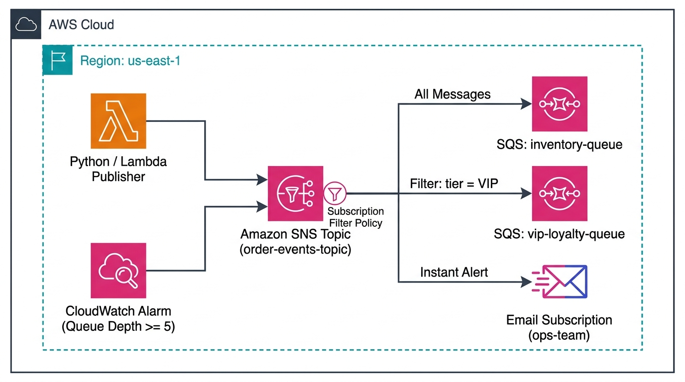
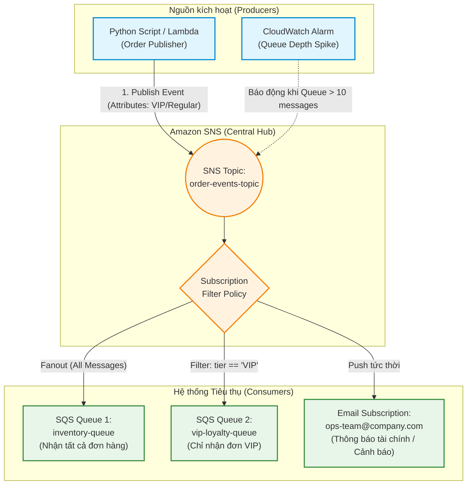

# Lab Thực hành AWS: Xây dựng Hệ thống Phân phối Thông điệp Fanout Đa Kênh với Amazon SNS, SQS Queues và CloudWatch Alarms

- **Tên bài thực hành:** Mô hình Fanout Phân tán Tin nhắn (Pub/Sub Fanout Pattern) với Amazon SNS, Lọc tin nhắn (Message Filtering), Đẩy đa kênh (Email + SQS Worker) và Cảnh báo Tự động qua CloudWatch Alarms
- **Dịch vụ AWS sử dụng:** Amazon SNS (Standard Topic, Subscriptions, Subscription Filter Policy), Amazon SQS (Standard Queue, SQS Access Policy), Amazon CloudWatch (Billing / Custom Metric Alarm), AWS Lambda (Python 3.12 / Boto3 Publisher), AWS IAM (Least Privilege Roles).
- **Mức độ:** Trung cấp (Intermediate)
- **Thời lượng dự kiến:** 60 – 75 phút
- **Chi phí dự kiến:** **$0.00** (Hoàn toàn nằm trong gói AWS Free Tier).
- **Ngày cập nhật:** 2026-10-21

---

## 1. Tổng quan Kiến trúc & Mục tiêu bài Lab

### 1.1. Bối cảnh Bài toán Thực tế (Real-World Scenario)
Trong một hệ thống thanh toán và bán lẻ trực tuyến, khi khách hàng hoàn tất một giao dịch (`OrderCompleted`):
1. Dịch vụ kho hàng (**Inventory Service**) cần cập nhật trừ số lượng hàng hóa trong kho.
2. Dịch vụ chăm sóc khách hàng VIP (**VIP Loyalty Service**) cần tích điểm và gửi mã quà tặng nếu đơn hàng có giá trị cao (`order_tier = "VIP"`).
3. Đội ngũ vận hành tài chính (**Finance Ops**) cần nhận được một email tức thời để theo dõi doanh thu.
4. Đồng thời, đội ngũ kỹ sư cần một cơ chế tự động gửi cảnh báo qua Email/SMS mỗi khi hàng đợi thanh toán bị quá tải tin nhắn hoặc phát sinh sự cố hệ thống.

Nếu kết nối theo mô hình Point-to-Point truyền thống, dịch vụ Order API phải gọi 3–4 lần API riêng biệt, dễ gây lỗi dây chuyền (Cascading Failure) và làm chậm thời gian phản hồi của khách hàng.

**Giải pháp Kiến trúc Chuẩn Doanh nghiệp:** Sử dụng mô hình **Fanout Pattern** kết hợp giữa **Amazon SNS** và **Amazon SQS**:
- Đơn hàng xuất bản **1 lần duy nhất** lên Amazon SNS Topic.
- SNS tự động nhân bản (Fanout) và đẩy đồng thời:
  - Tới `inventory-queue` (SQS) để xử lý kho.
  - Tới `vip-loyalty-queue` (SQS) qua bộ lọc **Subscription Filter Policy** (chỉ đón nhận đơn hàng VIP).
  - Tới hộp thư cá nhân qua **Email Subscription**.
- Cấu hình một **CloudWatch Alarm** giám sát độ sâu hàng đợi (`ApproximateNumberOfMessagesVisible`), tự động kích hoạt SNS Topic phát thông báo khi hàng đợi bị dồn ứ.

---

### 1.2. Mục tiêu Học tập (Learning Objectives)
1. **Làm chủ Mô hình Pub/Sub Fanout (Fanout Architecture):** Tự tay thiết kế và cấu hình 1 SNS Topic phát tán tin nhắn tới nhiều SQS Queues độc lập.
2. **Kỹ thuật Lọc Tin Nhắn tại Nguồn (SNS Message Filtering):** Thiết lập `Subscription Filter Policy` bằng JSON để chỉ chuyển tiếp các tin nhắn có `MessageAttributes` thỏa mãn điều kiện.
3. **Cấu hình SQS Access Policy Phân quyền:** Viết chính sách cấp quyền cho SNS Topic được phép đẩy tin nhắn vào hàng đợi SQS (`sqs:SendMessage`).
4. **Tích hợp Giám sát và Cảnh báo Tự động (CloudWatch Alarms + SNS):** Thiết lập Alarm giám sát hàng đợi và tự động gửi email thông báo khi vượt ngưỡng cảnh báo.
5. **Thực thi Đoạn mã Tự động hóa Publisher (Python Boto3):** Viết script Python xuất bản tin nhắn có cấu trúc kèm Message Attributes để kiểm chứng luồng hoạt động đa kênh.

---

### 1.3. Sơ đồ Kiến trúc Luồng Xử lý (Fanout & Alerting Workflow)



*Hình 1.1: Kiến trúc Fanout Pattern sử dụng Amazon SNS Topic phân phối sự kiện tới inventory-queue, vip-loyalty-queue và Email Subscription.*

Luồng tương tác chi tiết giữa các thành phần:



---

## 2. Chuẩn bị Tài nguyên & Kế hoạch Thực hiện

### 2.1. Bảng Thông số Tài nguyên Lab
| Tên tài nguyên | Loại dịch vụ | Mục đích / Cấu hình |
| :--- | :--- | :--- |
| `order-events-topic` | **Amazon SNS Topic** | Standard Topic, trung tâm tiếp nhận và phân phối sự kiện |
| `inventory-queue` | **Amazon SQS Queue** | Standard Queue, nhận 100% bản tin để cập nhật kho |
| `vip-loyalty-queue` | **Amazon SQS Queue** | Standard Queue, có Filter Policy `tier = ["VIP"]` |
| `ops-email-subscription`| **SNS Subscription** | Giao thức Email, nhận thông báo tức thời |
| `QueueDepthSpikeAlarm` | **CloudWatch Alarm** | Giám sát metric `ApproximateNumberOfMessagesVisible` $\ge 5$ |

### 2.2. Chi phí & Điều kiện Free Tier
- **Amazon SNS:** Miễn phí **1,000,000 lượt xuất bản (Publishes)**, 100,000 HTTP/SQS deliveries, 1,000 email deliveries mỗi tháng.
- **Amazon SQS:** Miễn phí **1,000,000 requests** mỗi tháng.
- **Amazon CloudWatch:** Miễn phí 10 Metrics cảnh báo chuẩn (Standard Alarms).
- $\rightarrow$ **Chi phí thực hành: $0.00**.

---

## 3. Các Bước Triển Khai Kỹ Thuật Chi Tiết (Hands-on Steps)

### Bước 1: Khởi tạo Amazon SNS Topic

1. Mở AWS Management Console, tìm kiếm dịch vụ **Simple Notification Service (SNS)**.
2. Tại menu bên trái, chọn **Topics** $\rightarrow$ bấm **Create topic**.
3. **Details:**
   - **Type:** Chọn **Standard** (đảm bảo hỗ trợ đa kênh Email và thông lượng cao).
   - **Name:** Nhập `order-events-topic`.
   - **Display name:** Nhập `OrderHub` (tên hiển thị trong tiêu đề SMS/Email).
4. Giữ nguyên các thiết lập mặc định khác $\rightarrow$ Bấm **Create topic**.
5. Sao chép lại chuỗi **Topic ARN** (dạng `arn:aws:sns:us-east-1:123456789012:order-events-topic`).

---

### Bước 2: Tạo Hai Hàng Đợi Amazon SQS và Cấu hình Access Policy

Ta cần 2 hàng đợi SQS độc lập đại diện cho 2 hệ thống downstream. Hàng đợi SQS cần cấp quyền cho SNS Topic ghi tin nhắn vào.

#### 1. Tạo hàng đợi `inventory-queue`:
1. Mở dịch vụ **Simple Queue Service (SQS)** $\rightarrow$ bấm **Create queue**.
2. **Type:** Chọn **Standard**.
3. **Name:** Nhập `inventory-queue`.
4. Cuộn xuống mục **Access policy**, chọn chế độ **Advanced**, thay thế nội dung JSON bằng chính sách cho phép SNS Topic gửi tin nhắn:
```json
{
  "Version": "2012-10-17",
  "Statement": [
    {
      "Sid": "AllowSNSToPublishToInventoryQueue",
      "Effect": "Allow",
      "Principal": {
        "Service": "sns.amazonaws.com"
      },
      "Action": "sqs:SendMessage",
      "Resource": "arn:aws:sqs:us-east-1:YOUR_ACCOUNT_ID:inventory-queue",
      "Condition": {
        "ArnEquals": {
          "aws:SourceArn": "arn:aws:sns:us-east-1:YOUR_ACCOUNT_ID:order-events-topic"
        }
      }
    }
  ]
}
```
*(Thay thế `YOUR_ACCOUNT_ID` bằng Account ID 12 số của bạn).*
5. Bấm **Create queue**.

#### 2. Tạo hàng đợi `vip-loyalty-queue`:
1. Bấm **Create queue** một lần nữa.
2. **Type:** Chọn **Standard**.
3. **Name:** Nhập `vip-loyalty-queue`.
4. Tại mục **Access policy** $\rightarrow$ chọn **Advanced**, dán chính sách sau:
```json
{
  "Version": "2012-10-17",
  "Statement": [
    {
      "Sid": "AllowSNSToPublishToVIPQueue",
      "Effect": "Allow",
      "Principal": {
        "Service": "sns.amazonaws.com"
      },
      "Action": "sqs:SendMessage",
      "Resource": "arn:aws:sqs:us-east-1:YOUR_ACCOUNT_ID:vip-loyalty-queue",
      "Condition": {
        "ArnEquals": {
          "aws:SourceArn": "arn:aws:sns:us-east-1:YOUR_ACCOUNT_ID:order-events-topic"
        }
      }
    }
  ]
}
```
*(Thay thế `YOUR_ACCOUNT_ID` bằng Account ID của bạn).*
5. Bấm **Create queue**.

---

### Bước 3: Đăng Ký Subscriptions và Thiết Lập Message Filter Policy

Quay trở lại dịch vụ **Amazon SNS** để liên kết các Subscriber vào Topic:

#### 1. Đăng ký nhận Email:
1. Vào **Topics** $\rightarrow$ chọn `order-events-topic` $\rightarrow$ bấm **Create subscription**.
2. **Protocol:** Chọn **Email**.
3. **Endpoint:** Nhập địa chỉ email cá nhân của bạn (ví dụ: `your-email@gmail.com`).
4. Bấm **Create subscription**.
5. **Xác thực Email (Bắt buộc):** Mở hộp thư email của bạn, tìm email từ *AWS Notifications* với tiêu đề *AWS Notification - Subscription Confirmation* $\rightarrow$ bấm vào đường link **Confirm subscription**. Trạng thái trên SNS console sẽ chuyển từ `PendingConfirmation` sang `Confirmed`.

#### 2. Đăng ký cho `inventory-queue` (Nhận toàn bộ tin nhắn):
1. Vẫn trong Topic `order-events-topic` $\rightarrow$ bấm **Create subscription**.
2. **Protocol:** Chọn **Amazon SQS**.
3. **Endpoint:** Chọn ARN của `inventory-queue`.
4. Bấm **Create subscription**.

#### 3. Đăng ký cho `vip-loyalty-queue` kèm **Subscription Filter Policy**:
1. Bấm **Create subscription** lần thứ ba.
2. **Protocol:** Chọn **Amazon SQS**.
3. **Endpoint:** Chọn ARN của `vip-loyalty-queue`.
4. Mở rộng mục **Subscription filter policy**:
   - Bật **Subscription filter policy** = Enable.
   - Chọn **Message attributes**.
   - Dán đoạn JSON lọc dữ liệu sau:
   ```json
   {
     "customer_tier": [
       "VIP"
     ]
   }
   ```
5. Bấm **Create subscription**.

> [!NOTE]
> Nhờ Filter Policy này, chỉ những bản tin xuất bản lên Topic có thuộc tính `customer_tier = "VIP"` mới được chuyển tiếp vào `vip-loyalty-queue`. Các đơn hàng thường sẽ bị lọc bỏ tự động tại tầng SNS mà không tốn công SQS nhận về.

---

### Bước 4: Tạo CloudWatch Alarm Giám Sát Độ Sâu Hàng Đợi (Queue Depth Alarm)

Ta thiết lập một cảnh báo thông minh: Nếu số lượng tin nhắn chờ xử lý trong `inventory-queue` vượt quá 5 tin (hàng đợi có nguy cơ bị tắc nghẽn), CloudWatch sẽ tự động bắn cảnh báo vào chính SNS Topic `order-events-topic` để gửi email cảnh báo khẩn cấp cho kỹ sư.

1. Mở dịch vụ **Amazon CloudWatch** $\rightarrow$ chọn **Alarms** $\rightarrow$ **All alarms** $\rightarrow$ bấm **Create alarm**.
2. Bấm **Select metric** $\rightarrow$ Chọn **SQS** $\rightarrow$ **Queue Metrics**.
3. Tìm hàng đợi `inventory-queue` và tích chọn metric **ApproximateNumberOfMessagesVisible** $\rightarrow$ Bấm **Select metric**.
4. **Cấu hình Metric & Ngưỡng (Threshold):**
   - **Statistic:** `Sum` (hoặc `Average`).
   - **Period:** `1 minute`.
   - **Threshold type:** `Static`.
   - **Whenever ApproximateNumberOfMessagesVisible is...:** Chọn **Greater/Equal ($>= \text{threshold}$)**.
   - **Than...:** Nhập `5`.
   - Bấm **Next**.
5. **Cấu hình Hành động (Notification):**
   - **Alarm state trigger:** Chọn **In alarm**.
   - **Send a notification to:** Chọn **Select an existing SNS topic**.
   - Chọn `order-events-topic`.
   - Bấm **Next**.
6. **Alarm name:** Nhập `InventoryQueueDepthSpikeAlarm`.
7. Bấm **Next** $\rightarrow$ xem lại cấu hình $\rightarrow$ Bấm **Create alarm**.

---

### Bước 5: Viết Kịch Bản Kiểm Thử Bằng Python (Publisher Boto3)

Tạo một script Python trên máy tính cá nhân hoặc chạy trực tiếp trong AWS CloudShell để xuất bản 2 đơn hàng: một đơn thường và một đơn VIP.

Tạo file `publish_test.py`:
```python
import json
import boto3

# Khởi tạo SNS client (chỉnh sửa region tương ứng)
sns = boto3.client('sns', region_name='us-east-1')

# THAY BẰNG TOPIC ARN CỦA BẠN
TOPIC_ARN = "arn:aws:sns:us-east-1:YOUR_ACCOUNT_ID:order-events-topic"

def publish_order(order_id, customer_name, amount, tier):
    payload = {
        "order_id": order_id,
        "customer_name": customer_name,
        "total_amount": amount,
        "currency": "USD"
    }
    
    print(f"\n[-->] Đang gửi {order_id} ({tier}) lên SNS Topic...")
    response = sns.publish(
        TopicArn=TOPIC_ARN,
        Subject=f"New Order: {order_id}",
        Message=json.dumps(payload, indent=2),
        MessageAttributes={
            "customer_tier": {
                "DataType": "String",
                "StringValue": tier
            }
        }
    )
    print(f"[OK] Đã xuất bản thành công! MessageId: {response['MessageId']}")

# 1. Gửi đơn hàng THƯỜNG (Regular)
publish_order("ORD-REGULAR-001", "Tran Van B", 45.0, "REGULAR")

# 2. Gửi đơn hàng VIP
publish_order("ORD-VIP-999", "Le Thi C", 1250.0, "VIP")
```

Chạy script bằng lệnh:
```bash
python3 publish_test.py
```

---

## 4. Kiểm Chứng Kết Quả Thực Nghiệm (Verification)

Sau khi chạy script xuất bản tin nhắn, kiểm tra kết quả tại 3 đích nhận:

### 1. Kiểm tra Email:
- Mở hộp thư cá nhân đã đăng ký. Bạn sẽ nhận được **cả 2 email** chứa chi tiết JSON của đơn hàng `ORD-REGULAR-001` và `ORD-VIP-999` gần như tức thì.

### 2. Kiểm tra `inventory-queue` (Nhận tất cả):
- Mở **Amazon SQS** $\rightarrow$ chọn `inventory-queue`.
- **Messages available = 2**.
- Bấm **Send and receive messages** $\rightarrow$ Bấm **Poll for messages**. Bạn sẽ thấy cả 2 bản tin `ORD-REGULAR-001` và `ORD-VIP-999` đều nằm trong hàng đợi.

### 3. Kiểm tra `vip-loyalty-queue` (Kiểm chứng Message Filtering):
- Mở **Amazon SQS** $\rightarrow$ chọn `vip-loyalty-queue`.
- **Messages available = 1** (chỉ có duy nhất 1 bản tin).
- Bấm **Poll for messages** để kiểm tra nội dung: Bạn sẽ chỉ thấy bản tin của đơn hàng **`ORD-VIP-999`**. Bản tin đơn hàng thường đã bị SNS tự động loại bỏ.

```text
       [SNS Topic: order-events-topic]
                |
     +----------+----------+
     |                     |
[inventory-queue]   [vip-loyalty-queue]
(2 Messages:         (1 Message:
 ORD-REGULAR-001      ORD-VIP-999 only!)
 ORD-VIP-999)
```

---

## 5. Dọn Dẹp Tài Nguyên Sau Bài Lab (Clean Up)

Để đảm bảo tài khoản không phát sinh chi phí tiềm ẩn:
1. **CloudWatch Alarm:** Vào CloudWatch $\rightarrow$ Alarms $\rightarrow$ Chọn `InventoryQueueDepthSpikeAlarm` $\rightarrow$ Bấm **Delete**.
2. **Amazon SNS:** Vào SNS $\rightarrow$ Subscriptions $\rightarrow$ Xóa 3 subscriptions đã tạo $\rightarrow$ Vào **Topics** $\rightarrow$ Xóa `order-events-topic`.
3. **Amazon SQS:** Vào SQS $\rightarrow$ Xóa cả 2 hàng đợi `inventory-queue` và `vip-loyalty-queue`.

---

## 6. Bài Học Đúc Kết Cho Cloud Engineer
1. **Kiến trúc Fanout Decoupling:** Mô hình kết hợp giữa SNS và SQS là mẫu thiết kế tiêu chuẩn vàng trên AWS để xây dựng các hệ thống hướng sự kiện không phụ thuộc lẫn nhau, tăng tính sẵn sàng và khả năng chịu lỗi.
2. **Tối ưu bằng Message Filtering:** Lọc tin nhắn tại tầng SNS giúp tiết kiệm băng thông mạng, giảm số lần kích hoạt SQS/Lambda và tiết kiệm đáng kể chi phí vận hành.
3. **Bảo mật SQS Access Policy:** Luôn nhớ mở quyền `sqs:SendMessage` kèm điều kiện `aws:SourceArn` để chỉ cho phép duy nhất Topic chỉ định được đẩy tin, ngăn chặn việc đẩy tin nhắn giả mạo vào hàng đợi.
