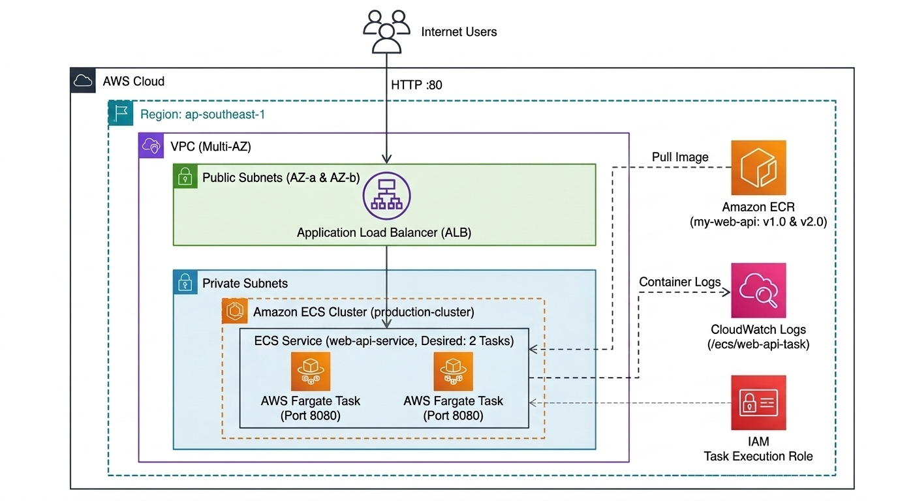
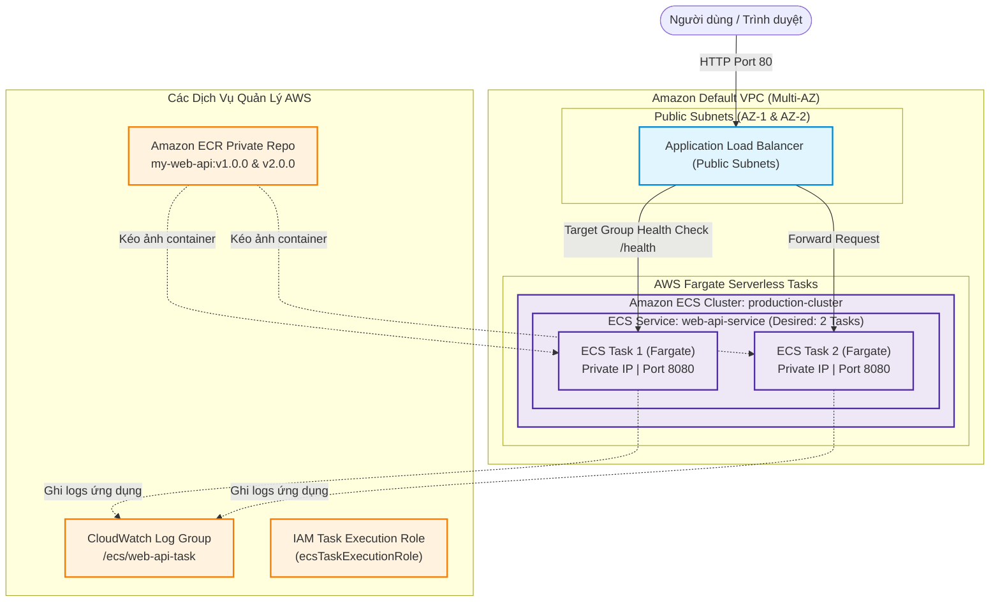

# Lab Thực hành AWS: Đóng Gói và Triển Khai Microservices Container Bằng AWS Management Console (Amazon ECR, ECS Fargate & ALB)

- **Tên bài thực hành:** Hướng dẫn từng bước triển khai ứng dụng container hóa phi máy chủ (Serverless Container) qua giao diện đồ họa **AWS Management Console**: Tạo kho chứa **Amazon ECR**, cấu hình **Application Load Balancer (ALB)**, tạo **ECS Cluster & Task Definition**, thiết lập **ECS Service on Fargate** và kiểm thử cập nhật phiên bản không gián đoạn (**Zero-Downtime Rolling Update**).
- **Phương thức thực thi:** 100% Giao diện trực quan **AWS Management Console** (Bao gồm các lệnh Docker cục bộ để build và push image lên ECR).
- **Dịch vụ AWS sử dụng:** Amazon ECR, Amazon ECS (Fargate Launch Type), Elastic Load Balancing (Application Load Balancer & Target Group), Amazon CloudWatch, AWS IAM, Amazon VPC.
- **Mức độ:** Trung cấp (Intermediate)
- **Thời lượng dự kiến:** 60 – 75 phút
- **Chi phí dự kiến:** **$0.00** (Nằm trọn vẹn trong gói AWS Free Tier).
- **Ngày thực hiện:** 2026-11-11

---

## 1. Tổng Quan Kiến Trúc & Luồng Thực Thi



*Hình 1.1: Kiến trúc triển khai Microservices trên Amazon ECS Fargate Multi-AZ qua AWS Management Console.*

Luồng tương tác chi tiết giữa các thành phần:



---

## 2. Chuẩn Bị Mã Nguồn Ứng Dụng (Cục Bộ / CloudShell)

Trước khi cấu hình trên AWS Console, chúng ta cần chuẩn bị mã nguồn ứng dụng và tệp `Dockerfile`. Bạn có thể thực hiện trên máy tính cá nhân (đã cài Docker) hoặc trên **AWS CloudShell**:

### 2.1. Tạo Thư Mục Làm Việc
```bash
mkdir -p ~/aws-ecs-lab && cd ~/aws-ecs-lab
```

### 2.2. Tạo Mã Nguồn Web API (`app.py`)
Tệp `app.py` xây dựng Web Server nhẹ bằng Python có endpoint `/health` phục vụ kiểm tra sức khỏe của ALB:
```python
import os
from http.server import BaseHTTPRequestHandler, HTTPServer
import json

APP_VERSION = os.environ.get("APP_VERSION", "v1.0.0")
PORT = int(os.environ.get("PORT", 8080))

class SimpleHandler(BaseHTTPRequestHandler):
    def do_GET(self):
        if self.path == "/health":
            self.send_response(200)
            self.send_header("Content-Type", "application/json")
            self.end_headers()
            response = {"status": "HEALTHY", "version": APP_VERSION}
            self.wfile.write(json.dumps(response).encode("utf-8"))
        elif self.path == "/":
            self.send_response(200)
            self.send_header("Content-Type", "application/json")
            self.end_headers()
            response = {
                "message": "Xin chao tu AWS ECS Fargate (Console Lab)!",
                "version": APP_VERSION,
                "container_id": os.uname().nodename
            }
            self.wfile.write(json.dumps(response, indent=2).encode("utf-8"))
        else:
            self.send_response(404)
            self.end_headers()

if __name__ == "__main__":
    server = HTTPServer(("0.0.0.0", PORT), SimpleHandler)
    print(f"Container dang khoi chay tai cong {PORT} voi phien ban {APP_VERSION}...")
    server.serve_forever()
```

### 2.3. Tạo File `Dockerfile`
```dockerfile
FROM python:3.12-alpine

WORKDIR /app

COPY app.py /app/app.py

ENV PORT=8080
ENV APP_VERSION=v1.0.0

EXPOSE 8080

CMD ["python", "app.py"]
```

---

## 3. Hướng Dẫn Từng Bước Trên AWS Management Console

### Bước 1: Tạo Amazon ECR Private Repository & Đẩy Ảnh `v1.0.0`

1. Đăng nhập vào **AWS Management Console**, chọn Region làm việc (ví dụ: **Singapore `ap-southeast-1`** hoặc **N. Virginia `us-east-1`**).
2. Tìm kiếm dịch vụ **Elastic Container Registry (ECR)** trên thanh tìm kiếm.
3. Ở menu bên trái, chọn **Repositories** $\rightarrow$ nhấn nút cam **Create repository**.
4. Cấu hình thông số:
   - **Visibility settings:** Chọn **Private**.
   - **Repository name:** Nhập `my-web-api`.
   - **Tag immutability:** Để *Disabled* (mặc định).
   - **Scan on push:** Bật sang **Enabled** (tự động quét lỗ hổng CVE khi đẩy image).
   - **KMS encryption:** Để *Disabled* (dùng mã hóa mặc định của S3/ECR).
5. Nhấn **Create repository**.
6. Trong danh sách repositories, nhấp vào `my-web-api`:
   - Bấm nút **View push commands** ở góc trên bên phải.
   - Một cửa sổ hướng dẫn xuất hiện gồm 4 câu lệnh để đăng nhập, build và push ảnh.
7. Mở Terminal máy bạn (hoặc CloudShell) trong thư mục `~/aws-ecs-lab`, chạy lần lượt:

```bash
# 1. Lấy mật khẩu đăng nhập tạm thời cho Docker client
aws ecr get-login-password --region ap-southeast-1 | docker login --username AWS --password-stdin <ACCOUNT_ID>.dkr.ecr.ap-southeast-1.amazonaws.com

# 2. Build Docker image phiên bản v1.0.0
docker build -t my-web-api:v1.0.0 .

# 3. Gắn tag trỏ về ECR URI
docker tag my-web-api:v1.0.0 <ACCOUNT_ID>.dkr.ecr.ap-southeast-1.amazonaws.com/my-web-api:v1.0.0

# 4. Đẩy image lên kho ECR
docker push <ACCOUNT_ID>.dkr.ecr.ap-southeast-1.amazonaws.com/my-web-api:v1.0.0
```

8. Quay lại Console ECR, tải lại trang, bạn sẽ thấy tag **`v1.0.0`** xuất hiện. Hãy sao chép lại đường dẫn **Image URI** (dạng `<ACCOUNT_ID>.dkr.ecr.<REGION>.amazonaws.com/my-web-api:v1.0.0`).

---

### Bước 2: Tạo IAM Task Execution Role & CloudWatch Logs

1. Tìm kiếm và truy cập dịch vụ **IAM**.
2. Chọn **Roles** ở menu bên trái $\rightarrow$ nhấn nút **Create role**.
3. **Step 1: Select trusted entity**
   - **Trusted entity type:** Chọn **AWS service**.
   - **Use case:** Tìm và chọn **Elastic Container Service** $\rightarrow$ chọn mục con **Elastic Container Service Task** $\rightarrow$ nhấn **Next**.
4. **Step 2: Add permissions**
   - Tìm kiếm policy: `AmazonECSTaskExecutionRolePolicy`.
   - Tích chọn ô vuông bên cạnh policy này $\rightarrow$ nhấn **Next**.
5. **Step 3: Name, review, and create**
   - **Role name:** Đặt tên là `ecsTaskExecutionRole-Lab06`.
   - **Description:** `Quyen cho ECS Agent keo anh ECR va day logs CloudWatch`.
   - Nhấn **Create role**.
6. Truy cập dịch vụ **CloudWatch**:
   - Chọn **Logs** $\rightarrow$ **Log groups** $\rightarrow$ nhấn **Create log group**.
   - **Log group name:** Nhập `/ecs/web-api-task`.
   - **Retention setting:** Chọn *Expire events after 1 week (7 days)*.
   - Nhấn **Create**.

---

### Bước 3: Cấu Hình Security Groups & Application Load Balancer (ALB)

#### 3.1. Tạo Security Group cho ALB và ECS Tasks (Chaining Security)
1. Truy cập dịch vụ **EC2** $\rightarrow$ menu bên trái chọn **Security Groups** $\rightarrow$ nhấn **Create security group**.
2. **Tạo SG thứ nhất (Cho Load Balancer):**
   - **Security group name:** `alb-sg-lab06`
   - **Description:** `Cho phep traffic HTTP vao ALB`
   - **VPC:** Chọn **Default VPC**.
   - **Inbound rules:** Nhấn *Add rule*:
     - *Type:* `HTTP` (Port 80) | *Source:* `Anywhere-IPv4` (`0.0.0.0/0`).
   - Nhấn **Create security group**. Sao chép mã SG ID (ví dụ: `sg-01111111111111111`).
3. **Tạo SG thứ hai (Cho ECS Fargate Tasks):**
   - Nhấn **Create security group**.
   - **Security group name:** `ecs-tasks-sg-lab06`
   - **Description:** `Chi cho phep ALB chuyen tiep traffic vao cong 8080`
   - **VPC:** Chọn **Default VPC**.
   - **Inbound rules:** Nhấn *Add rule*:
     - *Type:* `Custom TCP` | *Port range:* `8080`
     - *Source:* Chọn **Custom**, gõ tìm và chọn chính mã `alb-sg-lab06` vừa tạo ở trên.
   - Nhấn **Create security group**.

#### 3.2. Tạo Target Group Cho ECS Fargate
1. Tại menu bên trái dịch vụ EC2, chọn **Target Groups** (dưới mục Load Balancing) $\rightarrow$ nhấn **Create target group**.
2. **Step 1: Specify group details**
   - **Choose a target type:** Bắt buộc chọn **IP addresses** *(Lưu ý sống còn: Fargate bắt buộc dùng target type = IP!)*.
   - **Target group name:** `tg-ecs-lab06`
   - **Protocol:** `HTTP` | **Port:** `8080`
   - **IP address type:** `IPv4`
   - **VPC:** Chọn **Default VPC**.
   - **Health checks:**
     - *Health check protocol:* `HTTP`
     - *Health check path:* Nhập `/health`
   - Mở rộng mục **Advanced health check settings**:
     - *Healthy threshold:* `2`
     - *Unhealthy threshold:* `2`
     - *Timeout:* `5` seconds
     - *Interval:* `15` seconds
   - Nhấn **Next**.
3. **Step 2: Register targets:** Không cần thêm IP nào bằng tay (ECS Service sẽ tự động đăng ký IP của container) $\rightarrow$ Nhấn **Create target group**.

#### 3.3. Tạo Application Load Balancer
1. Tại menu bên trái, chọn **Load Balancers** $\rightarrow$ nhấn nút cam **Create load balancer**.
2. Tại mục **Application Load Balancer**, nhấn **Create**.
3. **Basic configuration:**
   - **Load balancer name:** `alb-ecs-lab06`
   - **Scheme:** `Internet-facing`
   - **IP address type:** `IPv4`
4. **Network mapping:**
   - **VPC:** Chọn **Default VPC**.
   - **Mappings (Subnets):** Tích chọn ít nhất **2 Availability Zones** (ví dụ `ap-southeast-1a` và `ap-southeast-1b`) và chọn subnet mặc định tương ứng.
5. **Security groups:**
   - Xóa bỏ default security group.
   - Chọn security group: `alb-sg-lab06`.
6. **Listeners and routing:**
   - Protocol: `HTTP` | Port: `80`
   - **Default action:** Chọn forward tới Target group `tg-ecs-lab06`.
7. Nhấn **Create load balancer**. Chờ 1–2 phút cho trạng thái chuyển sang **Active**.

---

### Bước 4: Tạo ECS Cluster & Task Definition Trên Console

#### 4.1. Tạo ECS Cluster
1. Truy cập dịch vụ **Elastic Container Service (ECS)**.
2. Tại trang **Clusters**, nhấn nút cam **Create cluster**.
3. Cấu hình:
   - **Cluster name:** `production-cluster`
   - **Infrastructure:** Tích chọn **AWS Fargate (serverless)** (bỏ chọn EC2 instances).
   - **Monitoring:** Giữ mặc định (Container Insights có thể tắt để tiết kiệm chi phí).
4. Nhấn **Create**.

#### 4.2. Tạo Task Definition
1. Tại menu bên trái của ECS, chọn **Task definitions** $\rightarrow$ nhấn **Create new task definition** $\rightarrow$ chọn **Create new task definition** (giao diện wizard).
2. **Task definition configuration:**
   - **Task definition family:** `web-api-task`
3. **Infrastructure requirements:**
   - **Launch type:** Chọn **AWS Fargate**.
   - **Operating system/Architecture:** `Linux/X86_64`.
   - **Task CPU:** `0.25 vCPU` (256).
   - **Task memory:** `0.5 GB` (512).
   - **Task execution role:** Chọn role đã tạo: `ecsTaskExecutionRole-Lab06`.
   - **Task role:** Để trống (*None*).
4. **Container - 1:**
   - **Name:** `web-api`
   - **Image URI:** Dán đường dẫn ECR Image URI đã copy ở Bước 1:  
     `<ACCOUNT_ID>.dkr.ecr.ap-southeast-1.amazonaws.com/my-web-api:v1.0.0`
   - **Essential container:** Bật *Yes*.
   - **Port mappings:**
     - *Container port:* `8080`
     - *Protocol:* `TCP`
     - *Port name:* `web-api-8080-tcp`
     - *App protocol:* `HTTP`
   - Cuộn xuống mục **Environment variables**: Nhấn *Add environment variable*:
     - *Key:* `APP_VERSION` | *Value:* `v1.0.0`
   - Cuộn xuống mục **Logging**:
     - *Use log collection:* Bật chọn.
     - *Log driver:* `awslogs`.
     - *awslogs-group:* `/ecs/web-api-task`.
     - *awslogs-region:* `ap-southeast-1`.
     - *awslogs-stream-prefix:* `ecs`.
5. Nhấn **Create**. Một Task Definition mới được tạo với phiên bản revision `web-api-task:1`.

---

### Bước 5: Khởi Tạo ECS Service Kết Nối Load Balancer

1. Quay lại menu **Clusters** $\rightarrow$ nhấp chọn cluster `production-cluster`.
2. Trong tab **Services**, nhấn nút **Create**.
3. **Environment:**
   - **Compute configuration:** Chọn **Capacity provider strategy** (hoặc chọn *Launch type* là **FARGATE**).
   - **Application type:** Chọn **Service**.
4. **Deployment configuration:**
   - **Family:** Chọn `web-api-task`.
   - **Revision:** Chọn `1 (LATEST)`.
   - **Service name:** `web-api-service`
   - **Service type:** `Replica`
   - **Desired tasks:** Nhập `2` (duy trì 2 container chạy song song).
5. **Networking:**
   - **VPC:** Chọn **Default VPC**.
   - **Subnets:** Chọn 2 subnets công khai đã chọn cho ALB ở Bước 3.
   - **Security group:** Chọn *Use an existing security group* $\rightarrow$ Chọn `ecs-tasks-sg-lab06` (Bỏ chọn default SG).
   - **Public IP:** Bắt buộc bật **Turned on** *(Vì các task chạy trong subnet công khai không có NAT Gateway, cần Public IP để kéo image từ ECR)*.
6. **Load balancing:**
   - **Load balancer type:** Chọn **Application Load Balancer**.
   - **Container:** Chọn `web-api 8080:8080`.
   - **Use an existing load balancer:** Chọn `alb-ecs-lab06`.
   - **Listener:** Chọn *Use an existing listener* $\rightarrow$ chọn cổng `80:HTTP`.
   - **Target group:** Chọn *Use an existing target group* $\rightarrow$ chọn `tg-ecs-lab06`.
7. Nhấn **Create** ở cuối trang.
8. ECS Service sẽ bắt đầu điều phối hạ tầng: Cấp phát 2 card mạng ENI Fargate, kéo ảnh từ ECR, chạy container và đăng ký 2 Private IP vào Target Group `tg-ecs-lab06`.

---

## 4. Kiểm Thử Hệ Thống & Cập Nhật Không Gián Đoạn (Rolling Update)

### 4.1. Kiểm Tra Sức Khỏe Container & Truy Cập ALB

1. Mở dịch vụ **EC2** $\rightarrow$ vào mục **Target Groups** $\rightarrow$ chọn `tg-ecs-lab06`.
2. Nhấp vào tab **Targets**:
   - Bạn sẽ thấy 2 địa chỉ IP xuất hiện trong danh sách.
   - Chờ 1–2 phút để Health Status chuyển từ `Initial` sang **`Healthy`** (màu xanh lá).
3. Chuyển sang mục **Load Balancers** $\rightarrow$ chọn `alb-ecs-lab06`.
4. Sao chép chuỗi **DNS name** (ví dụ: `alb-ecs-lab06-123456789.ap-southeast-1.elb.amazonaws.com`).
5. Mở trình duyệt web hoặc terminal, truy cập vào URL:
   ```bash
   curl http://<ALB_DNS_NAME>/
   ```
6. Gửi request nhiều lần, bạn sẽ thấy JSON trả về với `container_id` thay đổi luân phiên:
   ```json
   {
     "message": "Xin chao tu AWS ECS Fargate (Console Lab)!",
     "version": "v1.0.0",
     "container_id": "ip-172-31-15-42.ap-southeast-1.compute.internal"
   }
   ```

---

### 4.2. Thực Hiện Nâng Cấp Phiên Bản `v2.0.0` (Zero-Downtime Rolling Update)

Chúng ta sẽ nâng cấp ứng dụng lên phiên bản `v2.0.0` hoàn toàn qua Console mà người dùng bên ngoài không hề bị gián đoạn dịch vụ:

#### 1. Đẩy Docker Image `v2.0.0` Lên ECR:
Mở terminal cục bộ, chỉnh sửa biến môi trường trong file `app.py` hoặc chạy nhanh lệnh:
```bash
# Sửa version sang v2.0.0
sed -i 's/v1.0.0/v2.0.0/g' app.py Dockerfile

# Build & Push v2.0.0
docker build -t my-web-api:v2.0.0 .
docker tag my-web-api:v2.0.0 <ACCOUNT_ID>.dkr.ecr.ap-southeast-1.amazonaws.com/my-web-api:v2.0.0
docker push <ACCOUNT_ID>.dkr.ecr.ap-southeast-1.amazonaws.com/my-web-api:v2.0.0
```

#### 2. Tạo Revision Mới Của Task Definition Trên Console:
1. Vào **ECS** $\rightarrow$ **Task definitions** $\rightarrow$ nhấp chọn `web-api-task`.
2. Nhấp vào nút **Create new revision** $\rightarrow$ chọn **Create new revision**.
3. Cuộn xuống mục **Container - 1**:
   - Sửa **Image URI** thành tag mới:  
     `<ACCOUNT_ID>.dkr.ecr.ap-southeast-1.amazonaws.com/my-web-api:v2.0.0`
   - Tại mục **Environment variables**, sửa giá trị của `APP_VERSION` thành `v2.0.0`.
4. Nhấn **Create**. Một revision mới là `web-api-task:2` được tạo ra.

#### 3. Cập Nhật ECS Service:
1. Vào **Clusters** $\rightarrow$ chọn `production-cluster` $\rightarrow$ chọn tab **Services** $\rightarrow$ tích chọn `web-api-service` $\rightarrow$ nhấn nút **Update**.
2. Tại mục **Task definition revision**: Chọn **`2 (LATEST)`**.
3. Giữ nguyên mọi cài đặt khác $\rightarrow$ Nhấn **Update** ở cuối trang.

#### 4. Quan Sát Quá Trình Rolling Update:
1. Chạy vòng lặp kiểm tra liên tục trên terminal:
   ```bash
   while true; do 
       curl -s --max-time 1 "http://<ALB_DNS_NAME>/" | grep "version" || echo "TIMEOUT!"
       sleep 0.5
   done
   ```
2. Vào **ECS Console** $\rightarrow$ `production-cluster` $\rightarrow$ `web-api-service` $\rightarrow$ chọn tab **Deployments**:
   - Bạn sẽ thấy xuất hiện một Deployment mới chạy revision `web-api-task:2`.
   - ECS sẽ tự động tạo 2 Tasks mới mang bản `v2.0.0`.
   - Khi 2 Task mới đạt trạng thái `Healthy` trên Target Group, ALB mới bắt đầu chuyển tiếp lưu lượng sang bản `v2.0.0` và tắt dần 2 Task cũ `v1.0.0`.
3. Màn hình terminal sẽ chuyển đổi mượt mà từ `v1.0.0` $\rightarrow$ hỗn hợp $\rightarrow$ `v2.0.0` **mà không hề có một dòng "TIMEOUT!" nào**.

---

## 5. Quy Trình Dọn Dẹp Tài Nguyên (Clean Up Tránh Tốn Phí)

Để đảm bảo không bị phát sinh chi phí sau khi hoàn thành bài lab, hãy thực hiện xóa tài nguyên trên Console theo thứ tự chuẩn sau:

1. **Xóa ECS Service & Cluster:**
   - Vào **ECS** $\rightarrow$ `production-cluster` $\rightarrow$ chọn `web-api-service` $\rightarrow$ nhấn **Delete**. Nhập chữ `delete` để xác nhận xóa.
   - Quay lại trang **Clusters** $\rightarrow$ chọn `production-cluster` $\rightarrow$ nhấn **Delete cluster**.
2. **Xóa Load Balancer & Target Group:**
   - Vào **EC2** $\rightarrow$ **Load Balancers** $\rightarrow$ chọn `alb-ecs-lab06` $\rightarrow$ **Actions** $\rightarrow$ **Delete load balancer**.
   - Vào **Target Groups** $\rightarrow$ chọn `tg-ecs-lab06` $\rightarrow$ **Actions** $\rightarrow$ **Delete**.
3. **Xóa ECR Repository:**
   - Vào **ECR** $\rightarrow$ chọn `my-web-api` $\rightarrow$ nhấn **Delete** $\rightarrow$ gõ `delete` để xóa toàn bộ các image bên trong.
4. **Xóa Security Groups & CloudWatch Logs:**
   - Vào **EC2** $\rightarrow$ **Security Groups** $\rightarrow$ xóa lần lượt `ecs-tasks-sg-lab06` rồi đến `alb-sg-lab06`.
   - Vào **CloudWatch** $\rightarrow$ **Log groups** $\rightarrow$ chọn `/ecs/web-api-task` $\rightarrow$ **Actions** $\rightarrow$ **Delete log group(s)**.

---

## 6. Đúc Kết Kiến Thức Vận Hành

> **3 điểm cốt lõi khi triển khai ECS Fargate qua Console:**
> 1. **Target Type là IP:** Khác với EC2 truyền thống (dùng Target type = Instance), AWS Fargate cấp phát IP riêng (awsvpc mode) cho từng task nên Target Group **bắt buộc phải là IP addresses**.
> 2. **Cơ chế Chaining Security Group:** Tuyệt đối không mở cổng 8080 của Tasks ra toàn mạng Internet. Hãy thiết lập Inbound rule của Tasks SG chỉ chấp nhận nguồn từ chính `alb-sg-lab06`.
> 3. **Tự động hóa Zero-Downtime:** Nhờ việc định cấu hình `/health` endpoint trên Target Group kết hợp với Rolling Update deployment, AWS ECS tự động bảo vệ hệ thống không bao giờ bị downtime khi phát hành phiên bản mới.
