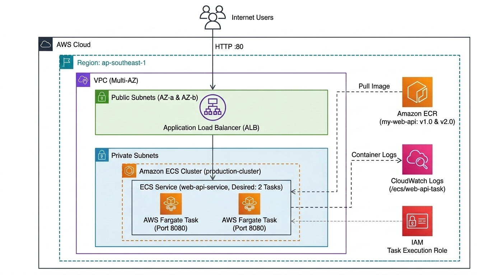
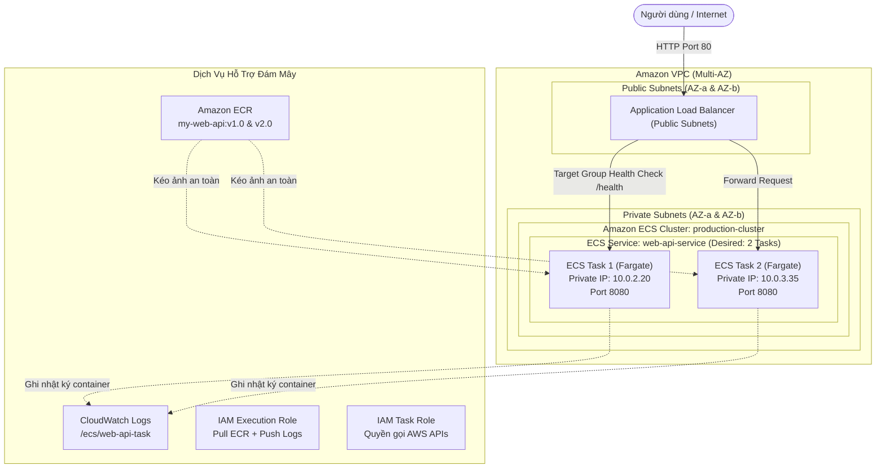

# Lab Thực hành AWS: Đóng Gói và Triển Khai Microservices Container với Amazon ECR, Amazon ECS (AWS Fargate) và Application Load Balancer

- **Tên bài thực hành:** Đóng gói ứng dụng web Container (Docker), lưu trữ an toàn trên Amazon ECR, điều phối phi máy chủ (Serverless Container Orchestration) trên Amazon ECS Fargate, phân phối tải với Application Load Balancer (ALB) và kiểm thử cập nhật phiên bản không gián đoạn (Zero-Downtime Rolling Update).
- **Dịch vụ AWS sử dụng:** Amazon ECR (Private Repository, Lifecycle Policy), Amazon ECS (Cluster, Task Definition, Service, Fargate Launch Type), Elastic Load Balancing (Application Load Balancer, Target Group), Amazon CloudWatch (Logs, Container Metrics), AWS IAM (Task Role vs Task Execution Role).
- **Mức độ:** Trung cấp (Intermediate)
- **Thời lượng dự kiến:** 60 – 75 phút
- **Chi phí dự kiến:** **$0.00** (Nằm trong hạn mức AWS Free Tier: ECR 500MB/tháng, ALB 750 giờ/tháng, CloudWatch 5GB logs).
- **Ngày thực hiện:** 2026-11-02

---

## 1. Tổng Quan Kiến Trúc & Mục Tiêu Bài Lab

### 1.1. Bối Cảnh Thực Tế Doanh Nghiệp
Hầu hết các doanh nghiệp hiện đại đang chuyển dịch từ mô hình chạy ứng dụng trực tiếp trên máy ảo (EC2) sang mô hình **Container hóa (Microservices)**. Tuy nhiên, việc tự quản lý cụm máy ảo EC2 làm Worker Nodes đòi hỏi kỹ sư phải liên tục vá lỗi hệ điều hành, cấu hình Auto Scaling hai tầng phức tạp.

Bài lab này mô phỏng kịch bản chuẩn Production:
1. Đóng gói một ứng dụng Python Web API kèm endpoint kiểm tra sức khỏe (`/health`) bằng Docker.
2. Đẩy và quản lý phiên bản ảnh Docker an toàn trên **Amazon ECR** với xác thực IAM không mật khẩu.
3. Triển khai cụm container phi máy chủ với **Amazon ECS on AWS Fargate** (không cần quản lý bất kỳ máy ảo EC2 nào).
4. Đứng trước một **Application Load Balancer (ALB)** Multi-AZ để phân phối lưu lượng và tự động loại bỏ các container bị lỗi.
5. Thực hiện cập nhật ứng dụng lên phiên bản mới (`v2.0`) bằng cơ chế **Rolling Update** mà không làm rớt bất kỳ kết nối nào của người dùng (Zero-Downtime).

---

### 1.2. Sơ Đồ Kiến Trúc Hệ Thống (Architecture Diagram)



*Hình 1.1: Kiến trúc triển khai Microservices trên Amazon ECS Fargate Multi-AZ kết hợp Amazon ECR, Application Load Balancer và CloudWatch Logs.*

Luồng tương tác chi tiết giữa các thành phần:



---

## 2. Chuẩn Bị & Thiết Kế Ứng Dụng (Codebase)

### 2.1. Cấu Trúc Thư Mục Cục Bộ
Tạo thư mục làm việc cho ứng dụng container:
```bash
mkdir -p ~/aws-ecs-lab && cd ~/aws-ecs-lab
```

### 2.2. Viết Mã Nguồn Python Web API (`app.py`)
Tạo file `app.py` sử dụng thư viện nhẹ `http.server` hoặc `Flask` để phục vụ request:
```python
import os
from http.server import BaseHTTPRequestHandler, HTTPServer
import json

APP_VERSION = os.environ.get("APP_VERSION", "v1.0.0")
PORT = int(os.environ.get("PORT", 8080))

class SimpleHandler(BaseHTTPRequestHandler):
    def do_GET(self):
        if self.path == "/health":
            self.send_response(200)
            self.send_header("Content-Type", "application/json")
            self.end_headers()
            response = {"status": "HEALTHY", "version": APP_VERSION}
            self.wfile.write(json.dumps(response).encode("utf-8"))
        elif self.path == "/":
            self.send_response(200)
            self.send_header("Content-Type", "application/json")
            self.end_headers()
            response = {
                "message": "Xin chao tu AWS ECS Fargate!",
                "version": APP_VERSION,
                "container_id": os.uname().nodename
            }
            self.wfile.write(json.dumps(response, indent=2).encode("utf-8"))
        else:
            self.send_response(404)
            self.end_headers()

if __name__ == "__main__":
    server = HTTPServer(("0.0.0.0", PORT), SimpleHandler)
    print(f"Container dang khoi chay tai cong {PORT} voi phien ban {APP_VERSION}...")
    server.serve_forever()
```

### 2.3. Tạo File `Dockerfile` Chuẩn Tối Ưu
Sử dụng base image Python tối giản (Alpine) để tối ưu dung lượng và giảm thời gian pull ảnh trên ECS:
```dockerfile
FROM python:3.12-alpine

WORKDIR /app

COPY app.py /app/app.py

ENV PORT=8080
ENV APP_VERSION=v1.0.0

EXPOSE 8080

CMD ["python", "app.py"]
```

---

## 3. Các Bước Triển Khai Thực Hành Chi Tiết

### Bước 1: Khởi Tạo Amazon ECR Private Repository & Đẩy Ảnh Container

#### 1.1. Tạo kho chứa ECR bằng AWS CLI:
```bash
AWS_REGION="ap-southeast-1"
REPO_NAME="my-web-api"

# 1. Tạo ECR Repository
aws ecr create-repository \
    --repository-name $REPO_NAME \
    --image-scanning-configuration scanOnPush=true \
    --region $AWS_REGION

# Lấy URL của ECR Repo
ACCOUNT_ID=$(aws sts get-caller-identity --query "Account" --output text)
ECR_URI="${ACCOUNT_ID}.dkr.ecr.${AWS_REGION}.amazonaws.com/${REPO_NAME}"
echo "ECR URI cua ban: $ECR_URI"
```

#### 1.2. Build và Đẩy Docker Image phiên bản `v1.0.0`:
```bash
# 2. Đăng nhập Docker client vào AWS ECR thông qua token tạm thời
aws ecr get-login-password --region $AWS_REGION | docker login --username AWS --password-stdin ${ACCOUNT_ID}.dkr.ecr.${AWS_REGION}.amazonaws.com

# 3. Build Docker image
docker build -t ${REPO_NAME}:v1.0.0 .

# 4. Gắn tag ECR
docker tag ${REPO_NAME}:v1.0.0 ${ECR_URI}:v1.0.0

# 5. Push image lên ECR
docker push ${ECR_URI}:v1.0.0
```

---

### Bước 2: Thiết Lập IAM Roles & CloudWatch Logs

ECS Tasks cần hai IAM Role độc lập với nguyên tắc phân quyền tối thiểu (Least Privilege):

#### 2.1. Tạo IAM Task Execution Role:
Role này cho phép ECS Agent kéo ảnh từ ECR và ghi log vào CloudWatch:
```bash
# Tạo Policy Document cho phép ECS assume role
cat <<EOF > ecs-trust-policy.json
{
  "Version": "2012-10-17",
  "Statement": [
    {
      "Effect": "Allow",
      "Principal": { "Service": "ecs-tasks.amazonaws.com" },
      "Action": "sts:AssumeRole"
    }
  ]
}
EOF

aws iam create-role \
    --role-name ecsTaskExecutionRole-Lab06 \
    --assume-role-policy-document file://ecs-trust-policy.json

# Đính kèm chính sách được quản lý sẵn của AWS
aws iam attach-role-policy \
    --role-name ecsTaskExecutionRole-Lab06 \
    --policy-arn arn:aws:iam::aws:policy/service-role/AmazonECSTaskExecutionRolePolicy

EXEC_ROLE_ARN="arn:aws:iam::${ACCOUNT_ID}:role/ecsTaskExecutionRole-Lab06"
```

#### 2.2. Tạo CloudWatch Log Group:
```bash
aws logs create-log-group \
    --log-group-name /ecs/web-api-task \
    --region $AWS_REGION
```

---

### Bước 3: Thiết Lập Hạ Tầng Mạng & Application Load Balancer (ALB)

#### 3.1. Thu thập thông tin VPC và Subnets:
```bash
# Lấy Default VPC (hoặc VPC tùy chọn)
VPC_ID=$(aws ec2 describe-vpcs --filters "Name=isDefault,Values=true" --query "Vpcs[0].VpcId" --output text)

# Lấy 2 Subnet ở 2 AZ khác nhau (đáp ứng điều kiện Multi-AZ của ALB)
SUBNET_1=$(aws ec2 describe-subnets --filters "Name=vpc-id,Values=$VPC_ID" --query "Subnets[0].SubnetId" --output text)
SUBNET_2=$(aws ec2 describe-subnets --filters "Name=vpc-id,Values=$VPC_ID" --query "Subnets[1].SubnetId" --output text)
```

#### 3.2. Tạo Security Groups (Security Group Chaining):
1. **ALB Security Group:** Mở cổng 80 cho Internet.
2. **ECS Tasks Security Group:** Chỉ cho phép nhận traffic cổng 8080 từ chính ALB Security Group.

```bash
# 1. Tạo ALB SG
ALB_SG=$(aws ec2 create-security-group \
    --group-name alb-sg-lab06 \
    --description "Cho phep Internet truy cap ALB port 80" \
    --vpc-id $VPC_ID --query "GroupId" --output text)

aws ec2 authorize-security-group-ingress \
    --group-id $ALB_SG --protocol tcp --port 80 --cidr 0.0.0.0/0

# 2. Tạo ECS Tasks SG
TASKS_SG=$(aws ec2 create-security-group \
    --group-name ecs-tasks-sg-lab06 \
    --description "Chi cho phep ALB gui traffic vao port 8080" \
    --vpc-id $VPC_ID --query "GroupId" --output text)

aws ec2 authorize-security-group-ingress \
    --group-id $TASKS_SG --protocol tcp --port 8080 --source-group $ALB_SG
```

#### 3.3. Tạo Application Load Balancer & Target Group:
```bash
# 1. Tạo Target Group với Target Type = IP (Bắt buộc cho AWS Fargate)
TG_ARN=$(aws elbv2 create-target-group \
    --name tg-ecs-lab06 \
    --protocol HTTP \
    --port 8080 \
    --vpc-id $VPC_ID \
    --target-type ip \
    --health-check-path /health \
    --health-check-interval-seconds 15 \
    --healthy-threshold-count 2 \
    --unhealthy-threshold-count 2 \
    --query "TargetGroups[0].TargetGroupArn" --output text)

# 2. Tạo ALB
ALB_ARN=$(aws elbv2 create-load-balancer \
    --name alb-ecs-lab06 \
    --subnets $SUBNET_1 $SUBNET_2 \
    --security-groups $ALB_SG \
    --query "LoadBalancers[0].LoadBalancerArn" --output text)

# Chờ ALB sẵn sàng
aws elbv2 wait load-balancer-available --load-balancer-arns $ALB_ARN

# 3. Tạo Listener chuyển tiếp cổng 80 vào Target Group
aws elbv2 create-listener \
    --load-balancer-arn $ALB_ARN \
    --protocol HTTP \
    --port 80 \
    --default-actions Type=forward,TargetGroupArn=$TG_ARN
```

---

### Bước 4: Khởi Tạo Amazon ECS Cluster & Triển Khai Service Trên Fargate

#### 4.1. Tạo ECS Cluster:
```bash
aws ecs create-cluster --cluster-name production-cluster --region $AWS_REGION
```

#### 4.2. Khai báo Task Definition (`task-def.json`):
```bash
cat <<EOF > task-def.json
{
  "family": "web-api-task",
  "networkMode": "awsvpc",
  "requiresCompatibilities": ["FARGATE"],
  "cpu": "256",
  "memory": "512",
  "executionRoleArn": "${EXEC_ROLE_ARN}",
  "containerDefinitions": [
    {
      "name": "web-api",
      "image": "${ECR_URI}:v1.0.0",
      "essential": true,
      "portMappings": [
        {
          "containerPort": 8080,
          "hostPort": 8080,
          "protocol": "tcp"
        }
      ],
      "environment": [
        { "name": "APP_VERSION", "value": "v1.0.0" }
      ],
      "logConfiguration": {
        "logDriver": "awslogs",
        "options": {
          "awslogs-group": "/ecs/web-api-task",
          "awslogs-region": "${AWS_REGION}",
          "awslogs-stream-prefix": "ecs"
        }
      }
    }
  ]
}
EOF

# Đăng ký Task Definition
aws ecs register-task-definition --cli-input-json file://task-def.json
```

#### 4.3. Tạo ECS Service duy trì 2 Tasks:
```bash
aws ecs create-service \
    --cluster production-cluster \
    --service-name web-api-service \
    --task-definition web-api-task \
    --desired-count 2 \
    --launch-type FARGATE \
    --network-configuration "awsvpcConfiguration={subnets=[$SUBNET_1,$SUBNET_2],securityGroups=[$TASKS_SG],assignPublicIp=ENABLED}" \
    --load-balancers "targetGroupArn=$TG_ARN,containerName=web-api,containerPort=8080"
```

---

## 4. Kiểm Thử Hệ Thống & Cập Nhật Không Gián Đoạn (Rolling Update)

### 4.1. Kiểm Thử Hoạt Động & Cân Bằng Tải
Lấy DNS Name của Application Load Balancer:
```bash
ALB_DNS=$(aws elbv2 describe-load-balancers --load-balancer-arns $ALB_ARN --query "LoadBalancers[0].DNSName" --output text)
echo "Truy cap website qua ALB: http://${ALB_DNS}"
```

Gửi liên tục 5 requests để kiểm chứng ALB phân bổ đều giữa các Tasks:
```bash
for i in {1..5}; do curl -s "http://${ALB_DNS}/" | grep -E "version|container_id"; echo "---"; sleep 1; done
```
*Kết quả quan sát được:* Trường `container_id` thay đổi luân phiên giữa các Task IDs, chứng minh ALB phân phối tải thành công qua 2 container Fargate.

---

### 4.2. Kịch Bản Thử Nghiệm: Cập Nhật Phiên Bản `v2.0.0` (Zero-Downtime Rolling Update)

Doanh nghiệp phát hành bản nâng cấp giao diện `v2.0.0`. ECS sẽ thực hiện chiến lược Rolling Update: khởi tạo Task mới `v2.0.0`, chờ Target Group Health Check báo `Healthy`, sau đó mới tắt dần Task cũ `v1.0.0`.

#### 1. Sửa code `app.py` và build ảnh `v2.0.0`:
```bash
# Đổi biến phiên bản
sed -i 's/v1.0.0/v2.0.0/g' app.py Dockerfile

# Build & Push v2.0.0 lên ECR
docker build -t ${REPO_NAME}:v2.0.0 .
docker tag ${REPO_NAME}:v2.0.0 ${ECR_URI}:v2.0.0
docker push ${ECR_URI}:v2.0.0
```

#### 2. Cập nhật Task Definition lên Revision mới:
```bash
sed -i 's/v1.0.0/v2.0.0/g' task-def.json
aws ecs register-task-definition --cli-input-json file://task-def.json
```

#### 3. Kích hoạt cập nhật ECS Service:
```bash
aws ecs update-service \
    --cluster production-cluster \
    --service-name web-api-service \
    --task-definition web-api-task
```

#### 4. Chạy script kiểm tra Zero-Downtime:
Chạy vòng lặp gửi request liên tục mỗi 0.5 giây trong suốt quá trình triển khai:
```bash
while true; do 
    curl -s --max-time 1 "http://${ALB_DNS}/" | grep "version" || echo "REQUEST TIMEOUT!"
    sleep 0.5
done
```
*Kết quả thực nghiệm:*
- Trong suốt 2 phút cập nhật, **không có bất kỳ request nào bị timeout hay lỗi 502/503**.
- Ban đầu 100% trả về `v1.0.0` $\rightarrow$ Chuyển dần sang hỗn hợp `v1.0.0` & `v2.0.0` $\rightarrow$ Kết thúc với 100% `v2.0.0`.

---

## 5. Dọn Dẹp Tài Nguyên (Clean Up)

Sau khi hoàn thành bài lab, tiến hành hủy tài nguyên theo thứ tự ngược lại để tránh phát sinh chi phí:
```bash
# 1. Giảm desired count về 0 và xóa ECS Service
aws ecs update-service --cluster production-cluster --service-name web-api-service --desired-count 0
aws ecs delete-service --cluster production-cluster --service-name web-api-service --force

# 2. Xóa ECS Cluster
aws ecs delete-cluster --cluster production-cluster

# 3. Xóa Listener, ALB và Target Group
LISTENER_ARN=$(aws elbv2 describe-listeners --load-balancer-arn $ALB_ARN --query "Listeners[0].ListenerArn" --output text)
aws elbv2 delete-listener --listener-arn $LISTENER_ARN
aws elbv2 delete-load-balancer --load-balancer-arn $ALB_ARN
aws elbv2 delete-target-group --target-group-arn $TG_ARN

# 4. Xóa ECR Repository (bao gồm toàn bộ ảnh)
aws ecr delete-repository --repository-name $REPO_NAME --force

# 5. Xóa Security Groups & CloudWatch Logs
aws ec2 delete-security-group --group-id $TASKS_SG
aws ec2 delete-security-group --group-id $ALB_SG
aws logs delete-log-group --log-group-name /ecs/web-api-task
```

---

## 6. Bài Học Kinh Nghiệm & Đúc Kết Kiến Thức

> **3 điểm cốt lõi kỹ sư Cloud cần nắm vững:**
> 1. **Fargate Target Type:** Khi kết nối ECS Fargate với Application Load Balancer, Target Group **bắt buộc phải cấu hình `target-type = ip`** (không dùng `instance` vì Fargate không có instance ID).
> 2. **Phân quyền IAM 2 tầng:**
>    - `Task Execution Role`: Quyền của tầng hạ tầng AWS (kéo ảnh từ ECR, đẩy log vào CloudWatch).
>    - `Task Role`: Quyền của tầng ứng dụng chạy trong container (truy vấn S3, DynamoDB, SQS).
> 3. **Rolling Update an toàn:** Thiết lập `/health` endpoint độc lập với logic nghiệp vụ giúp ALB tự động rút các Task lỗi ra khỏi mạng lưới phân phối trước khi người dùng bị ảnh hưởng.
