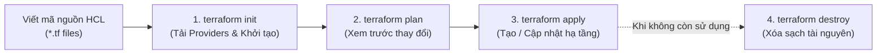

# Terraform Cơ Bản #01: Tổng Quan IaC, Cài Đặt & Ngôn Ngữ HCL

Nếu bạn từng phải bấm tay hàng chục bước trên AWS Console (thường gọi là **ClickOps**) để dựng một môi trường VPC, Subnet, Security Group rồi EC2, hẳn bạn đã từng gặp ít nhất một trong các tình huống sau:
- Dựng xong môi trường **Dev**, đến lúc dựng **Staging** hoặc **Prod** lại quên mất mình đã tích chọn option nào, dẫn đến lỗi *"chạy được ở Dev nhưng sập ở Prod"*.
- Một thành viên trong team vô tình sửa rule trên giao diện web mà không ai hay biết, không có lịch sử để `git diff` hay rollback.
- Khi cần xóa toàn bộ hạ tầng test để tiết kiệm chi phí, bạn phải dò lại từng dịch vụ để xóa thủ công và rất dễ bỏ sót tài nguyên chạy ngầm.

Đó chính là lý do **Infrastructure as Code (IaC)** và **Terraform** ra đời.

---

## 1. Khái niệm nền tảng

### 1.1. IaC (Infrastructure as Code) là gì?

**IaC (Infrastructure as Code)** hiểu đơn giản là phương pháp **định nghĩa, cấp phát (provision) và quản lý hạ tầng công nghệ thông tin bằng mã nguồn** thay vì thao tác thủ công trên giao diện đồ họa.

Trong lĩnh vực Cloud Computing và DevOps, IaC cho phép bạn mô tả toàn bộ máy chủ, mạng (VPC, Subnet), bộ nhớ lưu trữ, cơ sở dữ liệu, quyền hạn IAM... thông qua các tệp cấu hình mà máy tính có thể đọc và thực thi tự động. Nhờ coi hạ tầng như mã nguồn phần mềm, bạn có thể:
- Lưu trữ cấu hình trên **Git** để theo dõi lịch sử thay đổi (audit trail).
- **Code Review** (Pull Request) trước khi thay đổi hạ tầng thực tế.
- Tái sử dụng và nhân bản môi trường (Dev / Staging / Prod) giống hệt nhau chỉ với một vài lệnh.

### 1.2. Tư duy Declarative (Khai báo) vs. Imperative (Mệnh lệnh)

Để hiểu sức mạnh của Terraform, cần phân biệt hai cách tiếp cận khi tự động hóa hạ tầng:

| Tiêu chí | Imperative (Mệnh lệnh) | Declarative (Khai báo) |
| :--- | :--- | :--- |
| **Cách viết** | Chỉ rõ **từng bước phải làm gì** (*How*) theo đúng thứ tự. | Chỉ mô tả **trạng thái cuối cùng mong muốn** (*What*). |
| **Ví dụ công cụ** | Bash Script, AWS CLI, Python Boto3. | **Terraform**, AWS CloudFormation, Kubernetes YAML. |
| **Xử lý thay đổi** | Nếu chạy lại script lần 2, dễ bị lỗi "tài nguyên đã tồn tại" nếu không tự viết logic `if/else` kiểm tra. | Công cụ tự so sánh trạng thái hiện tại với code và chỉ cập nhật phần chênh lệch (Idempotent). |

Terraform đi theo hướng **Declarative**: bạn chỉ cần khai báo *"Tôi muốn có 2 máy chủ EC2 loại t3.micro nằm trong VPC này"*, Terraform sẽ tự tính toán thứ tự tạo tài nguyên phụ thuộc và giữ cho hạ tầng thực tế khớp với bản khai báo.

### 1.3. IaC vs. CaC (Terraform vs. Ansible)

Người mới học DevOps thường nhầm lẫn giữa **IaC (Infrastructure as Code)** và **CaC (Configuration as Code)**:

- **IaC (Infrastructure as Code):** Tập trung vào việc **cấp phát và quản lý lớp hạ tầng nền** như máy ảo (VM/EC2), mạng (VPC, Load Balancer), lưu trữ (S3, EBS), cơ sở dữ liệu (RDS)... Công cụ tiêu biểu: **Terraform**, OpenTofu, Pulumi.
- **CaC (Configuration as Code):** Tập trung vào việc **cấu hình bên trong hệ điều hành/máy chủ đã có sẵn**, chẳng hạn như cài đặt gói phần mềm (Nginx, Docker), đẩy file cấu hình, khởi động service, vá lỗi OS. Công cụ tiêu biểu: **Ansible**, Chef, Puppet.

> [!TIP]
> Trong thực tế sản xuất, **Terraform và Ansible không thay thế nhau mà bổ trợ cho nhau**: dùng Terraform để dựng máy chủ, mạng, Load Balancer; sau đó dùng Ansible để cài đặt và cấu hình phần mềm bên trong các máy chủ đó.

---

## 2. Terraform là gì & Luồng làm việc cốt lõi

### 2.1. Tổng quan về Terraform

**Terraform** là một công cụ IaC mã nguồn mở (phát triển bởi HashiCorp) cho phép bạn khởi tạo, quản lý và cập nhật hạ tầng một cách an toàn và nhất quán trên nhiều nền tảng đám mây (**Multi-Cloud**) như AWS, Google Cloud, Azure, Kubernetes, Cloudflare... chỉ với một quy trình làm việc thống nhất.

**Những lợi ích nổi bật của Terraform:**
1. **Quản lý Multi-Cloud thống nhất:** Dùng chung một cú pháp HCL để làm việc với AWS, GCP, Azure, GitHub, Cloudflare... thông qua hệ sinh thái **Providers** phong phú.
2. **Đảm bảo tính nhất quán (Consistency):** Loại bỏ hiện tượng lệch cấu hình giữa các môi trường Dev, Staging, Production và giữa các team khác nhau.
3. **Tái tạo nhanh & Giảm thiểu lỗi con người:** Triển khai hàng chục tài nguyên phức tạp trong vài phút thay vì bấm tay dễ nhầm lẫn.
4. **Xem trước tác động (`plan`) trước khi áp dụng:** Cho phép kiểm tra chính xác những gì sắp được tạo mới, sửa đổi hay xóa bỏ trước khi chạm vào hạ tầng thật.
5. **Nhật ký kiểm toán rõ ràng:** Mọi thay đổi đều đi qua Git commit và Pull Request.

### 2.2. Vòng đời làm việc chuẩn của Terraform

Mọi dự án Terraform đều xoay quanh 4 lệnh cốt lõi sau:



- `terraform init`: Khởi tạo thư mục làm việc, tải các plugin **Provider** (ví dụ: `aws`, `local`, `docker`) được khai báo trong code.
- `terraform plan`: Tạo bản kế hoạch thực thi (Execution Plan) — so sánh code `.tf` với trạng thái hiện tại để báo cho bạn biết tài nguyên nào sẽ thêm (`+`), sửa (`~`), hoặc xóa (`-`). **Chưa làm thay đổi hạ tầng thật.**
- `terraform apply`: Thực thi kế hoạch để tạo hoặc cập nhật hạ tầng thực tế và lưu lại trạng thái vào file `terraform.tfstate`.
- `terraform destroy`: Xóa toàn bộ tài nguyên đang được Terraform quản lý trong dự án (cực kỳ hữu ích khi dọn dẹp môi trường lab).

---

## 3. Hướng dẫn cài đặt Terraform

Chọn hệ điều hành bạn đang sử dụng để cài đặt Terraform CLI:

#### 3.1. Linux (Ubuntu / Debian)

Cài đặt thông qua kho lưu trữ chính thức của HashiCorp:

```bash
sudo apt-get update && sudo apt-get install -y gnupg software-properties-common

wget -O- https://apt.releases.hashicorp.com/gpg | \
  gpg --dearmor | \
  sudo tee /usr/share/keyrings/hashicorp-archive-keyring.gpg > /dev/null

echo "deb [signed-by=/usr/share/keyrings/hashicorp-archive-keyring.gpg] \
  https://apt.releases.hashicorp.com $(lsb_release -cs) main" | \
  sudo tee /etc/apt/sources.list.d/hashicorp.list

sudo apt-get update && sudo apt-get install -y terraform
```

#### 3.2. macOS (Homebrew)

```bash
brew tap hashicorp/tap
brew install hashicorp/tap/terraform
```

#### 3.3. Windows

Mở PowerShell (quyền Administrator) và cài bằng `winget` (hoặc `choco install terraform`):

```powershell
winget install Hashicorp.Terraform
```

#### 3.4. Kiểm tra sau cài đặt

Mở terminal mới và chạy lệnh sau để xác nhận Terraform đã sẵn sàng:

```bash
terraform -version
```

Nếu màn hình hiển thị phiên bản (ví dụ `Terraform v1.x.x`), bạn đã cài đặt thành công.

---

## 4. Giới thiệu ngôn ngữ cấu hình HCL

### 4.1. HCL là gì?

**HCL (HashiCorp Configuration Language)** là ngôn ngữ cấu hình có cấu trúc được HashiCorp thiết kế để cân bằng giữa việc **dễ đọc/viết với con người** và **dễ phân tích với máy móc** (tương thích hoàn toàn với JSON). Terraform sử dụng các tệp có đuôi `.tf` viết bằng HCL để mô tả hạ tầng.

### 4.2. Giải phẫu cú pháp một Block HCL

Mỗi file `.tf` được cấu thành từ các **Blocks** (khối lệnh) và **Arguments** (tham số `key = value`):

```hcl
<block_type> "<label_1>" "<label_2>" {
  # Phần thân của block chứa các arguments
  argument_1 = "value_1"
  argument_2 = 123
}
```

Trong đó, 4 loại block phổ biến nhất bạn sẽ gặp ở mọi dự án Terraform là:

1. `terraform { ... }`: Cấu hình phiên bản Terraform và danh sách `required_providers`.
2. `provider "<tên>" { ... }`: Khai báo nhà cung cấp dịch vụ (ví dụ `aws` kèm `region`).
3. `resource "<loại_tài_nguyên>" "<tên_nội_bộ>" { ... }`: Khai báo một tài nguyên thực tế cần tạo (ví dụ `aws_instance`, `aws_s3_bucket`, `local_file`).
4. `output "<tên>" { ... }`: Xuất giá trị ra màn hình sau khi `apply` thành công (ví dụ: Public IP, URL).

### 4.3. Các kiểu dữ liệu & Comment cơ bản

HCL hỗ trợ đầy đủ các kiểu dữ liệu quen thuộc:

```hcl
# Comment một dòng dùng dấu # (phổ biến nhất trong Terraform)
// Hoặc dùng hai dấu gạch chéo
/*
  Comment nhiều dòng
  dùng cặp dấu này
*/

# 1. String (Chuỗi)
region = "ap-southeast-1"

# 2. Number (Số)
instance_count = 2

# 3. Boolean (Đúng / Sai)
enable_monitoring = true

# 4. List (Danh sách)
availability_zones = ["ap-southeast-1a", "ap-southeast-1b"]

# 5. Map (Cặp key-value)
tags = {
  Environment = "Dev"
  Owner       = "James"
}
```

### 4.4. Ví dụ đầu tiên chạy được ngay (Local File)

Để làm quen nhanh với luồng `init → plan → apply → destroy` mà chưa cần tài khoản Cloud hay lo tốn phí, hãy thử tạo một file văn bản trên máy cục bộ bằng provider `hashicorp/local`.

Tạo thư mục mới và file `main.tf`:

```bash
mkdir terraform-hello-world && cd terraform-hello-world
```

Nội dung file `main.tf`:

```hcl
terraform {
  required_version = ">= 1.5.0"

  required_providers {
    local = {
      source  = "hashicorp/local"
      version = "~> 2.5"
    }
  }
}

resource "local_file" "hello_terraform" {
  filename = "${path.module}/hello.txt"
  content  = "Xin chào Terraform! Đây là tài nguyên đầu tiên được tạo bằng IaC."
}

output "created_file_path" {
  description = "Đường dẫn tệp vừa được Terraform tạo"
  value       = local_file.hello_terraform.filename
}
```

Bây giờ, chạy tuần tự 4 lệnh cốt lõi để quan sát:

```bash
# 1. Tải provider hashicorp/local
terraform init

# 2. Xem trước kế hoạch (sẽ thấy + create local_file.hello_terraform)
terraform plan

# 3. Thực thi tạo file (nhập 'yes' khi được hỏi)
terraform apply

# Kiểm tra file hello.txt đã xuất hiện chưa
cat hello.txt

# 4. Dọn dẹp: xóa file hello.txt thông qua Terraform
terraform destroy
```

---

## 5. Tổng kết & Bài tiếp theo

Trong bài mở đầu này, chúng ta đã nắm được:
- **IaC** giúp quản lý hạ tầng bằng code, khắc phục rủi ro của thao tác tay (ClickOps) và phân biệt rõ **IaC (Terraform)** với **CaC (Ansible)**.
- Tư duy **Declarative** và vòng đời 4 bước chuẩn của Terraform: `init` → `plan` → `apply` → `destroy`.
- Cách cài đặt Terraform CLI trên Linux/macOS/Windows và giải phẫu cú pháp cơ bản của **HCL** qua ví dụ chạy thực tế.

👉 **Ở bài tiếp theo (Terraform Cơ Bản #02):** Chúng ta sẽ tìm hiểu sâu về **Terraform State (`terraform.tfstate`)**, cách sử dụng **Variables & Outputs** để tách biệt cấu hình, và thực hành cấp phát tài nguyên thật trên **AWS**.
