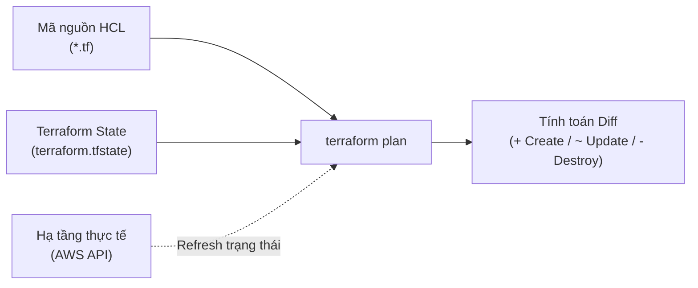

# Terraform Cơ Bản #02: Quản Lý State, Variables, Outputs & Triển Khai Hạ Tầng AWS

Ở [Bài #01](/james-blog/blog/iac-cicd/terraform/terraform-co-ban-01-tong-quan-iac-va-hcl), chúng ta đã làm quen với tư duy IaC, vòng đời `init → plan → apply → destroy` và cú pháp HCL qua ví dụ tạo tệp cục bộ `local_file`.

Tuy nhiên, để áp dụng Terraform vào công việc thực tế và triển khai lên Cloud (như AWS), bạn không thể viết cứng (hardcode) mọi giá trị vào một tệp `main.tf` duy nhất. Trong **Bài #02 — phần hoàn kết của series Terraform Cơ bản**, chúng ta sẽ hoàn thiện 4 mảnh ghép còn lại:
1. Hiểu bản chất **Terraform State (`terraform.tfstate`)** — bộ nhớ của Terraform.
2. Tham số hóa mã nguồn bằng **Variables, Locals & Outputs**.
3. Truy vấn tài nguyên có sẵn bằng **Data Sources** và hiểu cơ chế phụ thuộc.
4. **Thực hành End-to-End:** Dựng một máy chủ Web EC2 (Nginx) trên **AWS Free Tier** theo cấu trúc thư mục chuẩn dự án thực tế.

---

## 1. Terraform State (`terraform.tfstate`) — "Bộ nhớ" của Terraform

Khi bạn chạy `terraform apply` ở Bài #01, Terraform tự động sinh ra một tệp tên là `terraform.tfstate` cùng thư mục. Đây là thành phần quan trọng nhất nhưng cũng dễ gây sự cố nhất nếu không hiểu rõ.

### 1.1. Terraform State dùng để làm gì?

Terraform là công cụ **Declarative** — nó cần biết hiện tại trên Cloud đang có gì để so sánh với code `.tf` của bạn. Tệp `terraform.tfstate` (định dạng JSON) đảm nhiệm 3 vai trò:
- **Ánh xạ (Mapping):** Ghi nhớ `resource "aws_instance" "web"` trong code tương ứng với Instance ID nào trên AWS (ví dụ: `i-0a1b2c3d4e5f67890`).
- **Theo dõi Metadata & Dependencies:** Lưu lại thứ tự phụ thuộc để khi chạy `terraform destroy`, Terraform biết phải xóa EC2 trước rồi mới xóa Security Group hay VPC.
- **Tối ưu hiệu năng (`plan`):** Với hạ tầng lớn, Terraform đọc trạng thái từ State để tính toán thay đổi nhanh chóng trước khi đối chiếu lại với Cloud API.



### 1.2. Local State vs. Remote State (Làm việc nhóm)

- **Local State (Mặc định):** Lưu `terraform.tfstate` ngay trên máy cá nhân. Chỉ phù hợp khi tự học hoặc lab cá nhân. Nếu làm việc nhóm, người A chạy `apply` xong nhưng người B không có file state mới nhất → dễ tạo trùng tài nguyên hoặc xóa nhầm hạ tầng của nhau.
- **Remote State (Chuẩn Production):** Lưu tệp State trên một kho lưu trữ dùng chung như **Amazon S3** kết hợp cơ chế **State Locking** (khóa không cho 2 người chạy `apply` cùng lúc) để đảm bảo an toàn tuyệt đối cho cả team.

> [!CAUTION]
> **Bảo mật tuyệt đối với `terraform.tfstate`:** Tệp State có thể chứa thông tin nhạy cảm dạng văn bản thuần (plaintext) như mật khẩu DB, khóa API hoặc Private Key. **Tuyệt đối không bao giờ commit `terraform.tfstate` lên Git!** Luôn đưa vào `.gitignore`.

---

## 2. Tham số hóa Code: Variables, Locals & Outputs

### 2.1. Input Variables (`variable`)

Thay vì viết cứng `"ap-southeast-1"` hay `"t2.micro"` khắp nơi, bạn khai báo biến đầu vào bằng block `variable`:

```hcl
variable "aws_region" {
  description = "AWS Region triển khai hạ tầng"
  type        = string
  default     = "ap-southeast-1"
}

variable "instance_type" {
  description = "Loại máy chủ EC2"
  type        = string
  default     = "t3.micro"

  validation {
    condition     = contains(["t2.micro", "t3.micro", "t3.small"], var.instance_type)
    error_message = "Chỉ cho phép sử dụng t2.micro, t3.micro hoặc t3.small để tối ưu chi phí."
  }
}
```

**Các cách truyền giá trị cho biến (theo thứ tự ưu tiên từ thấp đến cao):**
1. Giá trị `default` trong block `variable`.
2. Biến môi trường `TF_VAR_<tên_biến>` (ví dụ: `export TF_VAR_aws_region="us-east-1"`).
3. Tệp `terraform.tfvars` (Terraform tự động nạp) hoặc `*.auto.tfvars`.
4. Cờ dòng lệnh trực tiếp: `terraform apply -var="instance_type=t2.micro"`.

> [!TIP]
> Với các biến chứa mật khẩu hoặc token, hãy thêm `sensitive = true` trong block `variable` để Terraform ẩn giá trị đó khỏi màn hình log khi chạy `plan` và `apply`.

### 2.2. Local Values (`locals`)

`locals` giống như hằng số hoặc biến nội bộ dùng để ghép chuỗi, tránh lặp lại biểu thức nhiều lần trong cùng một module:

```hcl
locals {
  name_prefix = "${var.project_name}-${var.environment}"
  common_tags = {
    Project     = var.project_name
    Environment = var.environment
    ManagedBy   = "Terraform"
  }
}
```

### 2.3. Output Values (`output`)

`output` giúp in ra các thông tin quan trọng ngay sau khi `terraform apply` hoàn tất (như Public IP, URL của Web Server, ARN của S3 Bucket):

```hcl
output "web_public_ip" {
  description = "Địa chỉ IP công khai của Web Server"
  value       = aws_instance.web.public_ip
}

output "web_url" {
  description = "Đường dẫn truy cập ứng dụng Nginx"
  value       = "http://${aws_instance.web.public_ip}"
}
```

---

## 3. Data Sources & Quản lý Phụ thuộc

### 3.1. Phân biệt `resource` và `data`

- **`resource`:** Khai báo một tài nguyên mới do Terraform **tạo, sở hữu và có quyền sửa/xóa**.
- **`data` (Data Source):** Chỉ **đọc thông tin** của một tài nguyên **đã tồn tại sẵn** trên Cloud (ví dụ: lấy AMI ID mới nhất của Amazon Linux 2023, hoặc lấy thông tin Default VPC). Terraform không sở hữu và không xóa tài nguyên trong block `data`.

```hcl
# Tự động tìm AMI Amazon Linux 2023 mới nhất mà không cần hardcode AMI ID
data "aws_ami" "al2023" {
  most_recent = true
  owners      = ["amazon"]

  filter {
    name   = "name"
    values = ["al2023-ami-2023.*-x86_64"]
  }
}
```

### 3.2. Cơ chế phụ thuộc: Implicit vs. Explicit

- **Implicit Dependency (Ngầm định — Khuyên dùng):** Khi `aws_instance.web` tham chiếu tới `aws_security_group.web_sg.id`, Terraform tự hiểu phải tạo Security Group trước rồi mới tạo EC2.
- **Explicit Dependency (Tường minh):** Khi hai tài nguyên không tham chiếu thuộc tính của nhau nhưng vẫn cần chạy theo thứ tự, dùng tham số `depends_on = [aws_s3_bucket.example]`.

---

## 4. Thực hành End-to-End: Cấp phát EC2 Web Server trên AWS

Trong bài thực hành này, chúng ta sẽ tổ chức mã nguồn theo cấu trúc chuẩn của một dự án Terraform thực tế để dựng một máy chủ **EC2 (Amazon Linux 2023)** cài sẵn **Nginx** (100% Free Tier).

### 4.1. Điều kiện chuẩn bị
- Đã cài đặt **Terraform CLI** (xem Bài #01) và **AWS CLI**.
- Đã cấu hình xác thực AWS trên máy (`aws configure` hoặc biến môi trường `AWS_ACCESS_KEY_ID` / `AWS_SECRET_ACCESS_KEY`).

### 4.2. Cấu trúc thư mục chuẩn

```text
terraform-aws-web-demo/
├── .gitignore               # Chặn commit .terraform/ và *.tfstate
├── providers.tf             # Cấu hình Terraform & AWS Provider
├── variables.tf             # Khai báo biến đầu vào
├── terraform.tfvars         # Gán giá trị thực tế cho biến
├── main.tf                  # Data Source, Security Group & EC2 Instance
└── outputs.tf               # Xuất Public IP & URL truy cập Web
```

Tạo thư mục dự án:

```bash
mkdir terraform-aws-web-demo && cd terraform-aws-web-demo
```

### 4.3. Viết mã nguồn từng tệp

**1. Tạo `.gitignore`:**

```text
.terraform/
.terraform.lock.hcl
*.tfstate
*.tfstate.*
crash.log
*.tfvars
!terraform.tfvars.example
```

**2. Tạo `providers.tf`:**

```hcl
terraform {
  required_version = ">= 1.5.0"

  required_providers {
    aws = {
      source  = "hashicorp/aws"
      version = "~> 5.0"
    }
  }
}

provider "aws" {
  region = var.aws_region

  default_tags {
    tags = {
      ManagedBy   = "Terraform"
      Environment = var.environment
      Project     = var.project_name
    }
  }
}
```

**3. Tạo `variables.tf`:**

```hcl
variable "aws_region" {
  description = "Region triển khai hạ tầng AWS"
  type        = string
  default     = "ap-southeast-1"
}

variable "project_name" {
  description = "Tên dự án dùng làm tiền tố đặt tên tài nguyên"
  type        = string
  default     = "tf-basic-demo"
}

variable "environment" {
  description = "Môi trường triển khai (dev, staging, prod)"
  type        = string
  default     = "dev"
}

variable "instance_type" {
  description = "Kích thước máy chủ EC2 (Free Tier)"
  type        = string
  default     = "t3.micro"
}
```

**4. Tạo `terraform.tfvars`:**

```hcl
aws_region    = "ap-southeast-1"
project_name  = "james-web"
environment   = "dev"
instance_type = "t3.micro"
```

**5. Tạo `main.tf`:**

```hcl
locals {
  name_prefix = "${var.project_name}-${var.environment}"
}

# 1. Đọc Default VPC có sẵn
data "aws_vpc" "default" {
  default = true
}

# 2. Lấy AMI Amazon Linux 2023 mới nhất
data "aws_ami" "al2023" {
  most_recent = true
  owners      = ["amazon"]

  filter {
    name   = "name"
    values = ["al2023-ami-2023.*-x86_64"]
  }
}

# 3. Tạo Security Group mở cổng HTTP (80)
resource "aws_security_group" "web_sg" {
  name        = "${local.name_prefix}-web-sg"
  description = "Cho phep truy cap HTTP cong 80 tu Internet"
  vpc_id      = data.aws_vpc.default.id

  ingress {
    description = "HTTP from Internet"
    from_port   = 80
    to_port     = 80
    protocol    = "tcp"
    cidr_blocks = ["0.0.0.0/0"]
  }

  egress {
    description = "Allow all outbound"
    from_port   = 0
    to_port     = 0
    protocol    = "-1"
    cidr_blocks = ["0.0.0.0/0"]
  }

  tags = {
    Name = "${local.name_prefix}-web-sg"
  }
}

# 4. Khởi tạo EC2 Instance và cài sẵn Nginx qua User Data
resource "aws_instance" "web" {
  ami                         = data.aws_ami.al2023.id
  instance_type               = var.instance_type
  vpc_security_group_ids      = [aws_security_group.web_sg.id]
  associate_public_ip_address = true

  user_data = <<-EOF
              #!/bin/bash
              dnf update -y
              dnf install -y nginx
              systemctl enable --now nginx
              echo "<h1>Xin chao tu Terraform & AWS EC2!</h1>" > /usr/share/nginx/html/index.html
              EOF

  tags = {
    Name = "${local.name_prefix}-web-server"
  }
}
```

**6. Tạo `outputs.tf`:**

```hcl
output "instance_id" {
  description = "ID của máy chủ EC2"
  value       = aws_instance.web.id
}

output "web_public_ip" {
  description = "Public IP của máy chủ Web"
  value       = aws_instance.web.public_ip
}

output "web_url" {
  description = "URL kiểm tra trang web Nginx"
  value       = "http://${aws_instance.web.public_ip}"
}
```

### 4.4. Triển khai, kiểm chứng và dọn dẹp (Zero Cost)

Chạy tuần tự các lệnh sau trong thư mục `terraform-aws-web-demo`:

```bash
# 1. Định dạng code chuẩn HCL và kiểm tra cú pháp
terraform fmt -recursive
terraform init
terraform validate

# 2. Xem trước kế hoạch tạo 2 tài nguyên (Security Group + EC2)
terraform plan

# 3. Triển khai lên AWS (nhập 'yes' để xác nhận)
terraform apply
```

Sau khoảng 1–2 phút, Terraform sẽ in ra `web_url` ở phần Outputs (ví dụ `http://54.169.xxx.xxx`). Mở trình duyệt hoặc chạy `curl` để kiểm tra:

```bash
curl http://<PUBLIC_IP_CUA_BAN>
# Kết quả: <h1>Xin chao tu Terraform & AWS EC2!</h1>
```

**Kiểm tra nhanh State đang quản lý gì:**

```bash
terraform state list
# data.aws_ami.al2023
# data.aws_vpc.default
# aws_instance.web
# aws_security_group.web_sg
```

**Dọn dẹp sạch sẽ tài nguyên sau khi thực hành:**

```bash
terraform destroy -auto-approve
```

---

## 5. Bộ lệnh & Checklist Best Practices khép lại Series Cơ bản

| Lệnh | Công dụng |
| :--- | :--- |
| `terraform fmt` | Tự động căn chỉnh format code `.tf` theo chuẩn HashiCorp. |
| `terraform validate` | Kiểm tra lỗi cú pháp và kiểu biến trước khi chạy `plan`. |
| `terraform state list` | Liệt kê toàn bộ tài nguyên đang nằm trong State. |
| `terraform output` | Xem lại các giá trị Output sau khi đã `apply`. |

**5 nguyên tắc vàng khi bắt đầu với Terraform:**
1. Luôn chạy `terraform fmt` và `terraform validate` trước khi commit code.
2. Luôn đọc kỹ kết quả của `terraform plan` (đặc biệt chú ý các dòng màu đỏ `- destroy` hoặc `-/+ replace`) trước khi `apply`.
3. Không bao giờ commit thư mục `.terraform/` và tệp `*.tfstate` lên Git.
4. Dùng `data` source để tra cứu AMI/VPC động thay vì hardcode ID cố định theo Region.
5. Khi làm lab cá nhân, luôn kết thúc bằng `terraform destroy` để đảm bảo chi phí **$0.00**.

Vậy là chúng ta đã hoàn thành trọn vẹn **Series Terraform Cơ Bản (2 bài)** — từ khái niệm IaC, HCL đến quản lý State, tham số hóa code và triển khai hạ tầng AWS thực tế. Từ nền tảng này, bạn đã sẵn sàng bước sang các chủ đề nâng cao hơn như **Terraform Modules**, **Remote Backend (S3)** và tích hợp **Terraform vào CI/CD Pipeline**.
