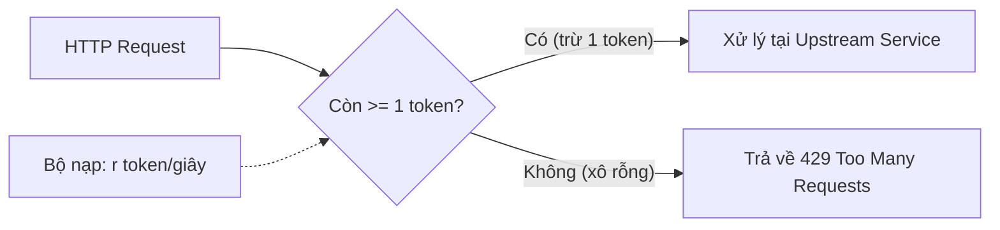

Kiểm soát lưu lượng (Rate Limiting) là lớp phòng thủ đầu tiên giúp bảo vệ dịch vụ backend trước các đợt tăng đột biến lưu lượng (traffic spike) hoặc hành vi gọi API quá mức. Trong số các thuật toán phổ biến, **Token Bucket** cân bằng rất tốt giữa giới hạn tốc độ trung bình và khả năng cho phép burst ngắn hạn.

## Luồng hoạt động tổng quan

Mỗi client (hoặc API key) được cấp một "xô" chứa tối đa $B$ token. Token được nạp thêm đều đặn với tốc độ $r$ token mỗi giây:



## Mô hình toán học cập nhật lười (Lazy Refill)

Thay vì dùng một tiến trình chạy nền cộng token mỗi giây cho hàng triệu khóa, ta chỉ tính lại lượng token ngay tại thời điểm có request mới đến ở mốc thời gian $t_{\text{now}}$.

Gọi $t_{\text{last}}$ là thời điểm cập nhật gần nhất và $c_{\text{prev}}$ là lượng token còn lại lúc đó. Số token hiện có $c(t_{\text{now}})$ được xác định bởi:

$$
c(t_{\text{now}}) = \min\!\Big(B,\; c_{\text{prev}} + (t_{\text{now}} - t_{\text{last}}) \cdot r\Big)
$$

Nếu $c(t_{\text{now}}) < 1$, thời gian chờ tối thiểu $\Delta t_{\text{retry}}$ (tính bằng giây) để có đủ 1 token trả về trong header `Retry-After` là:

$$
\Delta t_{\text{retry}} = \frac{1 - c(t_{\text{now}})}{r}
$$

### Độ phức tạp thuật toán

Nhờ cơ chế cập nhật lười:
- **Thời gian xử lý mỗi request**: $\mathcal{O}(1)$ phép tính số học cơ bản.
- **Bộ nhớ cho mỗi khóa hoạt động**: $\mathcal{O}(1)$ (chỉ lưu cặp số thực `tokens` và `lastRefillMs`).

## Cài đặt hoàn chỉnh bằng TypeScript

Đoạn mã dưới đây minh họa bộ giới hạn tốc độ chạy in-memory hỗ trợ trả về số giây cần chờ:

```ts title="src/lib/rate-limiter.ts" {17-23}
export interface BucketState {
  tokens: number;
  lastRefillMs: number;
}

export class TokenBucketLimiter {
  private readonly buckets = new Map<string, BucketState>();

  constructor(
    private readonly capacity: number,
    private readonly refillPerSecond: number,
  ) {}

  consume(key: string, nowMs = Date.now()): { allowed: boolean; retryAfterSec: number } {
    const prev = this.buckets.get(key) ?? { tokens: this.capacity, lastRefillMs: nowMs };
    const elapsedSec = Math.max(0, (nowMs - prev.lastRefillMs) / 1000);
    const available = Math.min(
      this.capacity,
      prev.tokens + elapsedSec * this.refillPerSecond,
    );

    if (available < 1) {
      this.buckets.set(key, { tokens: available, lastRefillMs: nowMs });
      return {
        allowed: false,
        retryAfterSec: Math.ceil((1 - available) / this.refillPerSecond),
      };
    }

    this.buckets.set(key, { tokens: available - 1, lastRefillMs: nowMs });
    return { allowed: true, retryAfterSec: 0 };
  }
}
```

## So sánh nhanh với các thuật toán khác

| Thuật toán | Cho phép Burst ngắn | Bộ nhớ mỗi key | Điểm lưu ý chính |
| :--- | :---: | :---: | :--- |
| Fixed Window | Có (nhưng gấp đôi ở rìa cửa sổ) | Rất thấp | Dễ bị lách gấp 2 lần hạn mức tại ranh giới phút |
| Sliding Window Log | Không | Cao ($\mathcal{O}(N)$) | Lưu toàn bộ mốc thời gian của từng request |
| **Token Bucket** | **Có (kiểm soát bởi $B$)** | **Thấp ($\mathcal{O}(1)$)** | Phù hợp nhất cho hầu hết REST / GraphQL API |

Khi mở rộng hệ thống ra nhiều instance, bạn có thể chuyển logic trong hàm `consume` vào một đoạn **Redis Lua script** ngắn để đảm bảo tính nguyên tử (atomicity) mà không phát sinh race condition.
